# 中华人民共和国国家标准

GB 35114—2017

# 公共安全视频监控联网信息安全 技术要求

# Technical requirements for information security of video surveillance network system for public security

2017-11-01 发布

2018-11-01 实施

## 目次

前言 …… III
1 范围 …… 1
2 规范性引用文件 …… 1
3 术语、定义和缩略语 …… 1
3.1 术语和定义 …… 1
3.2 缩略语 …… 3
4 公共安全视频监控联网信息安全系统互联结构 …… 3
4.1 互联结构 …… 3
4.2 系统内联网 …… 4
4.3 系统间联网 …… 4
4.4 联网方式 …… 4
5 证书和密钥要求 …… 4
5.1 密码算法 …… 4
5.2 数字证书类型 …… 5
5.3 数字证书格式 …… 5
5.4 密钥种类 …… 5
6 基本功能要求 …… 5
6.1 统一编码规则 …… 5
6.2 用户身份认证 …… 5
6.3 前端设备分级 …… 5
6.4 设备身份认证 …… 6
6.5 管理平台间认证 …… 6
6.6 授权与访问控制 …… 6
6.7 控制信令认证 …… 6
6.8 视频源签名及完整性校验 …… 6
6.9 视音频加密 …… 7
6.10 设备异常管理报警 …… 7
6.11 安全管理 …… 7
6.12 日志管理 …… 7
6.13 非对称密钥管理 …… 7
6.14 对称密钥管理 …… 7
7 性能要求 …… 7
7.1 设备身份认证 …… 7
7.2 视频数据签名 …… 8
7.3 视频加解密 …… 8
附录 A（规范性附录） 数字证书格式 …… 9

附录 B（规范性附录） 密码模块编码规则 …… 11
附录 C（规范性附录） 流程和协议 …… 12
附录 D（资料性附录） 信令消息示范 …… 45
附录 E（资料性附录） 加密视频的导出 …… 101
参考文献 …… 103

## 前言

本标准的全部技术内容为强制性。

本标准按照 GB/T 1.1—2009 给出的规则起草。

请注意本文件的某些内容可能涉及专利。本文件的发布机构不承担识别这些专利的责任。

本标准由中华人民共和国公安部提出并归口。

本标准起草单位:公安部第一研究所、北京中盾安全技术开发公司、杭州恒生数字设备科技有限公司、长春吉大正元信息技术股份有限公司、北京江南天安科技有限公司、国家密码管理局商用密码检测中心、国家安全防范报警系统产品质量监督检验中心(北京)、苏州科达科技股份有限公司、浙江大华技术股份有限公司、杭州海康威视数字技术股份有限公司、北京中星微电子有限公司。

本标准主要起草人:陈朝武、栗红梅、王建勇、查敏中、赵惠芳、高利、闫雪、罗鹏、王冰洋、李国、林冬、张跃、陈宁、韩光瞬、刘宏伟、孙琼芳、崔云红、裴静、邱嵩、芦翔、孔维生、陈卫东。

# 公共安全视频监控联网信息安全 技术要求

## 1 范围

本标准规定了公共安全领域视频监控联网视频信息以及控制信令信息安全保护的技术要求，包括公共安全视频监控联网信息安全系统的互联结构、证书和密钥要求、基本功能要求、性能要求等技术要求。

本标准适用于公共安全领域视频监控系统的信息安全方案设计、系统检测、验收以及与之相关的设备研发与检测。

## 2 规范性引用文件

下列文件对于本文件的应用是必不可少的。凡是注日期的引用文件，仅注日期的版本适用于本文件。凡是不注日期的引用文件，其最新版本(包括所有的修改单)适用于本文件。

GB/T 2260—2007 中华人民共和国行政区划代码

GB/T 2659—2000 世界各国和地区名称代码

GB/T 7408—2005 数据元和交换格式 信息交换 日期和时间表示法

GB/T 15843.3—2008 信息技术 安全技术 实体鉴别 第3部分:采用数字签名技术的机制

GB/T 25724—2017 公共安全视频监控数字视音频编解码技术要求

GB/T 28181—2016 公共安全视频监控联网系统信息传输、交换、控制技术要求

GM/T 0005—2012 随机性检测规范

GM/T 0014—2012 数字证书认证系统密码协议规范

GM/T 0015—2012 基于 SM2 密码算法的数字证书格式规范

GM/T 0034—2014 基于 SM2 密码算法的证书认证系统密码及其相关安全技术规范

IETF RFC 2976 SIP INFO 方法(The SIP INFO Method)

IETF RFC 3261 会话初始协议(SIP: Session Initiation Protocol)

IETF RFC 3548 Base16,Base32,Base64 数据编码(The Base16,Base32,and Base64 Data Encodings)

IETF RFC 3550 实时传输协议(RTP: A Transport Protocol for Real-Time Applications)

IETF RFC 3725 会话初始协议(SIP)中第三方呼叫控制(3PCC)的当前最佳实现[Best Current Practices for Third Party Call Control (3pcc) in the Session Initiation Protocol (SIP)]

IETF RFC 4566 会话描述协议(Session Description Protocol)

## 3 术语、定义和缩略语

## 3.1 术语和定义

GB/T 28181—2016界定的以及下列术语和定义适用于本文件。

## GB 35114—2017

## 3.1.1

## 视频加密密钥(视频密钥) video encryption key

具有安全功能的前端设备随机产生的对称密钥,按照一定的规律变化,用于直接加密视频内容,实现视频传输的机密性保护。

## 3.1.2

## 视频密钥加密密钥 video key encryption key

由视频监控安全管理平台产生并分发给具有安全功能前端设备的对称密钥,按照一定的规律变化,用于对视频密钥进行加密,实现其传输的机密性保护。

## 3.1.3

## 视频导出传输密钥 video export transmission key

在视频导出过程中由视频监控安全管理平台生成,用于对视频密钥进行加密,实现其导出的机密性保护。

## 3.1.4

## 前端设备 front-end device

公共安全视频监控联网系统中安装于监控现场的信息采集、编码/处理、存储、传输、安全控制等设备。

## 3.1.5

## 具有安全功能的前端设备 front-end device with safety function

具有基于数字证书的设备身份认证、视频签名、视频加密等信息安全保护功能的前端设备。

## 3.1.6

## 具有安全功能的用户终端 user terminal with safety function

具有基于数字证书的用户身份认证、加密视频解密等安全功能的用户终端。

## 3.1.7

## 具有安全功能的中心信令控制服务器 central control server with safety function

具有基于数字证书的设备身份认证、信令安全、密钥分发等安全功能的中心信令控制服务器。

## 3.1.8

## 具有安全功能的媒体服务器 media server with safety function

具有基于数字证书的设备身份认证、视频加密及解密等安全功能的媒体服务器。

## 3.1.9

## 视频监控安全管理平台 security management platform in video surveillance

由具有安全功能的中心信令控制服务器、具有安全功能的媒体服务器、信令安全路由网关等功能实体组成，具备用户身份认证、设备身份认证、密钥管理、权限管理、签名验签、加密解密、访问控制、审计、加密视频数据的实时点播/历史回放/存储/下载/分发/导出、视频数据源抗抵赖，控制信令的完整性验证等功能。

## 3.1.10

## 公共安全视频监控联网信息安全系统 information security system in video surveillance network in public security use

由具有安全功能的前端设备、具有安全功能的用户终端、视频安全密钥服务系统、视频监控安全管理平台四个部分组成，能够保障视频数据及控制信令信息真实性、完整性、保密性的公共安全视频监控联网系统。

## 3.1.11

## 安全模块 security module

含有密码算法、安全功能，可实现密钥管理机制的相对独立的软件、硬件、固件或其组合。

## 3.1.12

## 密码模块 cryptographic module

在前端设备中实现随机数产生和密码运算功能的、相对独立的软件、硬件、固件或其组合。

## 3.1.13

## 用户 user

在公共安全视频监控联网信息安全系统中注册并被授权的、对系统内的数据和/或设备有操作或管理需求的使用者。

## 3.1.14

## 信令安全路由网关 secure signal routing gateway

具有接收或转发域内外 SIP 信令功能,并且完成信令安全路由网关间路由信息的传递以及路由信令、信令身份标识的添加和鉴别等功能,是一种具有安全功能的 SIP 服务器。

## 3.1.15

## 视频安全密钥服务系统 key service system for video security

具备用户和设备身份证书的制发功能,为视频监控安全管理平台提供证书查询和验证等服务,并完成对对称密钥管理的系统。

## 3.1.16

## 功能实体 functional entity

实现一些特定功能的逻辑单元的集合。

注：一个物理设备可以由多个功能实体组成，一个功能实体也可以由多个物理设备组成。

## 3.2 缩略语

下列缩略语适用于本文件。

CRL:证书撤销列表(Certificate Revocation List)

ECB: 电码本模式(Electronic Code Book)

FDWSF: 具有安全功能的前端设备(Front-end Device With Safety Function)

GOP: 画面组(Group of Pictures)

IV: 初始化向量(Initialization Vector)

OFB: 输出反馈模式(Output Feedback)

SHA: 安全哈希算法(Secure Hash Algorithm)

SIP: 会话初始协议(Session Initiation Protocol)

VEK: 视频加密密钥 (Video Encryption Key)

VKEK: 视频密钥加密密钥 (Video Key Encryption Key)

## 4 公共安全视频监控联网信息安全系统互联结构

## 4.1 互联结构

公共安全视频监控联网信息安全系统(以下简称系统)互联结构见图1。图1描述了单个系统内、不同系统间两种情况下,功能实体之间的连接关系。功能实体之间的通道互联协议分为会话通道协议、媒体流通道协议和证书通道协议三种类型。

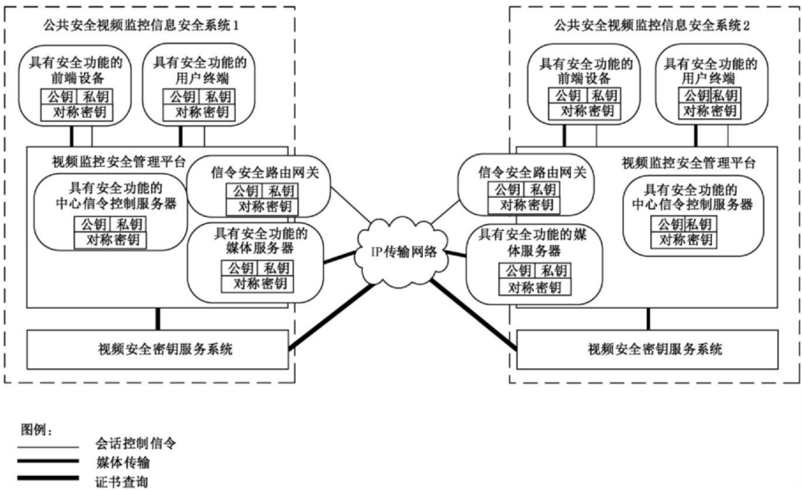  
图 1 公共安全视频监控信息安全系统互联结构示意图

## 4.2 系统内联网

系统由具有安全功能的前端设备、具有安全功能的用户终端、视频安全密钥服务系统(以下简称视频密钥系统)、视频监控安全管理平台(以下简称管理平台)四个部分组成。各部分以传输网络为基础，通过会话通道协议、媒体流通道协议和证书通道协议连接。

## 4.3 系统间联网

若干个相对独立的系统以信令安全路由网关、具有安全功能的媒体服务器为核心，通过 IP 传输网络，实现系统间控制信令信息和媒体信息的传输、交换、控制。视频密钥系统间以传输网络为基础，实现证书信息的查询和交换。

## 4.4 联网方式

## 4.4.1 级联

系统的级联方式依据 GB/T 28181—2016 中的 4.1.4.1 执行。

## 4.4.2 互联

系统的互连方式依据 GB/T 28181 2016 中的 4.1.4.2 执行。

## 5 证书和密钥要求

## 5.1 密码算法

系统使用国家密码管理行政机构批准的非对称密码算法、对称密码算法、密码杂凑算法和随机数生成算法，算法应采用获得国家密码管理行政机构批准的安全密码产品实现。算法及使用方法如下：

a）非对称密码算法使用SM2椭圆曲线密码算法，用于身份认证、数字签名、密钥协商等；

b) 对称密码算法使用 SM1、SM4 分组密码算法 OFB 模式, 用于视频数据的加密保护。使用 SM4 分组密码算法 ECB 模式, 用于密钥协商数据的加密保护;

c) 密码杂凑算法使用 SM3 密码杂凑算法,用于完整性校验;

d) 随机数生成算法生成的随机数应能通过 GM/T 0005—2012 中规定的方法进行检测。

## 5.2 数字证书类型

系统应使用基于非对称密码算法的数字证书体系实现用户身份认证、前端设备认证、服务器设备认证、管理平台间认证等安全功能。应为用户、前端设备、服务器设备以及管理平台签发数字证书。证书类型具体如下：

a） 用户证书：用于对用户的身份认证；

b) 前端设备证书:用于前端设备的身份认证以及对设备产生视频数据的数字签名;

c) 服务器设备证书:用于服务器设备的身份认证;

d) 管理平台证书:用于管理平台的身份认证。

## 5.3 数字证书格式

应支持 GM/T 0015—2012 中对证书格式和证书撤销列表(CRL)的规定。统一的证书格式见附录 A。

## 5.4 密钥种类

系统的密钥分为非对称密钥类和对称密钥类。非对称密钥类包括管理平台内功能实体的签名公私钥和加密公私钥、FDWSF 签名公私钥、具有安全功能的用户终端签名公私钥等。对称密钥类有视频密钥加密密钥、视频加密密钥等。

## 6 基本功能要求

## 6.1 统一编码规则

系统对 FDWSF、服务器设备、具有安全功能的用户终端进行统一编码，见 GB/T 28181—2016 的附录 D 中 D.1。集成在 FDWSF 的密码模块，应有唯一的标识，编码规则见附录 B。

## 6.2 用户身份认证

应对用户基本信息、属性信息以及用户 ID 与用户证书的对应关系作管理。应对所有用户进行身份认证。应支持基于数字证书的用户认证，认证流程见附录 C 中 C.1。

## 6.3 前端设备分级

6.3.1 根据安全保护强弱, 将 FDWSF 的安全能力分为三个等级, 由弱到强分别是 A 级、B 级、C 级, 见表 1。

6.3.2 A级应基于数字证书与管理平台双向身份认证的能力，达到身份真实目标。

6.3.3 B级应具备基于数字证书与管理平台双向身份认证的能力和对视频数据签名的能力，达到身份真实和视频来源于真实设备，能够校验视频内容是否遭到篡改的目标。

6.3.4 C级应具备基于数字证书与管理平台双向身份认证的能力、视频数据签名能力和视频数据加密能力，达到身份真实和视频来源于真实设备，能够校验视频内容是否遭到篡改，能够达到对视频内容加密保护目标。

表 1 前端设备分级

<table><tr><td>等级</td><td>基于数字证书与管理平台双向设备认证能力,达到身份真实目标</td><td>基于数字证书的视频数据签名能力,达到视频来源于真实设备且可校验视频是否遭到篡改的目标</td><td>视频加密能力,达到视频加密保护目标</td></tr><tr><td>A级</td><td>√</td><td>—</td><td>—</td></tr><tr><td>B级</td><td>√</td><td>√</td><td>—</td></tr><tr><td>C级</td><td>√</td><td>√</td><td>√</td></tr></table>

## 6.4 设备身份认证

6.4.1 管理平台应对 FDWSF 的基本信息、属性信息以及 FDWSF 的 ID、其密码模块 ID 与设备证书的对应关系作管理。

6.4.2 管理平台应对所有接入的 FDWSF 进行单向设备身份认证或者双向设备身份认证。认证流程见 C.2，消息示例参见 D.1 和 D.2。

## 6.5 管理平台间认证

管理平台互联互通时应进行管理平台间的双向身份认证。认证流程见 C.3。

## 6.6 授权与访问控制

6.6.1 在设备身份认证的基础上,管理平台应采用基于属性或基于角色的访问控制模型对用户进行授权管理和访问控制。

6.6.2 管理平台访问控制的粒度应至少包含前端设备的安全能力等级以及存储视频是否加密等属性。

6.6.3 在系统中访问加密视频信息的用户应是经过基于数字证书认证的用户，包括对加密视频的播放、回放、下载、删除等操作。

6.6.4 当跨域访问时，应采用信令 Monitor-User-Identity 携带的用户身份信息进行访问控制。对 C 级设备的访问要做严格的控制。

## 6.7 控制信令认证

6.7.1 管理平台和 FDWSF 应采用带密钥的杂凑算法 SM3 对设备遥控等重要的 SIP 控制信令做认证。
6.7.2 在 SIP 消息头域中，启用 Date 域，增加 Note 域。Note = (Digest nonce = "", algorithm =)，nonce 的值为杂凑运算结果经过 Base64 编码后的值，algorithm 的值为杂凑算法名称。控制信令认证的流程和方法规定见 C.4，消息示例参见 D.3。

6.7.3 当跨域访问时,若该信令是由本域的用户发起,则信令安全路由网关应将发送到外域的信令添加 Monitor-User-Identity 头域,其取值为信令安全路由网关 ID 和用户的身份信息;若该信令不是由本域的用户发起,则只在原有 Monitor-User-Identity 域值前添加信令安全路由网关 ID;各段分隔符为“-”。用户的身份为用户 ID 以及用户身份属性信息(用户身份属性信息包括:用户隶属机构属性、用户类别属性和用户职级属性)。

## 6.8 视频源签名及完整性校验

6.8.1 所有 B 级和 C 级 FDWSF 应对采集的视频进行视频数据签名操作并基于 TCP 协议进行传输。

6.8.2 所有 B 级和 C 级 FDWSF 应支持对视频 I 帧及其他关键帧的签名。

6.8.3 管理平台应支持对视频数据签名结果的接收、存储和验证，实现视频源的抗抵赖及完整性校验。

6.8.4 视频数据签名和验签的格式和流程见 C.5，消息示例参见 D.4。

## 6.9 视音频加密

6.9.1 所有 C 级 FDWSF 应对采集的视频及音频进行加密操作并传输。

6.9.2 管理平台应支持视频及音频加密数据的传输，支持用户在权限范围内对实时加密视音频播放、历史加密视音频回放、加密视音频的存储/下载/分发/导出等操作。

6.9.3 视音频加密格式和流程见 C.6，消息示例参见 D.5～D.11。

6.9.4 视频导出时管理平台应更换视频密钥加密密钥，具体流程参见附录 E。

6.9.5 加密视频直接存储到存储设备。

## 6.10 设备异常管理报警

6.10.1 管理平台应能及时发现 FDWSF 的异常情况，如非授权处理、密码模块损坏或丢失。

6.10.2 管理平台应能及时感知设备异常情况，如报警等，并同时写入日志。

## 6.11 安全管理

6.11.1 系统应设置安全管理员、安全操作员和安全审计员三类管理员角色。

6.11.2 安全管理员负责系统的安全参数配置、系统服务器启动和停止，不具有安全业务操作的权限。

6.11.3 安全操作员按其权限进行具体的安全业务操作，包括密钥生成、导入、备份和恢复等操作。

6.11.4 安全审计员负责系统的审计管理，负责对涉及系统安全的事件和各类管理、操作人员的行为进行审计和监督。

6.11.5 系统应使用数字证书和静态口令、动态口令、生物识别等其他认证因子相结合的方式认证安全管理员、安全操作员及安全审计员的身份，身份认证成功后才能登录系统进行操作。

## 6.12 日志管理

6.12.1 管理平台应对用户认证、设备认证、密钥管理等安全操作和各种异常安全事件，包括密钥协商失败、数据加解密失败、完整性校验失败等记录日志。

6.12.2 管理平台应具备获取 FDWSF 各种异常安全事件日志的功能。包括设备认证失败、密钥协商失败、数据加解密失败、完整性校验失败等。

## 6.13 非对称密钥管理

非对称密钥对及其证书应按照 GM/T 0034—2014 进行管理。

## 6.14 对称密钥管理

6.14.1 系统应对所使用的对称密钥进行完整生命周期的管理。

6.14.2 视频密钥加密密钥 VKEK 在设备注册时更新，并安全传输到具有安全功能前端设备的密码模块中安全存储。管理平台应使用安全模块安全保存所有前端设备的 VKEK，保存周期应满足历史视频保存时间的要求。

6.14.3 视频密钥加密密钥 VKEK 更新周期不大于 1 天。视频加密密钥 VEK 更新周期不大于 1 h。

## 7 性能要求

## 7.1 设备身份认证

在符合 GB/T 28181—2016 中 5.5 网络传输质量要求前提下, 设备身份双向认证时间延迟不超过 400 ms。双向认证时间延迟, 不包含穿越安全边界平台及设备等实际网络中其他必须存在的设备

延时。

## 7.2 视频数据签名

FDWSF 视频数据签名,应不小于 1 次/s。

## 7.3 视频加解密

C 级 FDWSF 应能支持全码流加密，在符合 GB/T 28181—2016 中 5.5 网络传输质量要求前提下，视频加密/解密增加的延时不超过 400 ms。

# 附录 A

# (规范性附录)

# 数字证书格式

## A.1 用户证书格式

用户证书格式应符合 GM/T 0015—2012 中对证书格式和证书撤销列表(CRL)的规定。

## A.2 设备证书格式

设备证书格式见表 A.1。设备证书撤销列表(CRL)应符合 GM/T 0015—2012 的规定。

表 A.1 设备证书格式定义

<table><tr><td>序号</td><td colspan="2">数据项名称</td><td>数据类型</td><td>数据长度</td><td>采用标准</td><td>说明</td></tr><tr><td>1</td><td colspan="2">版本号</td><td>整型</td><td>1字节</td><td>GM/T 0015-2012</td><td>证书格式版本号,目前为3</td></tr><tr><td>2</td><td colspan="2">序列号</td><td>字符型</td><td>32字节</td><td>GM/T 0015-2012</td><td>证书序列号,用于证书管理,唯一</td></tr><tr><td>3</td><td colspan="2">签名算法</td><td>字符型</td><td>16字节</td><td>GM/T 0015-2012</td><td>CA中心签名该证书使用的算法</td></tr><tr><td rowspan="5">4</td><td rowspan="5">签发单位</td><td>名称(CN)</td><td>字符型</td><td>8字节</td><td></td><td rowspan="5">签发该证书的CA中心的信息</td></tr><tr><td>区/县(L)</td><td>字符型</td><td>2字节</td><td>GB/T 2260-2007</td></tr><tr><td>地市(L)</td><td>字符型</td><td>2字节</td><td>GB/T 2260-2007</td></tr><tr><td>省份(S)</td><td>字符型</td><td>2字节</td><td>GB/T 2260-2007</td></tr><tr><td>国家(C)</td><td>字符型</td><td>2字节</td><td>GB/T 2659-2000</td></tr><tr><td rowspan="2">5</td><td rowspan="2">有效期</td><td>生效日期</td><td>字符型</td><td>19字节</td><td>GB/T 7408-2005</td><td>证书生效日期,格式例如:2007-08-12 12:23:34</td></tr><tr><td>失效日期</td><td>字符型</td><td>19字节</td><td>GB/T 7408-2005</td><td>证书失效日期,格式例如:2007-08-18 12:23:34</td></tr><tr><td rowspan="7">6</td><td rowspan="7">证书持有者信息</td><td>设备标识(CN)</td><td>字符型</td><td>128字节</td><td>-</td><td>格式为:设备ID、密码模块ID,ID间以“_”分隔,某个ID为空时值为“NULL”</td></tr><tr><td>网络类型(O)</td><td>字符型</td><td>2字节</td><td>-</td><td>01:公安信息网 02:视频专网</td></tr><tr><td>预留(O)</td><td>字符型</td><td>2字节</td><td>-</td><td>“00”预留代表空值,无意义</td></tr><tr><td>区/县(L)</td><td>字符型</td><td>2字节</td><td>GB/T 2260-2007</td><td></td></tr><tr><td>地市(L)</td><td>字符型</td><td>2字节</td><td>GB/T 2260-2007</td><td></td></tr><tr><td>省份(S)</td><td>字符型</td><td>2字节</td><td>GB/T 2260-2007</td><td></td></tr><tr><td>国家(C)</td><td>字符型</td><td>2字节</td><td>GB/T 2659-2000</td><td></td></tr><tr><td>7</td><td colspan="2">证书持有者公钥信息</td><td>字符型</td><td>256位</td><td>GM/T 0015-2012</td><td>证书持有者的公开密钥信息</td></tr><tr><td rowspan="5">8</td><td rowspan="5">扩展项</td><td>CRL分布点</td><td>字符型</td><td>128字节</td><td>GM/T 0015—2012</td><td></td></tr><tr><td>证书持有者密钥标识符</td><td>字符型</td><td>20字节</td><td>GM/T 0015—2012</td><td></td></tr><tr><td>签发单位的密钥标识符</td><td>字符型</td><td>20字节</td><td>GM/T 0015 2012</td><td></td></tr><tr><td>密钥用途</td><td>字符型</td><td>64字节</td><td>GM/T 0015 2012</td><td></td></tr><tr><td>预留</td><td>字符型</td><td>128字节</td><td>—</td><td>以后扩充</td></tr><tr><td>9</td><td colspan="2">签名项</td><td>字符型</td><td>256位</td><td>GM/T 0015—2012</td><td>CA中心对该证书的签名</td></tr></table>

## 附录 B

(规范性附录)

密码模块编码规则

编码规则由产品型号编码(4位)、类型编码(2位)、生产日期编码(8位)、批次编码(3位)和序号(5位)五个码段共22位十进制数字字符构成,即密码模块编码 = 产品型号编码 + 类型编码 + 生产日期编码 + 批次编码 + 序号。

编码规则详细说明见表 B.1。其中，产品型号编码取国家密码管理局批准密码模块产品型号的后四位编码。类型编码是指密码模块产品的类型。

表 B.1 详细编码规则

<table><tr><td>码段</td><td>码位</td><td>含义</td><td colspan="2">取值说明</td></tr><tr><td>产品型号编码</td><td>1~4</td><td>密码模块的产品型号编码</td><td colspan="2">取国家密码管理局批准的密码模块的产品型号后四位数字</td></tr><tr><td rowspan="4">类型编码</td><td rowspan="4">5~6</td><td rowspan="4">产品类型编码</td><td colspan="2">类型编码</td></tr><tr><td>01</td><td>安全芯片</td></tr><tr><td>02</td><td>安全TF卡</td></tr><tr><td>99</td><td>其他</td></tr><tr><td rowspan="4">生产日期</td><td>7~14</td><td rowspan="4">生产日期</td><td colspan="2">密码模块的生产日期,格式为xxxxxx</td></tr><tr><td>7~10</td><td colspan="2">年,如2014</td></tr><tr><td>11~12</td><td colspan="2">月,如02</td></tr><tr><td>13~14</td><td colspan="2">日,如22</td></tr><tr><td>批次</td><td>15~17</td><td>批次号</td><td colspan="2">密码模块的生产批次</td></tr><tr><td>序号</td><td>18~22</td><td>密码模块序号</td><td colspan="2"></td></tr></table>

# 附录 C

# (规范性附录)

# 流程和协议

## C.1 用户身份认证

B/S 客户端基于数字证书的用户身份认证流程应按照 GB/T 15843.3—2008 执行。C/S 客户端应采用基于 SIP 协议的双向身份认证模式进行用户身份认证。具体流程参照 C.2.2 内容。

## C.2 设备接入认证

## C.2.1 SIP 服务器认证 FDWSF 的单向身份认证

## C.2.1.1 单向身份认证说明

FDWSF 和 SIP 服务器进行单向认证。对 RFC 3261 中定义的方法 REGISTER 进行如下头域扩展：

a) Authorization 的值增加 Capability 项用来描述 FDWSF 的安全能力。当 Authorization 的值为 Capability 时，携带参数 algorithm、keyversion。参数 algorithm 的值分为四部分，中间以分号分割。第一部分定义为“A”，为非对称算法描述，取值为设备支持的非对称算法/模式/填充方式，多种算法之间用逗号分隔。例如：A:SM2；第二部分定义为“H”，为杂凑算法描述，取值为设备支持的杂凑算法，多种算法之间用逗号分隔。例如：H:SM3；第三部分定义为“S”，为对称算法的描述，取值为设备支持的对称算法/模式/填充方式，多种算法之间用逗号分隔。例如：S:SM1/OFB/PKCS5,SM1/ECB/PKCS5。第四部分定义为“SI”，为签名算法的描述。例如：SI:SM3-SM2。keyversion 为密钥版本号，取值为 FDWSF 的本地时间，16 位数字字符，例如：keyversion="1970-01-01T9:18:43"。

b) WWW-Authenticate 的值为 Unidirection。携带参数 random1、algorithm。random1 取值为随机数。algorithm 的值为 SIP 服务器使用的安全算法，该算法由 SIP 服务器从设备上报的安能力算法中选择获得，包括非对称算法、杂凑算法、对称算法，用分号分隔。例如：A：SM2；H：SM3；S：SM1/OFB/PKCS5；SI：SM3-SM2。

c) Authorization 的值为 Unidirection, 携带验证具有安全功能的前端设备的数据。携带 random1、random2、serverid、sign1、algorithm。random2 为具有安全功能的前端设备产生的随机数, random1 为 SIP 服务器产生的随机数, serverid 为 SIP 服务器设备 ID, sign1 为用具有安全功能的前端设备私钥对 random2 + random1 + SIP 服务器 ID 做数字签名后的结果, algorithm 为采用的安全算法。

## C.2.1.2 单向身份认证流程

单向身份认证流程见图 C.1, 消息示范参见 D.1。

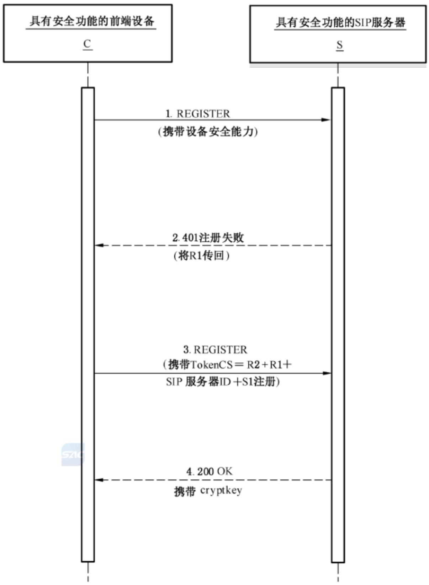  
图 C.1 SIP 服务器认证 FDWSF 的单向身份认证注册流程示意图

信令流程描述如下：

a) 1: FDWSF 向 SIP 服务器发送 REGISTER 请求。增加 Authorization 头字段, Authorization 的值为 Capability, 携带参数 algorithm、keyversion。参数 algorithm 的值分为四部分, 中间以分号分割。第一部分定义为“A”, 为非对称算法描述, 取值为设备支持的非对称算法/模式/填充方式, 多种算法之间用逗号分隔。例如: A: SM2; 第二部分定义为“H”, 为杂凑算法描述, 取值为设备支持的杂凑算法, 多种算法之间用逗号分隔。例如: H: SM3; 第三部分定义为“S”, 为对称算法的描述, 取值为设备支持的对称算法/模式/填充方式, 多种算法之间用逗号分隔。例如: S: SM1/OFB/PKCS5, SM1/CBC/PKCS5, SM4/OFB/PKCS5, SM4/CBC/PKCS5。第四部分定义为“SI”, 为签名算法的描述。例如: SI: SM3-SM2。keyversion 为密钥版本号。

b) 2: SIP 服务器产生随机数 R1, 向 FDWSF 发送一个挑战响应 401, 响应的消息头域 WWW-Authenticate 取值为为 Unidirection, 用来携带验证 SIP 服务器身份的数据。携带参数 random1、algorithm。random1 取值为 R1。algorithm 的值为 SIP 服务器使用的安全算法。

c) 3: FDWSF 收到 401 响应后, 得到 random1 和 algorithm 的值。产生随机数 R2; 用 FDWSF 私钥对 random2 + random1 + SIP 服务器 ID 做数字签名, 得到结果 sign1。FDWSF 重新向 SIP 服务器发送 REGISTER 请求, Authorization 取值为 Unidirection, 携带 random1、random2、serverid、sign1、algorithm。random2 为 FDWSF 产生的随机数 R2, random1 为 SIP 服务器产生的随机数 R1, serverid 为 SIP 服务器设备 ID, sign1 为用 FDWSF 私钥对 random2 + random1 + SIP 服务器 ID 做数字签名后的结果, algorithm 为采用的安全算法。

d) 4: SIP 服务器收到请求后,校验 FDWSF 签名的有效性(是否被验证过);校验 R1 有效性(只能 1 次+时效性);校验 SIP 服务器 ID 与自身是否相符;用设备证书校验 sign1 签名结果;校验成功,证明 FDWSF 身份合法。用 FDWSF 公钥对 VKEK 加密做 Base64 编码后得到 cryptkey,向 FDWSF 发送成功响应 200 OK 消息,携带 cryptkey 参数、algorithm 参数。如果校验失败则发送拒绝服务应答。FDWSF 收到 200 OK 后用 FDWSF 私钥解密 cryptkey,即可获得 VKEK 的值。

## C.2.2 SIP 服务器与 FDWSF 间的双向身份认证

## C.2.2.1 双向身份认证说明

FDWSF 和 SIP 服务器进行双向认证。对 RFC 3261 中定义的方法 REGISTER 进行如下头域扩展：

a) Authorization 的值增加 Capability 项用来描述 FDWSF 的安全能力。当 Authorization 的值为 Capability 时，携带参数 algorithm、keyversion。参数 algorithm 的值分为四部分，中间以分号分割。第一部分定义为“A”，为非对称算法描述，取值为设备支持的非对称算法/模式/填充方式，多种算法之间用逗号分隔。例如：A:SM2；第二部分定义为“H”，为杂凑算法描述，取值为设备支持的杂凑算法，多种算法之间用逗号分隔。例如：H:SM3；第三部分定义为“S”，为对称算法的描述，取值为设备支持的对称算法/模式/填充方式，多种算法之间用逗号分隔。例如：S:SM1/OFB/PKCS5, SM1/ECB/PKCS5。第四部分定义为“SI”，为签名算法的描述。例如：SI:SM3-SM2。keyversion 为密钥版本号，取值为 FDWSF 的本地时间，16 位数字字符，例如：keyversion="1970-01-01T9:18:43"。

b) WWW-Authenticate 的值为 Bidirection。携带参数 random1、algorithm。random1 取值为随机数。algorithm 的值为 SIP 服务器使用的安全算法，该算法由 SIP 服务器从设备上报的安全能力算法中选择获得，包括非对称算法、杂凑算法、对称算法，用分号分隔。例如：A: SM2; H: SM3; S: SM1/OFB/PKCS5; SI: SM3-SM2。

c) Authorization 的值为 Bidirection。携带验证 FDWSF 的数据。携带 random1、random2、serverid、sign1、algorithm。random2 为 FDWSF 产生的随机数，random1 为 SIP 服务器产生的随机数，serverid 为 SIP 服务器设备 ID，sign1 为用 FDWSF 私钥对 random2 + random1 + SIP 服务器 ID 做数字签名后的结果，algorithm 为采用的安全算法。

## C.2.2.2 双向身份认证流程

双向身份认证流程见图 C.2, 消息示范参见 D.2。

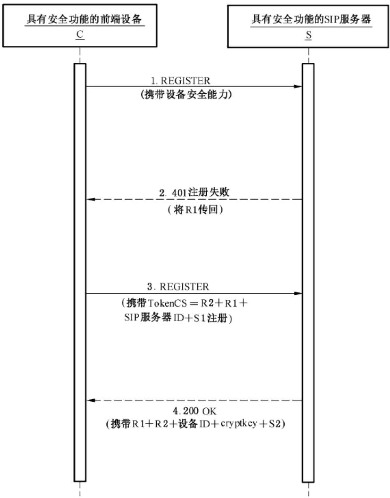  
图 C.2 SIP 服务器与 FDWSF 间双向认证注册流程示意图

信令流程描述如下：

a) 1: FDWSF 向 SIP 服务器发送 REGISTER 请求, 消息头域中携带 FDWSF 的安全能力。增加 Authorization 头字段, Authorization 的值为 Capability, 携带参数 algorithm、keyversion。参数 algorithm 的值分为四部分, 中间以分号分割。第一部分定义为“A”, 为非对称算法描述, 取值为设备支持的非对称算法/模式/填充方式, 多种算法之间用逗号分隔。例如: A: SM2; 第二部分定义为“H”, 为杂凑算法描述, 取值为设备支持的杂凑算法, 多种算法之间用逗号分隔。例如: H: SM3; 第三部分定义为“S”, 为对称算法的描述, 取值为设备支持的对称算法/模式/填充方式, 多种算法之间用逗号分隔。例如: S: SM1/OFB/PKCS5, SM1/ECB/PKCS5。第四部分定义为“SI”, 为签名算法的描述。例如: SI: SM3-SM2。keyversion 为密钥版本号。

b) 2: SIP 服务器产生随机数 R1, 向 FDWSF 发送一个挑战响应 401, 响应的消息头域 WWW-Authenticate 取值为为 Bidirection, 用来携带验证 SIP 服务器身份的数据。携带参数 random1、algorithm。random1 取值为 R1。algorithm 的值为 SIP 服务器使用的安全算法。

c) 3: FDWSF 收到 401 响应后, 得到 random1 和 algorithm 的值。产生随机数 R2; 用 FDWSF 私钥对 random2 + random1 + SIP 服务器 ID 做数字签名, 得到结果 sign1。FDWSF 重新向 SIP 服务器发送 REGISTER 请求, Authorization 取值为 Bidirection, 携带 random1、random2、serverid、sign1、algorithm。random2 为 FDWSF 产生的随机数 R2, random1 为 SIP 服务器产生的随机数 R1, serverid 为 SIP 服务器设备 ID, sign1 为用 FDWSF 私钥对 random2 + random1 + SIP 服务器 ID 做数字签名后的结果, algorithm 为采用的安全算法。

d) 4: SIP 服务器收到请求后, 校验 FDWSF 签名的有效性(是否被验证过); 校验 R1 有效性(只能

1 次＋时效性);校验 SIP 服务器 ID 与自身是否相符;用设备证书校验 sign1 签名结果;校验成功,证明 FDWSF 身份合法。用 FDWSF 公钥对 VKEK 加密得到 cryptkey,用管理平台私钥对 random1+random2+deviceid+cryptkey 做数字签名,得到结果 sign2。向 FDWSF 发送成功响应 200 OK 消息,携带 random2、random1、deviceid、sign2、algorithm。cryptkey 参数。random2 为 FDWSF 产生的随机数 R2,random1 为 SIP 服务器产生的随机数 R1,deviceid 为 FDWSF 的 ID,cryptkey 为 FDWSF 公钥对 VKEK 加密结果经 Base64 编码后的值,sign2 为用管理平台私钥对 random1+random2+deviceid+cryptkey 做数字签名后的结果,algorithm 为采用的安全算法。FDWSF 收到 200 OK 后,校验 SIP 服务器签名的有效性(是否被验证过);校验 R2 有效性(只能 1 次＋时效性);校验 deviceid 与自身是否相符;用 SIP 服务器证书校验 sign2 签名结果;校验成功,证明 SIP 服务器身份合法。用 FDWSF 私钥解密 cryptkey,即可获得 VKEK 的值。如果校验失败则发送拒绝服务应答。

## C.3 管理平台间认证

## C.3.1 管理平台间认证说明

管理平台间认证分为互联认证和级联认证,下面以信令安全路由网关1向信令安全路由网关2发起认证为例进行说明。

## C.3.2 管理平台间认证流程

管理平台间认证流程见图 C.3, 消息示范参见 D.2。

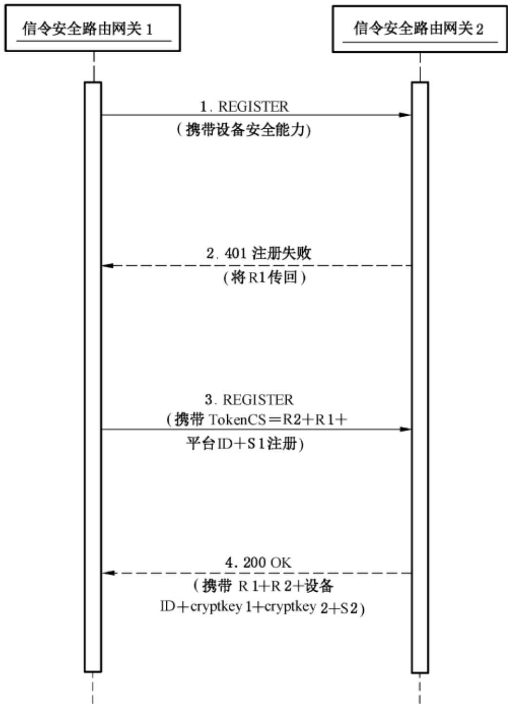  
图 C.3 管理平台间双向认证注册流程示意图

信令流程描述如下：

a) 1: 信令安全路由网关 1 向信令安全路由网关 2 发送 REGISTER 请求, 消息头域中携带信令安全路由网关 1 的安全能力。增加 Authorization 头字段, Authorization 的值为 Capability, 携带参数 algorithm、keyversion。参数 algorithm 的值分为四部分, 中间以分号分割。第一部分定义为“A”, 为非对称算法描述, 取值为设备支持的非对称算法/模式/填充方式, 多种算法之间用逗号分隔。例如: A: SM2; 第二部分定义为“H”, 为杂凑算法描述, 取值为设备支持的杂凑算法, 多种算法之间用逗号分隔。例如: H: SM3; 第三部分定义为“S”, 为对称算法的描述, 取值为设备支持的对称算法/模式/填充方式, 多种算法之间用逗号分隔。例如: S: SM1/OFB/PKCS5, SM1/ECB/PKCS5。第四部分定义为“SI”, 为签名算法的描述。例如: SI: SM3-SM2。keyversion 为密钥版本号。

b) 2:信令安全路由网关2产生随机数R1,向信令安全路由网关1发送一个挑战响应401,响应的消息头域WWW-Authenticate取值为为Bidirection,用来携带验证信令安全路由网关1身份的数据。携带参数random1、algorithm。random1取值为R1。algorithm的值为信令安全路由网关2使用的安全算法。

c) 3: 信令安全路由网关 1 收到 401 响应后, 得到 random1 和 algorithm 的值。产生随机数 R2; 用信令安全路由网关 1 私钥对 random2 + random1 + 信令安全路由网关 2ID 做数字签名, 得到结果 sign1。信令安全路由网关 1 重新向信令安全路由网关 2 发送 REGISTER 请求, Authorization 取值为 Bidirection, 携带 random1、random2、serverid、sign1、algorithm。random2 为信令安全路由网关 1 产生的随机数 R2, random1 为信令安全路由网关 2 产生的随机数 R1, serverid 为信令安全路由网关 2 设备 ID, sign1 为用信令安全路由网关 1 私钥对 random2 + random1 + 信令安全路由网关 2ID 做数字签名后的结果, algorithm 为采用的安全算法。

d) 4:信令安全路由网关22收到请求后,校验信令安全路由网关21签名的有效性(是否被验证过);校验R1有效性(只能1次+时效性);校验信令安全路由网关2ID与自身是否相符;用信令安全路由网关1证书校验sign1签名结果;校验成功,证明信令安全路由网关1身份合法。用信令安全路由网关1公钥对VKEK加密得到cryptkey1,用信令安全路由网关1公钥对VEMK及VEMK版本号加密得到cryptkey2,用信令安全路由网关2私钥对random1+random2+信令安全路由网关1ID+cryptkey1+cryptkey2做数字签名,得到结果sign2。向信令安全路由网关1发送成功响应200 OK消息,携带random2、random1、deviceid、sign2、algorithm。cryptkey1、cryptkey2参数。random2为信令安全路由网关1产生的随机数R2,random1为信令安全路由网关2产生的随机数R1,deviceid为信令安全路由网关1ID,cryptkey1为信令安全路由网关1公钥对VKEK加密结果经Base64编码后的值,cryptkey2为用信令安全路由网关1公钥对VEMK及VEMK版本号加密结果经Base64编码后的值,sign2为用信令安全路由网关2私钥对random1+random2+信令安全路由网关1ID+cryptkey1+cryptkey2做数字签名后的结果,algorithm为采用的安全算法。如果校验失败则发送拒绝服务应答。信令安全路由网关1收到200 OK后用信令安全路由网关1私钥解密cryptkey1,即可获得VKEK的值,解密cryptkey2,即可获得VEMK的值。

## C.4 控制信令认证

## C.4.1 控制信令认证说明

注册成功后，信令发送方与信令接收方进行交互时，采用基于带密钥的杂凑方式保障信令来源安全。对除 REGISTER 消息以外的消息做带密钥的杂凑。启用 Date 字段，扩展信令消息头域，在头域中增加 Note 字段（值为 Digest，有两个参数 nonce，algorithm）。Note = (Digest nonce = "",algorithm=),nonce 的值为 algorithm[METHOD+From+to+CallID+Date+VKEK+消息体]杂凑是经过 Base64 编码后的值,algorithm 的值为杂凑的算法名称,“+”为字符串连接运算。Date 比对有效时间范围可设,初设值为 10 min,应在校时精度范围内。Date 精确到秒。

## C.4.2 控制信令认证流程

基于带密钥的杂凑运算的信令认证会话的流程见图 C.4, 消息示范参见 D.3。

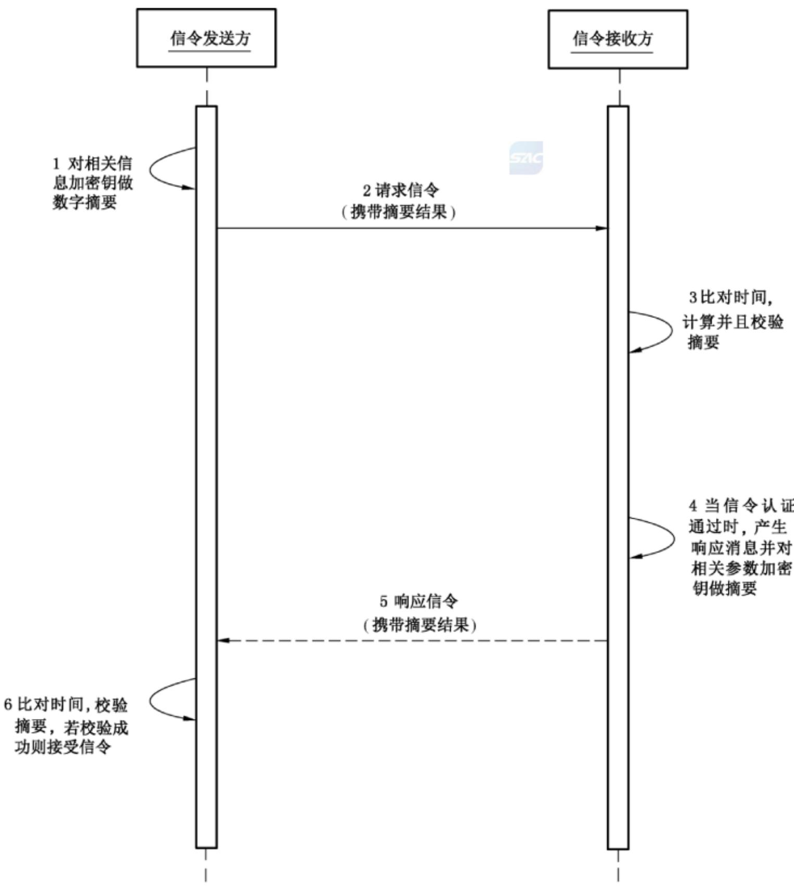  
图 C.4 基于带密钥的杂凑运算的控制信令认证交互流程示意图

信令流程描述如下：

a) 1: 信令发送方发送信令前, 需要对信令消息头域中的 METHOD、From、To、Call-ID、Date、密钥和消息体做杂凑运算, 得到结果 1, 并将结果 1 作为 Note 字段的参数 nonce 的值, 本次使用的杂凑算法作为 Note 字段的参数 algorithm 的值。

b) 2:信令发送方将信令发至信令接收方。

c) 3: 信令接收方接收信令, 比对 date 与当前时间, 如果时间之差在有效区间内则提取 METHOD、From、To、Call-ID、Date、消息体、结果 1、杂凑算法, 使用杂凑算法对 METHOD、From、To、Call-ID、Date、密钥和消息体做杂凑运算, 得到结果 1', 匹配结果 1 和结果 1'。如果匹配成功, 则信令认证通过, 否则认证失败, 丢弃该信令并终止该信令会话过程。

d) 4: 若信令接收方对收到的信令认证通过, 则生成响应信令, 并将即将发出的信令消息中的 METHOD、From、To、Call-ID、Date、密钥、消息体做杂凑运算, 得到结果 2。

e) 5:得到结果 2 作为 Note 字段的参数 nonce 的值,本次使用的杂凑算法作为 Note 字段的参数 algorithm 的值,将响应信令发送给信令发送方。

f) 6: 信令发送方接收到响应信令, 提取 METHOD、From、To、Call-ID, Date、消息体、结果 2, 比对 date 与当前时间, 如果时间之在差在有效区间内, 则将这些参数和密钥一起做杂凑运算, 得到结果 2', 匹配结果 2 和 2', 如果匹配成功, 则信令认证通过, 否则失败, 丢弃该信令。

## C.5 视频源签名及完整性校验

## C.5.1 视频数据签名数据的封装格式

## C.5.1.1 总则

视频编码、签名数据的封装符合 GB/T 25724—2017 要求。

## C.5.1.2 NAL 单元语法

按照 GB/T 25724—2017 的规定, 使用 NAL 单元参数中的 authentication\_idc 标注其是否认证。
NAL 单元语法符合标准 GB/T 25724—2017 中 5.2.3.1 的要求。

## C.5.1.3 安全参数集 RBSP 语法

码流签名采用的算法由 NAL 单元安全参数集 RBSP 约定。安全参数集 RBSP 语法的格式符合标准 GB/T 25724—2017 中 5.2.3.2.3 的要求。安全参数集语义应符合标准 GB/T 25724—2017 中 5.2.4.4.3 的要求。其中签名中所采用的杂凑算法依据表 C.1。

表 C.1 hash\_type 与算法的对应关系

<table><tr><td>hash_type</td><td>算法</td><td>摘要长度(byte)</td></tr><tr><td>0</td><td>SM3</td><td>32</td></tr><tr><td>1···3</td><td>保留</td><td>保留</td></tr></table>

签名中所采用的非对称算法依据 signature\_type，其取值依据表 C.2。

表 C.2 signature\_type 与算法的对应关系

<table><tr><td>signature_type</td><td>签名算法</td></tr><tr><td>0</td><td>SM2</td></tr><tr><td>1···3</td><td>保留</td></tr></table>

## C.5.1.4 认证数据的封装

认证数据的封装语法符合 GB/T 25724—2017 中 5.2.3.2.6 的要求。签名数据应经过 Base64 编码，Base64 编码方法应符合 RFC 3548 的要求。

## C.5.2 视频数据签名规则

视频数据签名规则如下：

a) 应保证解码器或验签服务器在收到携带认证数据的 NAL 之前, 已收到携带设备信息的安全参数集 NAL。

b) 携带设备信息的安全参数集 NAL, 以 GOP 整数倍为周期输出。

c) 认证数据单元 NAL 中的 frame\_num，表示应包含认证数据的图像，该图像为在认证数据 NAL 单元之前最临近的 frame\_num 与认证数据的 frame\_num 相同的图像。successive\_hash\_pictures\_minus1 等于 0 时，frame\_num 指示认证数据对应的图像。successive\_hash\_pictures\_minus1 大于 0 时，frame\_num 指示连续 SuccessiveHashPictures 个图像的最后一个。

d) 携带视频认证数据的认证数据 NAL, 从首个对应图像算起, 最多延后一个 GOP 周期输出。可信视频验签时, 从携带视频认证数据的认证数据单元 NAL 开始, 最多向前搜索一个 GOP, 定位首个对应图像。

e）编码比特流中必须携带绝对时间扩展信息，用于标识认证时间。

f) 认证数据应经过 Base64 编码。

## C.5.3 前端设备视频数据签名控制

## C.5.3.1 前端设备视频数据签名控制基本要求

管理平台发送命令控制 FDWSF 启动、停止视频数据签名。

## C.5.3.2 流程

前端设备视频数据签名控制流程见图 C.5, 消息示范参见 D.4。

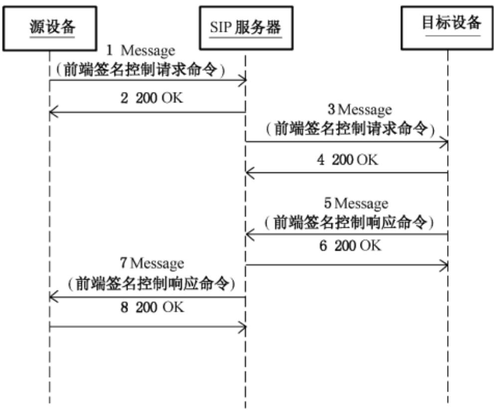  
图 C.5 前端设备视频数据签名控制流程示意图

命令流程描述如下：

a）1:源设备向 SIP 服务器发送设备控制命令,设备控制命令采用 MESSAGE 方法携带;

b) 2:SIP 服务器收到命令后返回 200 OK, 该响应无消息体;

c) 3: SIP 服务器向目标设备发送设备控制命令, 设备控制命令采用 MESSAGE 方法携带;

d) 4: 目标设备收到命令后返回 200 OK, 该响应无消息体;

e) 5: 目标设备向 SIP 服务器发送设备控制响应命令, 设备控制响应命令采用 MESSAGE 方法携带;

f) 6: SIP 服务器收到命令后返回 200 OK, 该响应无消息体;

g) 7:SIP 服务器向源设备转发设备控制响应命令,设备控制响应命令采用 MESSAGE 方法

```txt
携带；
h) 8:源设备收到命令后返回 200 OK,该响应无消息体。
```

## C.5.3.3 协议接口

## C.5.3.3.1 请求命令消息体

请求命令消息体应符合下列要求：

a) MESSAGE 消息头 Content-type 头域为 Content-type: Application/MANSCDP+xml。

b) 设备控制命令应采用 GB/T 28181—2016 中 4.3.4 中规定的 MANSCDP 协议格式定义。前端设备视频数据签名控制命令包括命令类型 (CmdType)、命令序列号 (SN)、设备编码 (DeviceID)、子命令等，采用 MESSAGE 方法的消息体携带。

c) 设备在收到 MESSAGE 消息后, 应立即返回应答, 应答均无消息体。

```txt
d) 消息体定义如下:
  <schema xmlns="http://www.w3.org/2001/XMLSchema"
  targetNamespace="http://www.w3.org/namespace/"
  xmlns:tg="http://www.w3.org/namespace/">
  <element name="Control">
  <complexType >
    <sequence>
      <!-- 命令类型:前端设备视频数据签名控制(必选)-->
      <clement name="CmdType" fixed ="SignatureControl" />
      <!-- 命令序列号(必选)-->
      <element name="SN" type="integer" minInclusive value = "1" />
      <!-- 目标设备编码(必选)-->
      <element name="DeviceID" type="tg:deviceIDType" />
      <!-- Start:启用签名;Stop:停止签名(必选)-->
      <element name="ControlCmd" type="string"/>
    </sequence>
  </complexType>
</element>
</schema>
```

## C.5.3.3.2 应答命令消息体

应答命令消息体应符合下列要求：

a) 设备控制应答命令应包括命令类型(CmdType)、命令序列号(SN)、设备编码(DeviceID)、执行结果(Result)，采用MESSAGE方法的消息体携带。

b) 设备控制应答命令应采用 GB/T 28181—2016 中 4.3.4 中规定的 MANSCDP 协议格式定义。

c) MESSAGE 消息头 Content-type 头域为 Content-type: Application/MANSCDP+xml。

d) 设备在收到 MESSAGE 消息后,应立即返回应答,应答均无消息体。

e) 消息体定义如下：

```asp
<schema xmlns="http://www.w3.org/2001/XMLSchema"
targetNamespace="http://www.w3.org/namespace/"
xmlns:tg="http://www.w3.org/namespace/">
```

```xml
<element name="Response">
<complexType >
  <sequence>
  <!-- 命令类型:设备控制(必选)-->
  <element name="CmdType" fixed ="SignatureControl" />
  <!-- 命令序列号(必选)-->
  <element name="SN" type="integer" minInclusive value = "1" />
  <!-- 目标设备编码(必选)-->
  <element name="DeviceID" type="tg:deviceIDType" />
  <!-- 命令执行结果(必选)-->
  <element name="Result" type="tg:resultType"/>
  </sequence>
</complexType>
</element>
</schema>
```

## C.5.4 视频数据签名

视频数据签名应符合下列要求：

a) 读取待认证的一个或多个 NAL 单元数据；

b) 按安全参数集约定的算法和方式对 NAL 单元进行杂凑计算,生成初次或二次杂凑值;

c) 按安全参数集 signature\_type 约定的算法和方式用设备私钥对一或多个图像的树顶杂凑结果进行签名计算,生成视频认证数据;

d) 将视频认证数据封装到认证数据单元中，以独立的 NAL 形式封装。

## C.5.5 视频验签

视频数据验签应符合下列要求：

a）从安全参数集 NAL 中获取源端设备信息，找到对应源端设备的公钥；

b) 用 signature\_type 中指定的签名算法, 用源端设备公钥解密认证数据, 生成验证杂凑值;

c) 在视频码流中定位认证数据对应图像的首个认证 NAL 单元；

d) 按安全参数集约定的算法和方式对从首个认证 NAL 单元开始的一或多组认证 NAL 单元进行初次杂凑计算或树顶杂凑计算，计算结果作为比对杂凑值；

e) 比较验证杂凑值和比对杂凑值,如完全相同,则视频认证数据对应的图像通过验证,否则未通过验证。

## C.6 视频加密

## C.6.1 视频加密数据的封装格式

## C.6.1.1 安全参数集 RBSP 语法

安全参数集 RBSP 语法应符合下列要求：

a) 码流的加密算法由 NAL 单元安全参数集 RBSP 约定。安全参数集 RBSP 语法应符合标准 GB/T 25724—2017 中 5.2.3.2.3 的要求。安全参数集语义应符合标准 GB/T 25724—2017 中 5.2.4.4.3 的要求。

b) 加密所采用的算法依据 encryption\_type, encryption\_type 见表 C.3。

表 C.3 encryption\_type 与算法的对应关系

<table><tr><td>encryption_type</td><td>加密算法</td></tr><tr><td>0</td><td>SM1</td></tr><tr><td>1</td><td>SM4</td></tr><tr><td>2···15</td><td>保留</td></tr></table>

## C.6.1.2 NAL 单元语法

按照 GB/T 25724—2017 的规定, 使用 NAL 单元参数中的 encryption\_idc 标注其携带的 RBSP 是否加密。

## C.6.2 视频加密规则

视频加密规则如下：

a）不对安全参数集加密处理，解码端收到新密钥和参数后及时激活，取代当前密钥和参数；

b) VEK 的长度为 16 个字节, 由 FDWSF 随机生成, VEK 更新的最小周期为一个 GOP, 一般采用 30 或 60 个 GOP 周期;

c) 携带更新 VEK、IV 的安全参数集 NAL, 应先于新密钥激活后的加密 VCL NAL 的传输; 携带设备信息的安全参数集 NAL, 应先于或同时携带认证数据传输;

d) 新的 VEK 在下一个 GOP 开始时使用, 同一个 GOP 使用相同的 VEK, GOP 周期内不变更加密运算的 VEK;

e) 编码片 RBSP 的最后 1 个字节不加密；

f) 采用分组加密 OFB 模式加密时,每个加密 GOP 使用不同的 IV,IV 由编码器随机生成。

## C.6.3 前端视频加密控制

## C.6.3.1 前端视频加密控制基本要求

管理平台发送命令控制 FDWSF 启动、停止视频数据加密。

## C.6.3.2 流程

前端视频加密控制流程见图 C.6，消息示范参见 D.5。

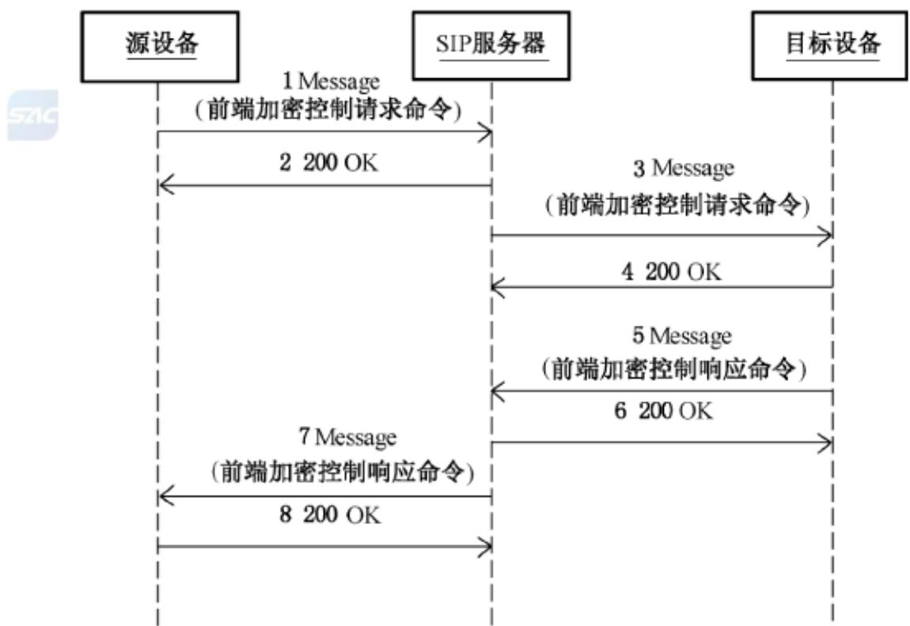  
图 C.6 前端视频加密控制流程示意图

命令流程描述如下：

a) 1: 源设备向 SIP 服务器发送设备控制命令, 设备控制命令采用 MESSAGE 方法携带;

b) 2: SIP 服务器收到命令后返回 200 OK, 该响应无消息体;

c) 3: SIP 服务器向目标设备发送设备控制命令, 设备控制命令采用 MESSAGE 方法携带;

d) 4: 目标设备收到命令后返回 200 OK, 该响应无消息体;

e) 5: 目标设备向 SIP 服务器发送设备控制响应命令, 设备控制响应命令采用 MESSAGE 方法携带;

f) 6: SIP 服务器收到命令后返回 200 OK, 该响应无消息体;

g) 7: SIP 服务器向源设备转发设备控制响应命令, 设备控制响应命令采用 MESSAGE 方法携带;

h) 8:源设备收到命令后返回 200 OK,该响应无消息体。

## C.6.3.3 协议接口

## C.6.3.3.1 请求命令消息体

请求命令消息体应符合下列要求：

a) MESSAGE 消息头 Content-type 头域为 Content-type: Application/MANSCDP+xml。

b) 设备控制命令采用 MANSCDP 协议格式定义。前端视频加密控制命令包括命令类型(Cmd-Type)、命令序列号(SN)、设备编码(DeviceID)、子命令等，采用 MESSAGE 方法的消息体携带。

c) 设备在收到 MESSAGE 消息后, 应立即返回应答, 应答均无消息体。

```txt
d) 消息体定义如下:
  <schema xmlns="http://www.w3.org/2001/XMLSchema"
  targetNamespace="http://www.w3.org/namespace/"
  xmlns:tg="http://www.w3.org/namespace/">
  <element name="Control">
  <complexType >
    <sequence>
      <!-- 命令类型:前端视频加密控制(必选)-->
      <element name="CmdType" fixed="EncryptionControl" />
      <!-- 命令序列号(必选)-->
      <element name="SN" type="integer" minInclusive value="1" />
      <!-- 目标设备编码(必选)-->
      <element name="DeviceID" type="tg:deviceIDType" />
      <!-- Start:启用加密;Stop:停止加密(必选)-->
      <element name="ControlCmd" type="string"/>
    </sequence>
  </complexType>
</element>
</schema>
```

## C.6.3.3.2 应答命令消息体

应答命令消息体应符合下列要求：

a) 前端视频加密控制应答命令应包括命令类型(CmdType)、命令序列号(SN)、设备编码(DeviceID)、执行结果(Result)，采用MESSAGE方法的消息体携带。

b) 设备控制应答命令采用 MANSCDP 协议格式定义。

c) MESSAGE 消息头 Content-type 头域为 Content-type: Application/MANSCDP+xml。

d) 设备在收到 MESSAGE 消息后,应立即返回应答,应答均无消息体。

```xml
e) 消息体定义如下:
  <schema xmlns="http://www.w3.org/2001/XMLSchema"
  targetNamespace="http://www.w3.org/namespace/"
  xmlns:tg="http://www.w3.org/namespace/">
  <element name="Response">
  <complexType >
    <sequence>
      <!-- 命令类型:设备控制(必选)-->
      <element name="CmdType" fixed="EncryptionControl" />
      <!-- 命令序列号(必选)-->
      <element name="SN" type="integer" minInclusive value="1" />
      <!-- 目标设备编码(必选)-->
      <element name="DeviceID" type="tg:deviceIDType" />
      <!-- 命令执行结果(必选)-->
      <element name="Result" type="tg:resultType"/>
    </sequence>
  </complexType>
</element>
</schema>
```

## C.6.4 视频加密

视频加密应符合下列要求：

a）编码器周期随机生成 128 bit 的 VEK。

b) 读取待加密的编码片 RBSP 数据。

c) 同时满足下述两个条件时,作废当前 VEK,激活新的 VEK,否则继续使用当前 VEK:

\- 此 RBSP 是 GOP 开始的第一个编码片数据；

\- 有新的VEK可用。

d) 编码器随机生成 128 bit 的 IV。

e) 采用约定的分组加密算法的 OFB 模式, 用 VEK 和 IV 生成流密钥。

f) 加密流密钥与待加密的编码片 RBSP 数据按位对齐, 进行异或运算, 得到加密的编码片 RBSP 数据。

g) 封装此加密 RBSP 的 VCL NAL, encryption\_idc=1。

h) 如激活了新的 VEK 或使用了新的 IV, 应封装安全扩展信息 NAL, 并先于此 VCL NAL 输出。

## C.6.5 视频解密

视频解密应符合下列要求：

a) 从安全参数集 NAL 中获取 IV、VEK 的密文, 记作 E(VEK), 用 VKEK 解密 E(VEK), 得到 VEK。

b) 读取待解密的编码片 RBSP 数据。

c) 同时满足下述两个条件时，作废当前 VEK，激活新的 VEK，否则继续使用当前 VEK：

\- 此 RBSP 是 GOP 开始的第一个编码片数据；

\- 有新的 VEK 可用。

d) 采用约定的分组加密算法的 OFB 模式, 用 VEK 和 IV 生成流密钥。

e) 流密钥与待解密的编码片 RBSP 数据按位对齐, 进行异或运算, 得到解密后的编码片 RBSP 数据。

## C.6.6 实时加密视频点播

## C.6.6.1 基本要求

实时加密视频点播的基本要求如下：

a) 实时加密视频点播的 SIP 消息应通过本域或其他域的具有安全功能的 SIP 服务器进行路由、转发，目标设备的实时视频流应通过本域内的具有安全功能的媒体服务器进行转发。

b) 实时加密视频点播采用 SIP 协议(RFC 3261)中的 INVITE 方法实现会话连接,采用 RTP/RTCP 协议(RFC 3550)实现媒体传输。在实时点播的信令控制过程中具有安全功能的 SIP 服务器将视频解密密钥安全传送到媒体接收者。

c) 实时加密视频点播的信令流程分为客户端主动发起和第三方呼叫控制两种方式，系统可选择其中一种或两种结合的实现方式。第三方呼叫控制的第三方控制者宜采用背靠背用户代理实现，有关第三方呼叫控制见 RFC 3725。

## C.6.6.2 客户端主动发起流程

客户端主动发起的实时加密视频点播流程见图 C.7, 消息示范参见 D.6。

其中，信令 1、8、9、10、11、12 为具有安全功能的 SIP 服务器接收到客户端的呼叫请求后通过 B2BUA 代理方式建立媒体流接收者与具有安全功能的媒体服务器之间的媒体流信令过程，信令 2-7 为具有安全功能的 SIP 服务器通过三方呼叫控制建立具有安全功能的媒体服务器与媒体流发送者之间的媒体流信令过程，信令 13、14 为 SIP 服务器向媒体流接收者发送密钥通知的过程，信令 15-18 为媒体流接收者断开与具有安全功能的媒体服务器之间的媒体流信令过程，信令 19-22 为具有安全功能的 SIP 服务器断开具有安全功能的媒体服务器与媒体流发送者之间的媒体流信令过程。

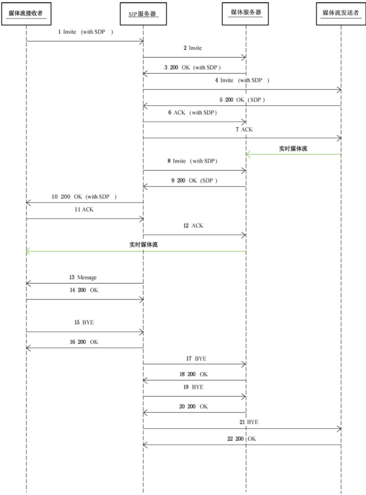  
图 C.7 客户端主动发起的实时加密视频点播流程示意图

命令流程描述如下：

a) 1: 媒体流接收者向具有安全功能的 SIP 服务器发送 Invite 消息, 消息头域中携带 Subject 字段, 表明点播的视频源 ID、发送方媒体流序列号、媒体流接收者 ID、接收端媒体流序列号等参数，SDP 消息体中 s 字段为“Play”代表实时点播，消息头域中携带 Monitor-User-Identity 字段，表明用户身份信息。

b) 2: 具有安全功能的 SIP 服务器收到 Invite 请求后, 通过三方呼叫控制建立具有安全功能的媒体服务器和媒体流发送者之间的媒体连接。向具有安全功能的媒体服务器发送 Invite 消息, 此消息不携带 SDP 消息体。

c) 3: 具有安全功能的媒体服务器收到具有安全功能的 SIP 服务器的 Invite 请求后, 回复 200 OK 响应, 携带 SDP 消息体, 消息体中描述了具有安全功能的具有安全功能的媒体服务器接收媒体流的 IP、端口、媒体格式等内容。

d) 4: 具有安全功能的 SIP 服务器收到具有安全功能的媒体服务器返回的 200 OK 响应后, 向媒体流发送者发送 Invite 请求, 请求中携带消息 3 中具有安全功能的媒体服务器回复的 200 OK 响应消息体, 并且修改 s 字段为“Play”代表实时点播, 增加 y 字段描述 SSRC 值, f 字段描述媒体参数。

e) 5: 媒体流发送者收到具有安全功能的 SIP 服务器的 Invite 请求后, 回复 200 OK 响应, 携带 SDP 消息体, 消息体中描述了媒体流发送者发送媒体流的 IP、端口、媒体格式、SSRC 字段等内容。

f) 6: 具有安全功能的 SIP 服务器收到媒体流发送者返回的 200 OK 响应后, 向具有安全功能的媒体服务器发送 ACK 请求, 请求中携带消息 5 中媒体流发送者回复的 200 OK 响应消息体, 完成与具有安全功能的媒体服务器的 Invite 会话建立过程。

g）7: 具有安全功能的 SIP 服务器收到媒体流发送者返回的 200 OK 响应后，向媒体流发送者发送 ACK 请求，请求中不携带消息体，完成与媒体流发送者的 Invite 会话建立过程。

h) 8: 完成三方呼叫控制后, 具有安全功能的 SIP 服务器通过 B2BUA 代理方式建立媒体流接收者和具有安全功能的媒体服务器之间的媒体连接。在消息 1 中增加 SSRC 值, 转发给具有安全功能的媒体服务器。

i) 9: 具有安全功能的媒体服务器收到 Invite 请求, 回复 200 OK 响应, 携带 SDP 消息体, 消息体中描述了具有安全功能的媒体服务器发送媒体流的 IP、端口、媒体格式、SSRC 值等内容。

j) 10: 具有安全功能的 SIP 服务器在消息 9 的 SDP 消息体基础上增加当前媒体流发送者的 VKEK 的版本号和 VKEK 密文描述, 用于媒体接收者对加密视频流解密。格式为“a = vkek: <version> <空格> <encryptedVKEK>”, 其中 encryptedVKEK 为用户公钥加密 VKEK 的结果, 转发给媒体流接收者。

k) 11: 媒体流接收者收到 200 OK 响应后, 回复 ACK 消息, 完成与具有安全功能的 SIP 服务器的 Invite 会话建立过程。

1) 12: 具有安全功能的 SIP 服务器将消息 11 转发给具有安全功能的媒体服务器, 完成与具有安全功能的媒体服务器的 Invite 会话建立过程。

m）13:在实时点播过程中出现 FDWSF 的 VKEK 改变情况下，SIP 服务器通过会话内的 Message 消息将新的 VKEK 密文和 VKEK 的版本号通知媒体流接收者，信令格式见 C.6.6.4 协议接口描述。

n) 14: 媒体流接收者收到 Message 消息后回复 200 OK 响应。

o) 15: 媒体流接收者向具有安全功能的 SIP 服务器发送 BYE 消息, 断开消息 1、10、11 建立的同媒体流接收者的 Invite 会话。

p) 16: 具有安全功能的 SIP 服务器收到 BYE 消息后回复 200 OK 响应, 会话断开。

q) 17: 具有安全功能的 SIP 服务器收到 BYE 消息后向具有安全功能的媒体服务器发送 BYE 消息，断开消息 8、9、12 建立的同具有安全功能的媒体服务器的 Invite 会话。

r) 18: 具有安全功能的媒体服务器收到 BYE 消息后回复 200 OK 响应, 会话断开。

s) 19: 具有安全功能的 SIP 服务器向具有安全功能的媒体服务器发送 BYE 消息, 断开消息 2、3、6 建立的同具有安全功能的媒体服务器的 Invite 会话。

t) 20: 具有安全功能的媒体服务器收到 BYE 消息后回复 200 OK 响应, 会话断开。

u) 21: 具有安全功能的 SIP 服务器向媒体流发送者发送 BYE 消息, 断开消息 4、5、7 建立的同媒体流发送者的 Invite 会话。

v）22:媒体流发送者收到BYE消息后回复200OK响应，会话断开。

## C.6.6.3 第三方呼叫控制流程

第三方呼叫控制的实时加密视频点播流程见图 C.8, 消息示范参见 D.7。

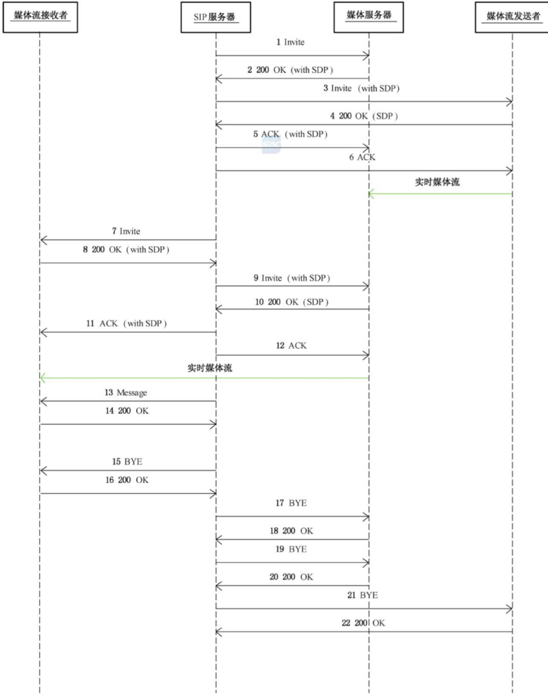  
图 C.8 第三方呼叫控制的实时加密视频点播流程示意图

其中，信令1～6为具有安全功能的SIP服务器通过三方呼叫控制建立具有安全功能的媒体服务器与媒体流发送者之间的媒体链接信令过程，信令7～12为具有安全功能的SIP服务器通过三方呼叫控制建立媒体流接收者与具有安全功能的媒体服务器之间的媒体链接信令过程，信令13、14为SIP服务器向媒体流接收者发送密钥通知的过程，信令15～18为断开媒体流接收者与具有安全功能的媒体服务器之间的媒体链接信令过程，信令19～22为断开具有安全功能的媒体服务器与媒体流发送者之间的媒体链接信令过程。

命令流程描述如下：

a) 1: 具有安全功能的 SIP 服务器向具有安全功能的媒体服务器发送 Invite 消息, 此消息不携带 SDP 消息体。

b) 2: 具有安全功能的媒体服务器收到具有安全功能的 SIP 服务器的 Invite 请求后, 回复 200 OK 响应, 携带 SDP 消息体, 消息体中描述了具有安全功能的媒体服务器接收媒体流的 IP、端口、媒体格式等内容。

c) 3: 具有安全功能的 SIP 服务器收到具有安全功能的媒体服务器返回的 200 OK 响应后, 向媒体流发送者发送 Invite 请求, 请求中携带消息 2 中具有安全功能的媒体服务器回复的 200 OK 响应消息体, 并且修改 s 字段为“Play”代表实时点播, 增加 y 字段描述 SSRC 值, f 字段描述媒体参数。

d) 4: 媒体流发送者收到具有安全功能的 SIP 服务器的 Invite 请求后, 回复 200 OK 响应, 携带 SDP 消息体, 消息体中描述了媒体流发送者发送媒体流的 IP、端口、媒体格式、SSRC 字段等内容。

e) 5: 具有安全功能的 SIP 服务器收到媒体流发送者返回的 200 OK 响应后, 向具有安全功能的媒体服务器发送 ACK 请求, 请求中携带消息 4 中媒体流发送者回复的 200 OK 响应消息体, 完成与具有安全功能的媒体服务器的 Invite 会话建立过程。

f) 6: 具有安全功能的 SIP 服务器收到媒体流发送者返回的 200 OK 响应后, 向媒体流发送者发送 ACK 请求, 请求中不携带消息体, 完成与媒体流发送者的 Invite 会话建立过程。

g) 7: 具有安全功能的 SIP 服务器向媒体流接收者发送 Invite 消息, 此消息不携带 SDP 消息体。

h) 8: 媒体流接收者收到具有安全功能的 SIP 服务器的 Invite 请求后, 回复 200 OK 响应, 携带 SDP 消息体, 消息体中描述了媒体流接收者接收媒体流的 IP、端口、媒体格式等内容。

i) 9: 具有安全功能的 SIP 服务器收到媒体流接收者返回的 200 OK 响应后, 向具有安全功能的媒体服务器发送 Invite 请求, 请求中携带消息 8 中媒体流接收者回复的 200 OK 响应消息体, 并且并且修改 s 字段为“Play”代表实时点播, 增加 y 字段描述 SSRC 值。

j) 10: 具有安全功能的媒体服务器收到具有安全功能的 SIP 服务器的 Invite 请求后, 回复 200 OK 响应, 携带 SDP 消息体, 消息体中描述了具有安全功能的媒体服务器发送媒体流的 IP、端口、媒体格式、SSRC 字段等内容。

k) 11: 具有安全功能的 SIP 服务器收到具有安全功能的媒体服务器返回的 200 OK 响应后, 向媒体流接收者发送 ACK 请求, 请求中携带内容为在消息 10 中具有安全功能的媒体服务器回复的 200 OK 响应消息体基础上, 增加当前媒体流发送者的 VKEK 版本号和 VKEK 密文描述, 用于媒体接收者对加密视频流解密, 格式为“a=vkek: <version> <空格> <encryptedVKEK>”, 其中 encryptedVKEK 为用用户公钥加密 VKEK 的结果。发给媒体流接收者完成与媒体流接收者的 Invite 会话建立过程。

1) 12: 具有安全功能的 SIP 服务器收到具有安全功能的媒体服务器返回的 200 OK 响应后, 向具有安全功能的媒体服务器发送 ACK 请求, 请求中不携带消息体, 完成与具有安全功能的媒体

服务器的 Invite 会话建立过程。

m) 13: 在实时点播过程中出现 FDWSF 的 VKEK 改变情况下, SIP 服务器通过会话内的 Message 消息将新的 VKEK 密文和 VKEK 的版本号通知媒体流接收者, 信令格式见 C.6.6.4 协议接口描述。

n) 14: 媒体流接收者收到 Message 消息后回复 200 OK 响应。

o) 15: 具有安全功能的 SIP 服务器向媒体流接收者发送 BYE 消息, 断开消息 7、8、11 建立的同媒体流接收者的 Invite 会话。

p) 16: 媒体流接收者收到 BYE 消息后回复 200 OK 响应, 会话断开。

q) 17: 具有安全功能的 SIP 服务器向具有安全功能的媒体服务器发送 BYE 消息, 断开消息 9、10、12 建立的同具有安全功能的媒体服务器的 Invite 会话。

r) 18: 具有安全功能的媒体服务器收到 BYE 消息后回复 200 OK 响应, 会话断开。

s) 19: 具有安全功能的 SIP 服务器向具有安全功能的媒体服务器发送 BYE 消息, 断开消息 1、2、5 建立的同具有安全功能的媒体服务器的 Invite 会话。

t) 20: 具有安全功能的媒体服务器收到 BYE 消息后回复 200 OK 响应, 会话断开。

u) 21: 具有安全功能的 SIP 服务器向媒体流发送者发送 BYE 消息, 断开消息 3、4、6 建立的同媒体流发送者的 Invite 会话。

v) 22: 媒体流发送者收到 BYE 消息后回复 200 OK 响应, 会话断开。


## C.6.6.4 协议接口

协议接口应符合下列要求：

a) SIP 消息头域(如 TO, FROM, Cseq, Call-ID, Max-Forwards, Via 等)的详细定义符合相关 SIP 消息的 RFC 文档的规定。

b) 消息头域 Allow 字段应支持 INVITE, ACK, INFO, CANCEL, BYE, OPTIONS, MESSAGE 方法, 不排除支持其他 SIP 和 SIP 扩展方法。

c) 消息头 Content-type 字段应表示消息体采用 SDP 协议格式定义。例如: Content-type: application/sdp。

d) 源设备应在 SDP 协议格式的消息体中包括 t 行(见 RFC 4566 的 5.9)，t 行的开始时间和结束时间均设置成 0，表示实时视频点播。

e) 发送给具有安全功能的媒体服务器的消息的消息头应包括 Subject 字段。实时视频图像点播流程中携带的请求和应答消息体采用 SDP 协议格式定义。有关 SDP 的详细描述见 RFC 4566。

f) SDP 文本信息包括:会话名称和意图,会话持续时间,构成会话的媒体,有关接收媒体的信息(地址等)。

g) SDP 协议格式消息体应包括 o 行(见 RFC 4566 的 5.2)，o 行中的 username 应为本设备的设备编码，设备编码应符合 6.1.1 的规定；c 行中应包括设备或系统 IP 地址；m 行中应包括媒体接收端口号。

h) 实时点播过程中, FDWSF 码流的密钥版本改变后, 通知媒体流接收者的 Message 消息携带消息体格式定义如下:

<schema xmlns="http://www.w3.org/2001/XMLSchema"
targetNamespace="http://www.w3.org/namespace/"
xmlns:tg="http://www.w3.org/namespace/">

```xml
<element name="Notify">
<complexType >
  <sequence>
  <!-- 命令类型:ClientVKEKNotify(必选)-->
  <element name="CmdType" fixed ="ClientVKEKNotify" />
  <!-- 命令序列号(必选)-->
  <element name="SN" type="integer" minInclusive value = "1" />
  <!-- 目标设备编码(必选)-->
  <element name="DeviceID" type="tg:deviceIDType" />
  <!--设备 VKEK 列表(必选)-->
    <!--VKEK 产生时间-->
    <element name="VKEKTime" type="datetime"/>
    <!-- VKEK 版本号(必选)-->
    <element name="VKEKVersion" type="string"/>
    <!-- VKEK 内容(必选)-->
    <element name="VKEKValue" type="string[0]"/>
    <!--媒体播放窗口号内容(必选)-->
    <element name="WID" type="int"/>
    <!--源设备内容(必选)-->
    <element name="SourceID" type="string[0]"/>
  </sequence>
</complexType>
</element>
</schema>
```

## C.6.7 历史加密视频的回放

## C.6.7.1 基本要求

历史加密视频的回放应符合下列要求：

a) 应采用 SIP 协议(RFC 3261)中的 INVITE 方法实现会话连接,采用 SIP 扩展协议(RFC 2976)INFO 方法的消息体携带加密视频回放控制命令,采用 RTP/RTCP 协议(RFC 3550)实现媒体传输。媒体回放控制命令引用 MANSRTSP 协议中的 PLAY,PAUSE,TEARDOWN 的请求消息和应答消息。

b) 历史加密视频回放的信令流程分为客户端主动发起和第三方呼叫控制两种方式，系统可选择其中一种或两种结合的实现方式。第三方呼叫控制的第三方控制者宜采用背靠背用户代理实现，有关第三方呼叫控制见 RFC 3725。

c) 媒体流接收者可以是具有安全功能的 SIP 客户端、具有安全功能的 SIP 设备(如视频解码器)等,媒体流发送者可以是具有安全功能的 SIP 设备、具有安全功能的媒体服务器等。

## C.6.7.2 客户端主动发起流程

客户端主动发起的历史加密视频回放流程见图 C.9, 消息示范参见 D.8。

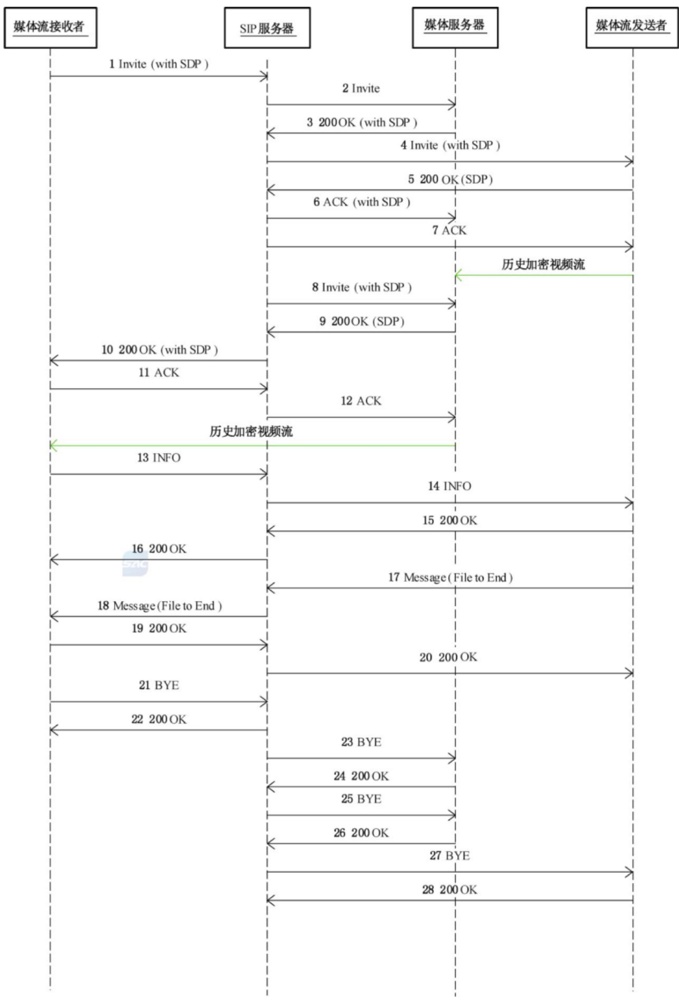  
图 C.9 客户端主动发起的历史加密视频回放流程示意图

其中，信令 1、8、9、10、11、12 为具有安全功能的 SIP 服务器接收到客户端的呼叫请求后通过 B2BUA 代理方式建立媒体流接受者与具有安全功能的媒体服务器之间的媒体链接信令过程，信令 2～7 为具有安全功能的 SIP 服务器通过三方呼叫控制建立具有安全功能的媒体服务器与媒体流之间的媒体链接信令过程，信令 13～16 为媒体流接收者进行回放控制信令过程，信令 17～20 为媒体流发送者回放、下载到文件结束向媒体接收者发送通知消息过程，信令 21～24 为断开媒体流接收者与具有安全功能的媒体服务器之间的媒体链接信令过程，信令 25～28 为具有安全功能的 SIP 服务器断开具有安全功能的媒体服务器与媒体流发送者之间的媒体链接信令过程。

命令流程描述如下：

a) 1: 媒体流接收者向具有安全功能的 SIP 服务器发送 Invite 消息, 消息头域中携带 Subject 字段, 表明点播的视频源 ID、发送方媒体流序列号、媒体流接收者 ID、接收端媒体流序列号标识等参数, SDP 消息体中 s 字段为“Playback”代表历史回放, u 字段代表回放通道 ID 和回放类型, t 字段代表回放时间段, 消息头域中携带 Monitor-User-Identity 字段, 表明用户身份信息。

b) 2: 具有安全功能的 SIP 服务器收到 Invite 请求后, 通过三方呼叫控制建立具有安全功能的媒体服务器和媒体流发送者之间的媒体连接。向具有安全功能的媒体服务器发送 Invite 消息, 此消息不携带 SDP 消息体。

c) 3: 具有安全功能的媒体服务器收到具有安全功能的 SIP 服务器的 Invite 请求后, 回复 200 OK 响应, 携带 SDP 消息体, 消息体中描述了具有安全功能的媒体服务器接收媒体流的 IP、端口、媒体格式等内容。

d) 4: 具有安全功能的 SIP 服务器收到具有安全功能的媒体服务器返回的 200 OK 响应后, 向媒体流发送者发送 Invite 请求, 请求中携带消息 3 中具有安全功能的媒体服务器回复的 200 OK 响应消息体, 并且修改 s 字段为“Playback”代表历史回放, u 字段代表回放通道 ID 和回放类型, t 字段代表回放时间段, 增加 y 字段描述 SSRC 值, f 字段描述媒体参数。

e) 5: 媒体流发送者收到具有安全功能的 SIP 服务器的 Invite 请求后, 回复 200 OK 响应, 携带 SDP 消息体, 消息体中描述了媒体流发送者发送媒体流的 IP、端口、媒体格式、SSRC 字段等内容。

f) 6: 具有安全功能的 SIP 服务器收到媒体流发送者返回的 200 OK 响应后, 向具有安全功能的媒体服务器发送 ACK 请求, 请求中携带消息 5 中媒体流发送者回复的 200 OK 响应消息体, 完成与具有安全功能的媒体服务器的 Invite 会话建立过程。

g) 7: 具有安全功能的 SIP 服务器收到媒体流发送者返回的 200 OK 响应后, 向媒体流发送者发送 ACK 请求, 请求中不携带消息体, 完成与媒体流发送者的 Invite 会话建立过程。

h) 8: 完成三方呼叫控制后, 具有安全功能的 SIP 服务器通过 B2BUA 代理方式建立媒体流接收者和具有安全功能的媒体服务器之间的媒体连接。在消息 1 中增加 SSRC 值, 转发给具有安全功能的媒体服务器。

i) 9: 具有安全功能的媒体服务器收到 Invite 请求, 回复 200 OK 响应, 携带 SDP 消息体, 消息体中描述了具有安全功能的媒体服务器发送媒体流的 IP、端口、媒体格式、SSRC 值等内容。

j) 10: 具有安全功能的 SIP 服务器将消息 9 转发给媒体流接收者, 同时扩展多个 a 字段携带历史文件的 VKEKVersion 和 VKEK。用于客户端对加密视频流解密播放, 格式为 “a = vkek: <version> <encryptedVKEK>”, 其中 encryptedVKEK 为用户公钥加密 VKEK 的结果, 根据录像时间段中的 VKEK 数量, 可携带多个 VKEKVersion 和 VKEK 密文。当请求的历史加密视频包含多个密钥时, 媒体流接收者依据历史加密视频的密钥版本选择 a 属性中所携带的对应

密钥。

k) 11: 媒体流接收者收到 200 OK 响应后, 回复 ACK 消息, 完成与具有安全功能的 SIP 服务器的 Invite 会话建立过程。

1) 12: 具有安全功能的 SIP 服务器将消息 11 转发给具有安全功能的媒体服务器, 完成与具有安全功能的媒体服务器的 Invite 会话建立过程。

m）13:在回放过程中,媒体流接收者通过向具有安全功能的 SIP 服务器发送会话内 Info 消息进行回放控制,包括视频的暂停、播放、快放、慢放、随机拖放播放等操作。

n) 14: 具有安全功能的 SIP 服务器收到消息 13 后转发给媒体流发送者。

o) 15: 媒体流发送者收到消息 14 后回复 200 OK 响应。

p) 16: 具有安全功能的 SIP 服务器将消息 15 转发给媒体流接收者。

q) 17: 媒体流发送者在文件回放结束后发送会话内 Message 消息, 通知具有安全功能的 SIP 服务器回放已结束。

r) 18: 具有安全功能的 SIP 服务器收到消息 17 后转发给媒体流接收者。

s) 19: 媒体流接收者收到消息 18 后回复 200 OK 响应, 进行链路断开过程。

t) 20: 具有安全功能的 SIP 服务器将消息 19 转发给媒体流发送者。

u) 21: 媒体流接收者向具有安全功能的 SIP 服务器发送 BYE 消息, 断开消息 1、10、11 建立的同媒体流接收者的 Invite 会话。

v) 22: 具有安全功能的 SIP 服务器收到 BYE 消息后回复 200 OK 响应, 会话断开。

w) 23: 具有安全功能的 SIP 服务器收到 BYE 消息后向具有安全功能的媒体服务器发送 BYE 消息，断开消息 8、9、12 建立的同具有安全功能的媒体服务器的 Invite 会话。

x) 24: 具有安全功能的媒体服务器收到 BYE 消息后回复 200 OK 响应, 会话断开。

y) 25: 具有安全功能的 SIP 服务器向具有安全功能的媒体服务器发送 BYE 消息, 断开消息 2、3、6 建立的同具有安全功能的媒体服务器的 Invite 会话。

z) 26: 具有安全功能的媒体服务器收到 BYE 消息后回复 200 OK 响应, 会话断开。

aa）27:具有安全功能的 SIP 服务器向媒体流发送者发送 BYE 消息，断开消息 4、5、7 建立的同媒体流发送者的 Invite 会话。

bb) 28: 媒体流发送者收到 BYE 消息后回复 200 OK 响应, 会话断开。

## C.6.7.3 第三方呼叫控制流程


第三方呼叫控制的历史加密视频回放流程见图 C.10，消息示范参见 D.9。

其中，信令1～6为具有安全功能的SIP服务器通过三方呼叫控制建立具有安全功能的媒体服务器与媒体流发送者之间的媒体链接信令过程，信令7～12为具有安全功能的SIP服务器通过三方呼叫控制建立媒体流接收者与具有安全功能的媒体服务器之间的媒体链接信令过程，信令13～14为回放控制信令过程，信令15～16为媒体流发送者回放、下载到文件结束向媒体接收者发送的回放结束通知消息，信令17～20为断开媒体流接收者与具有安全功能的媒体服务器之间的媒体链接信令过程，信令21～24为断开具有安全功能的媒体服务器与媒体流发送者之间的媒体链接信令过程。

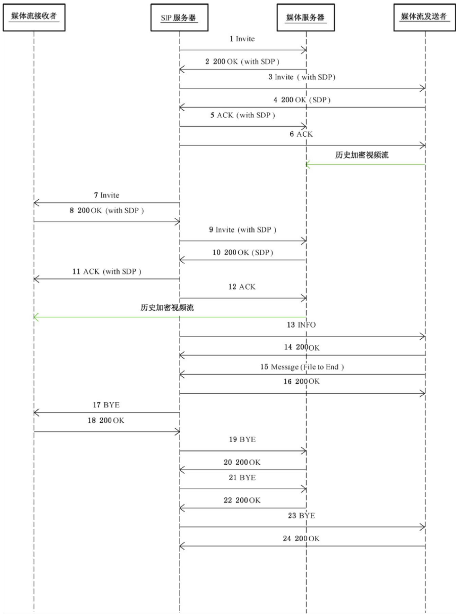  
图 C.10 第三方呼叫控制的历史加密视频回放流程示意图

命令流程描述如下：

a) 1: 具有安全功能的 SIP 服务器向具有安全功能的媒体服务器发送 Invite 消息, 此消息不携带 SDP 消息体。

b) 2: 具有安全功能的媒体服务器收到具有安全功能的 SIP 服务器的 Invite 请求后, 回复 200 OK响应,携带 SDP 消息体,消息体中描述了具有安全功能的媒体服务器接收媒体流的 IP、端口、媒体格式等内容。

c) 3: 具有安全功能的 SIP 服务器收到具有安全功能的媒体服务器返回的 200 OK 响应后, 向媒体流发送者发送 Invite 请求, 请求中携带消息 2 中具有安全功能的媒体服务器回复的 200 OK 响应消息体, 并且修改 s 字段为“Playback”代表历史回放, u 字段代表回放通道 ID 和回放类型, t 字段代表回放时间段, 增加 y 字段描述 SSRC 值, f 字段描述媒体参数。

d) 4: 媒体流发送者收到具有安全功能的 SIP 服务器的 Invite 请求后, 回复 200 OK 响应, 携带 SDP 消息体, 消息体中描述了媒体流发送者发送媒体流的 IP、端口、媒体格式、SSRC 字段等内容。

e) 5: 具有安全功能的 SIP 服务器收到媒体流发送者返回的 200 OK 响应后, 向具有安全功能的媒体服务器发送 ACK 请求, 请求中携带消息 4 中媒体流发送者回复的 200 OK 响应消息体, 完成与具有安全功能的媒体服务器的 Invite 会话建立过程。

f) 6: 具有安全功能的 SIP 服务器收到媒体流发送者返回的 200 OK 响应后, 向媒体流发送者发送 ACK 请求, 请求中不携带消息体, 完成与媒体流发送者的 Invite 会话建立过程。

g) 7: 具有安全功能的 SIP 服务器向媒体流接收者发送 Invite 消息, 此消息不携带 SDP 消息体。

h) 8: 媒体流接收者收到具有安全功能的 SIP 服务器的 Invite 请求后, 回复 200 OK 响应, 携带 SDP 消息体, 消息体中描述了媒体流接收者接收媒体流的 IP、端口、媒体格式等内容。

i) 9: 具有安全功能的 SIP 服务器收到媒体流接收者返回的 200 OK 响应后, 向具有安全功能的媒体服务器发送 Invite 请求, 请求中携带消息 8 中媒体流接收者回复的 200 OK 响应消息体, 并且修改 s 字段为“Playback”代表历史回放, 增加 y 字段描述 SSRC 值。

j) 10: 具有安全功能的媒体服务器收到具有安全功能的 SIP 服务器的 Invite 请求后, 回复 200 OK 响应, 携带 SDP 消息体, 消息体中描述了具有安全功能的媒体服务器发送媒体流的 IP、端口、媒体格式、SSRC 字段等内容。

k) 11: 具有安全功能的 SIP 服务器收到具有安全功能的媒体服务器返回的 200 OK 响应后, 向媒体流接收者发送 ACK 请求, 请求中携带消息 10 中具有安全功能的媒体服务器回复的 200 OK 响应消息体, 同时扩展 a 字段携带历史文件的 VKEKVersion 和 VKEK, 用于客户端对加密视频流解密播放, 格式为“a = vkek: <version> <空格> <encryptedVKEK>”, 其中 encrypted-VKEK 为用用户公钥加密 VKEK 的结果, 根据录像时间段中的 VKEK 数量, 可携带多个 VKEKVersion 和 VKEK 密文, 完成与媒体流接收者的 Invite 会话建立过程。

1) 12: 具有安全功能的 SIP 服务器收到具有安全功能的媒体服务器返回的 200 OK 响应后, 向具有安全功能的媒体服务器发送 ACK 请求, 请求中不携带消息体, 完成与具有安全功能的媒体服务器的 Invite 会话建立过程。

m）13:在回放过程中,具有安全功能的 SIP 服务器通过向媒体流发送者发送 Info 消息进行回放控制,包括视频的暂停、播放、定位、快放、慢放等操作。

n) 14: 媒体流发送者收到 Info 消息后回复 200 OK 响应。

o) 15: 媒体流发送者在文件回放结束后发送会话内 Message 消息, 通知具有安全功能的 SIP 服务器回放已结束。

p) 16: 具有安全功能的 SIP 服务器收到 Message 消息后回复 200 OK 响应, 进行链路断开过程。

q) 17: 具有安全功能的 SIP 服务器向媒体流接收者发送 BYE 消息, 断开消息 7、8、11 建立的同媒体流接收者的 Invite 会话。

r) 18: 媒体流接收者收到 BYE 消息后回复 200 OK 响应, 会话断开。

s) 19: 具有安全功能的 SIP 服务器向具有安全功能的媒体服务器发送 BYE 消息, 断开消息 9、10、12 建立的同带有安全功能的媒体服务器的 Invite 会话。

t) 20: 带有安全功能的媒体服务器收到 BYE 消息后回复 200 OK 响应, 会话断开。

u) 21: 具有安全功能的 SIP 服务器向带有安全功能的媒体服务器发送 BYE 消息, 断开消息 1、2、5 建立的同带有安全功能的媒体服务器的 Invite 会话。

v) 22: 带有安全功能的媒体服务器收到 BYE 消息后回复 200 OK 响应, 会话断开。

w) 23: 具有安全功能的 SIP 服务器向媒体流发送者发送 BYE 消息, 断开消息 3、4、6 建立的同媒体流发送者的 Invite 会话。

x) 24: 媒体流发送者收到 BYE 消息后回复 200 OK 响应, 会话断开。

## C.6.7.4 协议接口

## C.6.7.4.1 会话控制协议

会话控制协议应符合下列要求：

a) SIP 消息头域(如 TO, FROM, Cseq, Call-ID, Max-Forwards, Via 等)的详细定义符合相关 SIP 消息的 RFC 文档的规定。

b) 消息头域 Allow 字段应支持 INVITE, ACK, INFO, CANCEL, BYE, OPTIONS, MESSAGE 方法, 不排除支持其他 SIP 和 SIP 扩展方法。

c) 消息头 Content-type 字段为 Content-type: application/sdp。

d) 历史视频回放流程中携带消息体的请求和响应的消息体应采用 SDP 协议格式定义。有关 SDP 的详细描述见 RFC 4566。

e) SDP 文本信息包括:会话名称和意图,会话持续时间,构成会话的媒体,有关接收媒体的信息(地址等)。INVITE 请求以时间段方式获取加密历史图像。

f) 定位历史加密视频数据的信息在 SDP 协议格式的消息体中携带,应包含设备名和时间段信息,规定如下:

\- 媒体流接收者应在SDP协议格式的消息体中包括u行(见RFC4566的5.5)，u行应填写产生历史媒体的媒体源(如某个摄像头)的设备URI，应符合6.1.2的规定。设备URI应包含媒体源设备编码，媒体源设备编码成为检索历史媒体数据的设备名信息；

\- 媒体流接收者应在SDP协议格式的消息体中包括t行(见RFC4566的5.9)，t行的开始时间和结束时间组成检索历史媒体数据的时间段信息。

## C.6.7.4.2 视频回放控制协议

视频回放控制协议应符合下列要求：

a) 视频回放控制流程是采用 SIP 消息 INFO 实现视频播放、暂停、进/退和停止等视频回放控制命令的过程。视频回放控制请求消息在 INFO 方法的消息体中携带，回放控制请求消息应符合 MANSRTSP 协议的请求消息的部分定义，包括 PLAY、PAUSE、TEARDOWN；视频回放控制应答消息在 INFO 方法的 200 OK 响应消息体中携带，回放控制应答消息应符合 MANSRTSP 协议的应答消息定义。

b) 携带 MANSRTSP 请求和应答命令的 INFO 消息头 Content-type 字段为 Content-type: Application/MANSRTSP。

## C.6.8 加密视频的下载

## C.6.8.1 基本要求

具有安全功能的 SIP 服务器接收到媒体接收者发送的视频文件下载请求后向媒体流发送者发送媒体文件下载命令，媒体流发送者采用 RTP 将视频流传输给媒体流接收者，媒体流接收者直接将视频流保存为加密媒体文件。媒体流接收者可以是带有安全功能的用户终端或安全视频监控管理平台，媒体流发送者可以是安全媒体设备或安全视频监控管理平台。

## C.6.8.2 客户端主动发起流程

客户端主动发起的媒体文件下载流程见图 C.11, 消息示范参见 D.10。

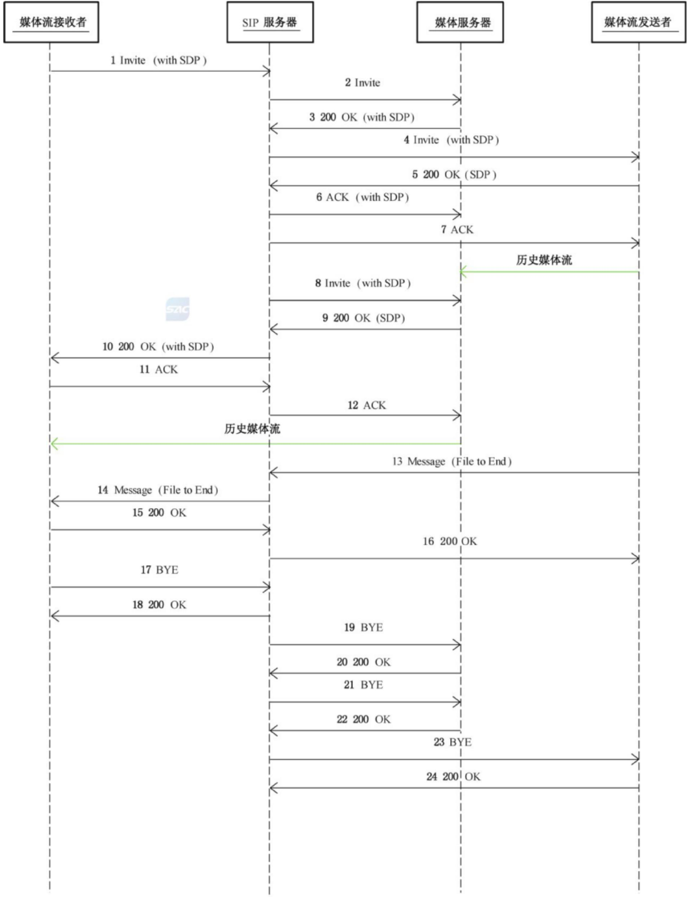  
图 C.11 客户端主动发起的视频文件下载流程示意图

其中，信令 1、8、9、10、11、12 为具有安全功能的 SIP 服务器接收到客户端的呼叫请求后通过 B2BUA 代理方式建立媒体流接受者与带有安全功能的媒体服务器之间的媒体链接信令过程，信令 2～7 为具有安全功能的 SIP 服务器通过三方呼叫控制建立带有安全功能的媒体服务器与媒体流之间的媒体链接信令过程，信令 13～16 为媒体流发送者回放、下载到文件结束向媒体接收者发送下载完成的通知消息过程，信令 17～20 为断开媒体流接收者断开与带有安全功能的媒体服务器之间的媒体链接信令过程，信令 21～24 为具有安全功能的 SIP 服务器断开带有安全功能的媒体服务器与媒体流发送者之间的媒体链接信令过程。

命令流程描述如下：

a) 1: 媒体流接收者向具有安全功能的 SIP 服务器发送 Invite 消息, 消息头域中携带 Subject 字段, 表明点播的视频源 ID、发送方媒体流序列号、媒体流接收者 ID、接收端媒体流序列号标识等参数, SDP 消息体中 s 字段为“Download”代表文件下载, u 字段代表下载通道 ID 和下载类型, t 字段代表下载时间段, 消息头域中携带 Monitor-User-Identity 字段, 表明用户身份信息。

b) 2: 具有安全功能的 SIP 服务器收到 Invite 请求后, 通过三方呼叫控制建立具有安全功能的媒体服务器和媒体流发送者之间的媒体连接。向具有安全功能的媒体服务器发送 Invite 消息, 此消息不携带 SDP 消息体。

c) 3: 具有安全功能的媒体服务器收到具有安全功能的 SIP 服务器的 Invite 请求后, 回复 200 OK 响应, 携带 SDP 消息体, 消息体中描述了具有安全功能的媒体服务器接收媒体流的 IP、端口、媒体格式等内容。

d) 4: 具有安全功能的 SIP 服务器收到具有安全功能的媒体服务器返回的 200 OK 响应后, 向媒体流发送者发送 Invite 请求, 请求中携带消息 3 中具有安全功能的媒体服务器回复的 200 OK 响应消息体, 并且修改 s 字段为“Download”代表文件下载, u 字段代表下载通道 ID 和下载类型, t 字段代表下载时间段, 增加 y 字段描述 SSRC 值, f 字段描述媒体参数。

e) 5: 媒体流发送者收到具有安全功能的 SIP 服务器的 Invite 请求后, 回复 200 OK 响应, 携带 SDP 消息体, 消息体中描述了媒体流发送者发送媒体流的 IP、端口、媒体格式、SSRC 字段等内容。

f) 6: 具有安全功能的 SIP 服务器收到媒体流发送者返回的 200 OK 响应后, 向具有安全功能的媒体服务器发送 ACK 请求, 请求中携带消息 5 中媒体流发送者回复的 200 OK 响应消息体, 完成与具有安全功能的媒体服务器的 Invite 会话建立过程。

g) 7: 具有安全功能的 SIP 服务器收到媒体流发送者返回的 200 OK 响应后, 向媒体流发送者发送 ACK 请求, 请求中不携带消息体, 完成与媒体流发送者的 Invite 会话建立过程。

h) 8: 完成三方呼叫控制后, 具有安全功能的 SIP 服务器通过 B2BUA 代理方式建立媒体流接收者和具有安全功能的媒体服务器之间的媒体连接。在消息 1 中增加 SSRC 值, 转发给具有安全功能的媒体服务器。

i) 9: 具有安全功能的媒体服务器收到 Invite 请求, 回复 200 OK 响应, 携带 SDP 消息体, 消息体中描述了具有安全功能的媒体服务器发送媒体流的 IP、端口、媒体格式、SSRC 值等内容。

j) 10: 具有安全功能的 SIP 服务器将消息 9 转发给媒体流接收者, 同时扩展 a 字段携带历史文件的 VKEKVersion 和 VKEK, 用于客户端对加密视频流解密播放, 格式为 “a=vkek: <version> <空格> <encryptedVKEK>”, 其中 encryptedVKEK 为用户公钥加密 VKEK 的结果, 根据录像时间段中的 VKEK 数量, 可携带多个 VKEKVersion 和 VKEK 密文。当请求的历史加密视频包含多个密钥时, 媒体流接收者依据历史加密视频的密钥版本选择 a 属性中所携带的对应密钥。

k) 11: 媒体流接收者收到 200 OK 响应后, 回复 ACK 消息, 完成与具有安全功能的 SIP 服务器的 Invite 会话建立过程。

1) 12: 具有安全功能的 SIP 服务器将消息 11 转发给具有安全功能的媒体服务器, 完成与具有安全功能的媒体服务器的 Invite 会话建立过程。

m) 13: 媒体流发送者在文件下载结束后发送会话内 Message 消息, 通知具有安全功能的 SIP 服务器下载已结束。

n) 14: 具有安全功能的 SIP 服务器收到消息 17 后转发给媒体流接收者。

o) 15: 媒体流接收者收到消息 18 后回复 200 OK 响应, 进行链路断开过程。

p) 16: 具有安全功能的 SIP 服务器将消息 19 转发给媒体流发送者。

q) 17: 媒体流接收者向具有安全功能的 SIP 服务器发送 BYE 消息, 断开消息 1、10、11 建立的同媒体流接收者的 Invite 会话。

r) 18: 具有安全功能的 SIP 服务器收到 BYE 消息后回复 200 OK 响应, 会话断开。

s) 19: 具有安全功能的 SIP 服务器收到 BYE 消息后向具有安全功能的媒体服务器发送 BYE 消息，断开消息 8、9、12 建立的同具有安全功能的媒体服务器的 Invite 会话。

t) 20: 具有安全功能的媒体服务器收到 BYE 消息后回复 200 OK 响应, 会话断开。

u) 21: 具有安全功能的 SIP 服务器向具有安全功能的媒体服务器发送 BYE 消息, 断开消息 2、3、6 建立的同具有安全功能的媒体服务器的 Invite 会话。

v) 22: 具有安全功能的媒体服务器收到 BYE 消息后回复 200 OK 响应, 会话断开。

w) 23: 具有安全功能的 SIP 服务器向媒体流发送者发送 BYE 消息, 断开消息 4、5、7 建立的同媒体流发送者的 Invite 会话。

x) 24: 媒体流发送者收到 BYE 消息后回复 200 OK 响应, 会话断开。

## C.6.8.3 第三方呼叫控制流程

第三方呼叫控制的媒体文件下载流程见图 C.12，消息示范参见 D.11。

其中，信令1～6为具有安全功能的SIP服务器通过三方呼叫控制建立具有安全功能的媒体服务器与媒体流发送者之间的媒体链接信令过程，信令7～12为具有安全功能的SIP服务器通过三方呼叫控制建立媒体流接收者与具有安全功能的媒体服务器之间的媒体链接信令过程，信令13～14为媒体流发送者回放、下载到文件结束向媒体接收者发送下载完成通知消息，信令15～18为断开媒体流接收者与具有安全功能的媒体服务器之间的媒体链接信令过程，信令19～22为断开具有安全功能的媒体服务器与媒体流发送者之间的媒体链接信令过程。

命令流程描述如下：

a) 1: 具有安全功能的 SIP 服务器向具有安全功能的媒体服务器发送 Invite 消息, 此消息不携带 SDP 消息体。

b) 2: 具有安全功能的媒体服务器收到具有安全功能的 SIP 服务器的 Invite 请求后, 回复 200 OK 响应, 携带 SDP 消息体, 消息体中描述了具有安全功能的媒体服务器接收媒体流的 IP、端口、媒体格式等内容。

c) 3: 具有安全功能的 SIP 服务器收到具有安全功能的媒体服务器返回的 200 OK 响应后, 向媒体流发送者发送 Invite 请求, 请求中携带消息 2 中具有安全功能的媒体服务器回复的 200 OK 响应消息体, 并且修改 s 字段为“Download”代表下载, u 字段代表下载通道 ID 和下载视频类型, t 字段代表下载时间段, 增加 y 字段描述 SSRC 值, f 字段描述媒体参数。

d) 4: 媒体流发送者收到具有安全功能的 SIP 服务器的 Invite 请求后, 回复 200 OK 响应, 携带 SDP 消息体, 消息体中描述了媒体流发送者发送媒体流的 IP、端口、媒体格式、SSRC 字段等内容。

e) 5: 具有安全功能的 SIP 服务器收到媒体流发送者返回的 200 OK 响应后, 向具有安全功能的媒体服务器发送 ACK 请求, 请求中携带消息 4 中媒体流发送者回复的 200 OK 响应消息体, 完成与具有安全功能的媒体服务器的 Invite 会话建立过程。

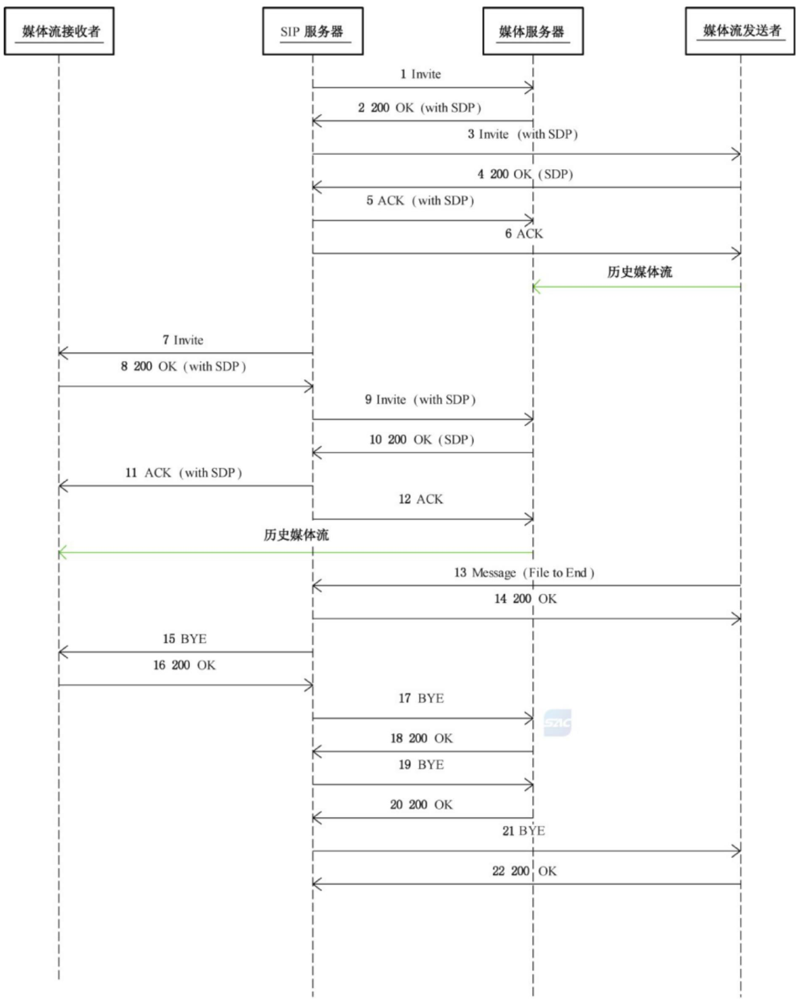  
图 C.12 第三方呼叫控制的视频文件下载流程示意图

f) 6: 具有安全功能的 SIP 服务器收到媒体流发送者返回的 200 OK 响应后, 向媒体流发送者发送 ACK 请求, 请求中不携带消息体, 完成与媒体流发送者的 Invite 会话建立过程。

g) 7: 具有安全功能的 SIP 服务器向媒体流接收者发送 Invite 消息, 此消息不携带 SDP 消息体。

h) 8: 媒体流接收者收到具有安全功能的 SIP 服务器的 Invite 请求后, 回复 200 OK 响应, 携带 SDP 消息体, 消息体中描述了媒体流接收者接收媒体流的 IP、端口、媒体格式等内容。

i) 9: 具有安全功能的 SIP 服务器收到媒体流接收者返回的 200 OK 响应后, 向具有安全功能的媒体服务器发送 Invite 请求, 请求中携带消息 8 中媒体流接收者回复的 200 OK 响应消息体, 并且修改 s 字段为“Playback”代表历史回放, 增加 y 字段描述 SSRC 值。

j) 10: 具有安全功能的媒体服务器收到具有安全功能的 SIP 服务器的 Invite 请求后, 回复 200 OK 响应, 携带 SDP 消息体, 消息体中描述了具有安全功能的媒体服务器发送媒体流的 IP、端口、媒体格式、SSRC 字段等内容。

k) 11: 具有安全功能的 SIP 服务器收到具有安全功能的媒体服务器返回的 200 OK 响应后, 向媒体流接收者发送 ACK 请求, 请求中携带消息 10 中具有安全功能的媒体服务器回复的 200 OK 响应消息体, 同时扩展 a 字段携带历史文件的 VKEKVersion 和 VKEK, 用于客户端对加密视频流解密播放, 格式为“a=vkek: <version> <空格> <encryptedVKEK>”, 其中 encryptedVKEK 为用用户公钥加密 VKEK 的结果, 根据录像时间段中的 VKEK 数量, 可携带多个 VKEKVersion 和 VKEK 密文, 完成与媒体流接收者的 Invite 会话建立过程。

1) 12: 具有安全功能的 SIP 服务器收到具有安全功能的媒体服务器返回的 200 OK 响应后, 向具有安全功能的媒体服务器发送 ACK 请求, 请求中不携带消息体, 完成与具有安全功能的媒体服务器的 Invite 会话建立过程。

m) 13: 媒体流发送者在文件回放结束后发送会话内 Message 消息, 通知具有安全功能的 SIP 服务器下载已结束。

n) 14: 具有安全功能的 SIP 服务器收到 Message 消息后回复 200 OK 响应, 进行链路断开过程。

o) 15: 具有安全功能的 SIP 服务器向媒体流接收者发送 BYE 消息, 断开消息 7、8、11 建立的同媒体流接收者的 Invite 会话。

p) 16: 媒体流接收者收到 BYE 消息后回复 200 OK 响应, 会话断开。

q) 17: 具有安全功能的 SIP 服务器向具有安全功能的媒体服务器发送 BYE 消息, 断开消息 9、10、12 建立的同具有安全功能的媒体服务器的 Invite 会话。

r) 18: 具有安全功能的媒体服务器收到 BYE 消息后回复 200 OK 响应, 会话断开。

s) 19: 具有安全功能的 SIP 服务器向具有安全功能的媒体服务器发送 BYE 消息, 断开消息 1、2、5 建立的同具有安全功能的媒体服务器的 Invite 会话。

t) 20: 具有安全功能的媒体服务器收到 BYE 消息后回复 200 OK 响应, 会话断开。

u) 21: 具有安全功能的 SIP 服务器向媒体流发送者发送 BYE 消息, 断开消息 3、4、6 建立的同媒体流发送者的 Invite 会话。

v) 22: 媒体流发送者收到 BYE 消息后回复 200 OK 响应, 会话断开。

## C.6.8.4 协议接口

协议接口应符合下列要求：

a) SIP 消息头域(如 TO, FROM, Cseq, Call-ID, Max-Forwards, Via 等)的详细定义符合相关 SIP 消息的 RFC 文档的规定。

b) 消息头域 Allow 字段应支持 INVITE, ACK, INFO, CANCEL, BYE, OPTIONS, MESSAGE 方法, 不排除支持其他 SIP 和 SIP 扩展方法。

c) 消息头 Content-type 字段为 Content-type: application/sdp。

d) 历史媒体下载流程中携带消息体的请求和响应的消息体应采用 SDP 协议格式定义。有关 SDP 的详细描述见 RFC 4566。

e) SDP 文本信息包括:会话名称和意图,会话持续时间,构成会话的媒体,有关接收媒体的信息(地址等)。INVITE 请求以时间段方式获取历史图像。

f) 定位历史媒体数据的信息在 SDP 协议格式的消息体中携带,应包含设备名和时间段信息,规

定如下：

\- 媒体流接收者应在 SDP 协议格式的消息体中包括 u 行(见 RFC 4566 的 5.5), u 行表明视频文件的 URI;

\- 媒体流接收者应在SDP协议格式的消息体中包括t行(见RFC4566的5.9)，t行的开始时间和结束时间组成检索历史媒体数据的时间段信息。

## C.7 数字证书服务

数字证书服务协议应遵循 GM/T 0014—2012 中 5.4 以及 5.6 的规定。

## 附录 D (资料性附录) 信令消息示范

## D.1 SIP 服务器认证 FDWSF 的单向身份认证消息示范

```txt
D.1.1 REGISTER sip:SIP 服务器编码@目的域名或 IP 地址端口 SIP/2.0
    Via: SIP/2.0/UDP 源域名或 IP 地址端口
    From: <sip:SIP 设备编码@源域名>;tag=185326220
    To: <sip:SIP 设备编码@源域名>
    Call-ID: ms1214-322164710-681262131542511620107-0@172.18.16.3
    CSeq: 1 REGISTER
    Contact: <sip:SIP 设备编码@源 IP 地址端口>
    Authorization:Capability algorithm="A:SM2;H:SM3;S:SM1/OFB/PKCS5,SM1/CBC/PKCS5,SM4/OFB/PKCS5,SM4/CBC/PKCS5;SI:SM3-SM2",keyversion=""
    Max-Forwards: 70
    Expires: 3600
    Content-Length: 0

D.1.2 SIP/2.0 401 Unauthorized
    To: sip:SIP 设备编码@源域名
    Content-Length: 0
    CSeq: 1 REGISTER
    Call-ID: ms1214-322164710-681262131542511620107-0@172.18.16.3
    From: <sip:SIP 设备编码@源域名>;tag=185326220
    Via: SIP/2.0/UDP 源域名或 IP 地址端口
    WWW-Authenticate: Unidirection algorithm="A:SM2;H:SM3;S:SM1/OFB/PKCS5;SI:SM3-SM2",
    random1="YTHFjdo37RiZvck3nNOqTA==""
D.1.3 REGISTER sip: SIP 服务器编码@目的域名或 IP 地址端口 SIP/2.0
    Via: SIP/2.0/UDP 源域名或 IP 地址端口
    From: <sip:SIP 设备编码@源域名>;tag=185326220
    To: <sip:SIP 设备编码@源域名>
    Call-ID: ms1214-322164710-681262131542511620107-0@172.18.16.3
    CSeq: 2 REGISTER
    Contact: <sip:SIP 设备编码@源 IP 地址端口>
    Authorization:Unidirection random1="", random2="", serverid="服务器编码", sign1="", algorithm="A:SM2;H:SM3;S:SM1/OFB/PKCS5;SI:SM3-SM2"
    Max-Forwards: 70
    Expires: 3600
    Content-Length: 0
```

```txt
4 SIP/2.0 200 OK
To: <sip:SIP 设备编码@源域名>;tag=69113a2a
Contact: sip:SIP 设备编码@源 IP 地址端口
Content-Length: 0
CSeq: 2 REGISTER
Call-ID: ms1214-322164710-681262131542511620107-0@172.18.16.3
From: <sip:SIP 设备编码@源域名>;tag=185326220
Via: SIP/2.0/UDP 源域名或 IP 地址端口
Date: 2010-11-02T15:01:26.115
Expires: 3600
SecurityInfo: Unidirection cryptkey="",algorithm="A:SM2;H:SM3"
Expires: 3600
```

## D.2 SIP 服务器与 FDWSF 间的双向身份认证消息示范

```txt
D.2.1 REGISTER sip:SIP 服务器编码@目的域名或 IP 地址端口 SIP/2.0
    Via: SIP/2.0/UDP 源域名或 IP 地址端口
    From: <sip:SIP 设备编码@源域名>;tag=185326220
    To: <sip:SIP 设备编码@源域名>
    Call-ID: ms1214-322164710-681262131542511620107-0@172.18.16.3
    CSeq: 1 REGISTER
    Contact: <sip:SIP 设备编码@源 IP 地址端口>
    Authorization:Capability algorithm="A:SM2;H:SM3;S:SM1/OFB/PKCS5,SM1/CBC/PKCS5,SM4/OFB/PKCS5,SM4/CBC/PKCS5;SI:SM3-SM2",keyversion=""
    Max-Forwards: 70
    Expires: 3600
    Content-Length: 0

D.2.2 SIP/2.0 401 Unauthorized
    To: sip:SIP 设备编码@源域名
    Content-Length: 0
    CSeq: 1 REGISTER
    Call-ID: ms1214-322164710-681262131542511620107-0@172.18.16.3
    From: <sip:SIP 设备编码@源域名>;tag=185326220
    Via: SIP/2.0/UDP 源域名或 IP 地址端口
    WWW-Authenticate: Bidirection algorithm="A:SM2;H:SM3;S:SM1/OFB/PKCS5;SI:SM3-SM2",random1="YTHFjdo37RiZvck3nNOqTA=""

D.2.3 REGISTER sip: SIP 服务器编码@目的域名或 IP 地址端口 SIP/2.0
    Via: SIP/2.0/UDP 源域名或 IP 地址端口
    From: <sip:SIP 设备编码@源域名>;tag=185326220
    To: <sip:SIP 设备编码@源域名>
```

```eml
Call-ID: ms1214-322164710-681262131542511620107-0@172.18.16.3
CSeq: 2 REGISTER
Contact: <sip:SIP 设备编码@源 IP 地址端口>
Authorization: Bidirection random1="", random2="", deviceid="", serverid="", sign1 (“”,
algorithm="A:SM2;H:SM3;S: SM1/OFB/PKCS5;SI:SM3-SM2"Max-Forwards: 70
Expires: 3600
Content-Length: 0

D.2.4 SIP/2.0 200 OK
To: <sip:SIP 设备编码@源域名>;tag=69113a2a
Contact: sip:SIP 设备编码@源 IP 地址端口
Content-Length: 0
CSeq: 2 REGISTER
Call-ID: ms1214-322164710-681262131542511620107-0@172.18.16.3
From: <sip:SIP 设备编码@源域名>;tag=185326220
Via: SIP/2.0/UDP 源域名或 IP 地址端口
Date: 2010-11-02T15:01:26.115
SecurityInfo: Bidirection random1="", random2="", deviceid="", cryptkey="", sign2 (“”,
algorithm="A:SM2;H:SM3;S: SM1/OFB/PKCS5;SI:SM3-SM2"
Expires: 3600

D.3 控制信令认证消息示范

INVITE sip:device01@ domain1.com:1902 SIP/2.0
Via: SIP/2.0/UDP sipserver10@domain1.com:5060
址;branch=z9hG4bKnashds8
Max-Forwards: 70
To: device01< sip:device01@ domain1.com:1902 >
From: controller01< sip: controller01@ domain1.com:5060>;tag=1928301774
Call-ID: a84b4c76e66710@192.168.9.205
CSeq: 314159 INVITE
Contact: <sip:192.168.9.205:5060
Content-Length: 0
Date:2008040112:20
Note: Digest
nonce="8c56a3f50903e318e1267d544e92b9d49a" algorithm=SM3
注:增加 Note 字段,值为 Digest,有两个参数 nonce, algorithm,其中 nonce 为 Base64[SM3[METHOD +From +to +CallID +Date +VKEK +消息体]]。
```

## D.4 前端设备视频数据签名控制消息示范

D.4.1 MESSAGE sip: 目的设备编码@目的域名或 IP 地址端口 SIP/2.0

To: <sip: 目的设备编码@目的域名>; tag=852843529

```txt
Content-Length: 消息实体的字节长度
CSeq: 2 MESSAGE
Call-ID: a84b4c76e66710
Via: SIP/2.0/UDP 源域名或 IP 地址
From: <sip:源设备编码@源域名>;tag=e40807c0
Content-Type: Application/MANSCDP+xml
Max-Forwards: 70

<? xml version="1.0"?>
<Control>
<CmdType>SignatureControl</CmdType>
<SN>17</SN>
<DeviceID>具有安全功能的前端设备 ID</DeviceID>
<!--Start:启用签名;Stop:停止签名-->
<ControlCmd>Start/Stop</ControlCmd>
</Control>

D.4.2 SIP/2.0 200 OK
Via: SIP/2.0/UDP 源域名或 IP 地址
From: <sip:源设备编码@源域名>;tag=e40807c0
To: <sip:目的设备编码@目的域名>;tag=852843529
Call-ID: a84b4c76e66710
CSeq: 2 MESSAGE
Content-Length: 0

D.4.3 MESSAGE sip:目的设备编码@目的域名或 IP 地址端口 SIP/2.0
To: <sip:目的设备编码@目的域名>;tag=852843529
Content-Length: 消息实体的字节长度
CSeq: 2 MESSAGE
Call-ID: wlss-3a65dfb6-7ee86970ea84c5b2284ad158b3d4fdee@172.18.16.5
Via: SIP/2.0/UDP SIP 服务器域名或 IP 地址
From: <sip:源设备编码@源域名>;tag=e40807c0
Content-Type: Application/MANSCDP+xml
Max-Forwards: 70

<? xml version="1.0"?>
<Control>
<CmdType>SignatureControl</CmdType>
<SN>17</SN>
<DeviceID>具有安全功能的前端设备 ID</DeviceID>
<!--Start:启用签名;Stop:停止签名-->
<ControlCmd>Start/Stop</ControlCmd>
</Control>
```

```txt
D.4.4 SIP/2.0 200 OK
    Via: SIP/2.0/UDP SIP 服务器域名或 IP 地址
    From: <sip:源设备编码@源域名>;tag=e40807c0
    To: <sip:目的设备编码@目的域名>;tag=852843529
    Call-ID: wlss-3a65dfb6-7ee86970ea84c5b2284ad158b3d4fdee@172.18.16.5
    CSeq: 2 MESSAGE
    Content-Length: 0

D.4.5 MESSAGE sip:目的设备编码@目的域名或 IP 地址端口 SIP/2.0
    Via: SIP/2.0/UDP 目的域名或 IP 地址
    From: <sip:目的设备编码@目的域名>;tag=852843529
    To: <sip:源设备编码@源域名>;tag=e40807c0
    Call-ID: de432gtf51u870
    CSeq: 2 MESSAGE
    Max-Forwards: 70
    Content-Type: Application/MANSCDP+xml
    Content-Length: 消息实体的字节长度

    <? xml version="1.0"?>
    <Response>
    <CmdType>SignatureControl</CmdType>
    <SN>17</SN>
    <DeviceID>具有安全功能的前端设备 ID</DeviceID>
    <!--控制执行结果,OK:执行成功;ERROR:执行失败-->
    <Result>OK</Result>
    </Response>

D.4.6 SIP/2.0 200 OK
    To: <sip:源设备编码@源域名>;tag=e40807c0
    Content-Length: 0
    CSeq: 2 MESSAGE
    Call-ID: de432gtf51u870
    Via: SIP/2.0/UDP 目的域名或 IP 地址
    From: <sip:目的设备编码@目的域名>;tag=852843529

D.4.7 MESSAGE sip:目的设备编码@目的域名或 IP 地址端口 SIP/2.0
    Via: SIP/2.0/UDP SIP 服务器域名或 IP 地址
    From: <sip:目的设备编码@目的域名>;tag=852843529
    To: <sip:源设备编码@源域名>;tag=e40807c0
    Call-ID: wlss-dc907ta2-7ee86970ea84c5b2284ad158b3d4fdee@172.18.16.5
    CSeq: 2 MESSAGE
    Max-Forwards: 70
```

```txt
Content-Type: Application/MANSCDP+xml
Content-Length: 消息实体的字节长度

<? xml version="1.0"?>
<Resporsce>
<CmdType>SignatureControl</CmdType>
<SN>17</SN>
<DeviceID>具有安全功能的前端设备 ID</DeviceID>
<!--控制执行结果,OK:执行成功;ERROR:执行失败-->
<Result>OK</Result>
</Response>
0.4.8 SIP/2.0 200 OK
To: <sip:源设备编码@源域名>;tag=e40807c0
Content-Length: 0
CSeq: 2 MESSAGE
Call-ID: wlss-dc907ta2-7ee86970ea84c5b2284ad158b3d4fdee@172.18.16.5
Via: SIP/2.0/UDP SIP 服务器域名或 IP 地址
From: <sip:目的设备编码@目的域名>;tag=852843529
```

## D.5 前端视频加密控制消息示范

```txt
D.5.1 MESSAGE sip: 目的设备编码@目的域名或 IP 地址端口 SIP/2.0
To: <sip: 目的设备编码@目的域名>; tag=852843529
Content-Length: 消息实体的字节长度
CSeq: 2 MESSAGE
Call-ID: a84b4c76e66710
Via: SIP/2.0/UDP 源域名或 IP 地址
From: <sip: 源设备编码@源域名>; tag=e40807c0
Content-Type: Application/MANSCDP+xml
Max-Forwards: 70

<? xml version="1.0"?>
<Control>
<CmdType>EncryptionControl</CmdType>
<SN>17</SN>
<DeviceID>具有安全功能的前端设备 ID</DeviceID>
<!--Start: 启用加密; Stop: 停止加密-->
<ControlCmd>Start/Stop</ControlCmd>
</Control>

D.5.2 SIP/2.0 200 OK
Via: SIP/2.0/UDP 源域名或 IP 地址
From: <sip: 源设备编码@源域名>; tag=e40807c0
To: <sip: 目的设备编码@目的域名>; tag=852843529
```

```txt
Call-ID: a84b4c76e66710
CSeq: 2 MESSAGE
Content-Length: 0

5.3 MESSAGE sip: 目的设备编码@目的域名或 IP 地址端口 SIP/2.0
To: <sip: 目的设备编码@目的域名>; tag=852843529
Content-Length: 消息实体的字节长度
CSeq: 2 MESSAGE
Call-ID: wlss-3a65dfb6-7ee86970ea84c5b2284ad158b3d4fdee@172.18.16.5
Via: SIP/2.0/UDP SIP 服务器域名或 IP 地址
From: <sip: 源设备编码@源域名>; tag=e40807c0
Content-Type: Application/MANSCDP+xml
Max-Forwards: 70

<? xml version="1.0"?>
<Control>
<CmdType>EncryptionControl</CmdType>
<SN>17</SN>
<DeviceID>具有安全功能的前端设备 ID</DeviceID>
<!--Start: 启用加密; Stop: 停止加密-->
<ControlCmd>Start/Stop</ControlCmd>
</Control>

5.4 SIP/2.0 200 OK
Via: SIP/2.0/UDP SIP 服务器域名或 IP 地址
From: <sip: 源设备编码@源域名>; tag=e40807c0
To: <sip: 目的设备编码@目的域名>; tag=852843529
Call-ID: wlss-3a65dfb6-7ee86970ea84c5b2284ad158b3d4fdee@172.18.16.5
CSeq: 2 MESSAGE
Content-Length: 0

5.5 MESSAGE sip: 目的设备编码@目的域名或 IP 地址端口 SIP/2.0
Via: SIP/2.0/UDP 目的域名或 IP 地址
From: <sip: 目的设备编码@目的域名>; tag=852843529
To: <sip: 源设备编码@源域名>; tag=e40807c0
Call-ID: de432gtf51u870
CSeq: 2 MESSAGE
Max-Forwards: 70
Content-Type: Application/MANSCDP+xml
Content-Length: 消息实体的字节长度

<? xml version="1.0"?>
<Response>
```

```txt
<CmdType>EncryptionControl</CmdType>
<SN>17</SN>
<DeviceID>具有安全功能的前端设备 ID</DeviceID>
<!--控制执行结果,OK:执行成功;ERROR:执行失败-->
<Result>OK</Result>
</Response>

D.5.6 SIP/2.0 200 OK
To: <sip:源设备编码@源域名>;tag=e40807c0
Content-Length: 0
CSeq: 2 MESSAGE
Call-ID: de432gtf51u870
Via: SIP/2.0/UDP 目的域名或 IP 地址
From: <sip:目的设备编码@目的域名>;tag=852843529

D.5.7 MESSAGE sip:目的设备编码@目的域名或 IP 地址端口 SIP/2.0
Via: SIP/2.0/UDP SIP 服务器域名或 IP 地址
From: <sip:目的设备编码@目的域名>;tag=852843529
To: <sip:源设备编码@源域名>;tag=e40807c0
Call-ID: wlss-dc907ta2-7ee86970ea84c5b2284ad158b3d4fdee@172.18.16.5
CSeq: 2 MESSAGE
Max-Forwards: 70
Content-Type: Application/MANSCDP+xml
Content-Length: 消息实体的字节长度

<?xml version="1.0"?>
<Response>
<CmdType>EncryptionControl</CmdType>
<SN>17</SN>
<DeviceID>具有安全功能的前端设备 ID</DeviceID>
<!--控制执行结果,OK:执行成功;ERROR:执行失败-->
<Result>OK</Result>
</Response>

D.5.8 SIP/2.0 200 OK
To: <sip:源设备编码@源域名>;tag=e40807c0
Content-Length: 0
CSeq: 2 MESSAGE
Call-ID: wlss-dc907ta2-7ee86970ea84c5b2284ad158b3d4fdee@172.18.16.5
Via: SIP/2.0/UDP SIP 服务器域名或 IP 地址
From: <sip:目的设备编码@目的域名>;tag=852843529
```

## D.6 客户端发起的实时加密视频点播消息示范

```txt
D.6.1 INVITE sip:媒体流发送者设备编码@目的域名或IP地址端口SIP/2.0
To: sip:媒体流发送者设备编码@目的域名
Content-Length: 消息实体的字节长度
Contact: <sip:媒体流接收者设备编码@源IP地址端口>
CSeq: 1 INVITE
Call-ID: wlss-f7c53b46-eea27828118c3b50449185980f4bfd0@172.20.16.4
Via: SIP/2.0/UDP源域名或IP地址
From: <sip:媒体流接收者设备编码@源域名>;tag=e3719a0b
Subject: 媒体流发送者设备编码:发送端媒体流序列号,媒体流接收者设备编码:接收端媒体流序列号
Monitor-User-Identity: policeno=<警号>,idcardno=<身份证号>
Content-Type: application/sdp
Max-Forwards: 70

v=0
o=64010600002020000001 0 0 IN IP4 172.20.16.3
s=Play
c=IN IP4 172.20.16.3
t=0 0
m=video 6000 RTP/AVP 96 98 97
a=recvonly
a=rtpmap:96 PS/90000
a=rtpmap:98 H264/90000
a=rtpmap:97 MPEG4/90000

D.6.2 INVITE sip:具有安全功能的媒体服务器编码@目的域名或IP地址端口SIP/2.0
To: sip:具有安全功能的媒体服务器编码@目的域名
Content-Length: 消息实体的字节长度
Contact: <sip:SIP服务器编码@源IP地址端口>
CSeq: 1 INVITE
Call-ID: wlss-11df50d7-730beb6350a5506aa8316d9dc100cf6b@172.18.16.5
Via: SIP/2.0/UDP源域名或IP地址端口
From: <sip:SIP服务器编码@源域名>;tag=1ad9931d
Subject: 媒体流发送者设备编码:发送端媒体流序列号,媒体流接收者设备编码:接收端媒体流序列号
Max-Forwards: 70
```

## D.6.3 SIP/2.0 200 OK

Via: SIP/2.0/UDP 源域名或 IP 地址

```txt
To: <sip: 具有安全功能的媒体服务器编码@目的域名>; tag=3094947605
Call-ID: wlss-11df50d7-730beb6350a5506aa8316d9dc100cf6b@172.18.16.5
CSeq: 1 INVITE
Contact: <sip: 具有安全功能的媒体服务器编码@目的域名或 IP 地址端口>
Content-Type: application/sdp
Content-Length: 消息实体的字节长度
```

```txt
v=0
o=64010000002020000001 0 0 IN IP4 172.18.16.3
s= # # ms20091214
c=IN IP4 172.18.16.3
t=0 0
m=video 6000 RTP/AVP 96 98 97
a=recvonly
a=rtpmap:96 PS/90000
a=rtpmap:98 H264/90000
a=rtpmap:97 MPEG4/90000
```

```txt
To: sip:媒体流发送者设备编码@目的域名
Content-Length: 消息实体的字节长度
Contact: <sip: SIP 服务器编码@源 IP 地址端口>
CSeq: 1 INVITE
Call-ID: wlss-e680b2c1-730beb6350a5506aa8316d9dc100cf6b@172.18.16.5
Via: SIP/2.0/UDP 源域名或 IP 地址
From: <sip:SIP 服务器编码@源域名>;tag=f569d024
Content-Type: application/sdp
Subject: 媒体流发送者设备编码:发送端媒体流序列号,媒体流接收者设备编码:接收端媒体流序列号
Max-Forwards: 70
```

```txt
v=0
o=64010000002020000001 0 0 IN IP4 172.18.16.3
s=Play
c=IN IP4 172.18.16.3
t=0 0
m=video 6000 RTP/AVP 96 98 97
a=recvonly
a=rtpmap:96 PS/90000
a=rtpmap:98 H264/90000
a=rtpmap:97 MPEG4/90000
y=0100000001
```

```txt
D.6.5 SIP/2.0 200 OK
Via: SIP/2.0/UDP 源域名或 IP 地址
From: <sip:SIP 服务器编码@源域名>;tag=f569d024
To: <sip:媒体流发送者设备编码@目的域名>;tag=32128
Call-ID: wlss-e680b2c1-730beb6350a5506aa8316d9dc100cf6b@172.18.16.5
CSeq: 1 INVITE
Contact: <sip:媒体流发送者设备编码@目的 IP 地址端口>
Content-Type: application/sdp
Content-Length: 消息实体的字节长度

v=0
o=64010000041110000044 0 0 IN IP4 172.24.18.44
s=Embedded Net DVR
c=IN IP4 172.24.18.44
t=0 0
m=video 8412 RTP/AVP 96
a=sendonly
a=rtpmap:96 PS/90000
y=100000001

D.6.6 ACK sip:具有安全功能的媒体服务器编码@目的域名或 IP 地址端口 SIP/2.
To: <sip:具有安全功能的媒体服务器编码@目的域名>;tag=3094947605
Content-Length: 消息实体的字节长度
CSeq: 1 ACK
Call-ID: wlss-11df50d7-730beb6350a5506aa8316d9dc100cf6b@172.18.16.5
Via: SIP/2.0/UDP 源域名或 IP 地址
From: <sip: SIP 服务器编码@源域名>;tag=1ad9931d
Content-Type: application/sdp
Max-Forwards: 70

v=0
o=64010000041110000044 0 0 IN IP4 172.24.18.44
s=Embedded Net DVR
c=IN IP4 172.24.18.44
t=0 0
m=video 8412 RTP/AVP 96
a=sendonly
a=rtpmap:96 PS/90000
y=100000001

D.6.7 ACK sip:媒体流发送者设备编码@目的域名或 IP 地址端口 SIP/2.0
To: <sip:媒体流发送者设备编码@目的域名>;tag=32128
Content-Length: 消息实体的字节长度
```

```eml
CSeq: 1 ACK
Call-ID: wlss-e680b2c1-730beb6350a5506aa8316d9dc100cf6b@172.18.16.5
Via: SIP/2.0/UDP源域名或IP地址
From: <sip:SIP服务器编码@源域名>;tag=f569d024
Max-Forwards: 70

D.6.8 INVITE sip:具有安全功能的媒体服务器编码@目的域名或IP地址端口 SIP/2.0
To: sip:具有安全功能的媒体服务器编码@目的域名
Content-Length: 消息实体的字节长度
Contact: <sip:SIP服务器编码@源IP地址端口>
CSeq: 1 INVITE
Call-ID: wlss-294c2c6e-eea27828118c3b50449185980f4bfdf0@172.18.16.5
Via: SIP/2.0/UDP源域名或IP地址
From: <sip:SIP服务器编码@源域名>;tag=02f283d7
Subject: 媒体流发送者设备编码:发送端媒体流序列号,媒体流接收者设备编码:接收端媒体流序列号
Content-Type: application/sdp
Max-Forwards: 70

v=0
o=64010600002020000001 0 0 IN IP4 172.18.16.3
s=Play
c=IN IP4 172.18.16.3
t=0 0
m=video 6000 RTP/AVP 96 98 97
a=recvonly
a=rtpmap:96 PS/90000
a=rtpmap:98 H264/90000
a=rtpmap:97 MPEG4/90000
y=0100000001

D.6.9 SIP/2.0 200 OK
Via: SIP/2.0/UDP源域名或IP地址
From: <sip:SIP服务器编码@源域名>;tag=02f283d7
To: <sip:具有安全功能的媒体服务器编码@目的域名>;tag=994072228
Call-ID: wlss-294c2c6e-eea27828118c3b50449185980f4bfdf0@172.18.16.5
CSeq: 1 INVITE
Contact: <sip:具有安全功能的媒体服务器编码@目的网单元IP地址端口>
Content-Type: application/sdp
Content-Length: 消息实体的字节长度

v=0
o=64010000002020000001 0 0 IN IP4 172.18.16.1
```

```txt
s= # # ms20090428 log-restart-callid-ssrc-reinvite
c=IN IP4 172.18.16.1
t=0 0
m=video 6000 RTP/AVP 96 98 97
a=sendonly
a=rtpmap:96 PS/90000
a=rtpmap:98 H264/90000
a=rtpmap:97 MPEG4/90000
y=0100000001

D.6.10 SIP/2.0 200 OK
To: <sip:媒体流发送者设备编码@目的域名>;tag=949c43d7
Contact: <sip:媒体流发送者设备编码@目的IP地址端口>
Content-Length: 消息实体的字节长度
CSeq: 1 INVITE
Call-ID: wlss-f7c53b46-eea27828118c3b50449185980f4bfd0@172.20.16.4
Via: SIP/2.0/UDP源域名或IP地址
From: <sip:媒体流接收者设备编码@源域名>;tag=e3719a0b
Content-Type: application/sdp

v=0
o=64010000002020000001 0 0 IN IP4 172.18.16.1
s= # # ms20090428 log-restart-callid-ssrc-reinvite
c=IN IP4 172.18.16.1
t=0 0
m=video 6000 RTP/AVP 96 98 97
a=sendonly
a=rtpmap:96 PS/90000
a=rtpmap:98 H264/90000
a=rtpmap:97 MPEG4/90000
a=vkek:<version><空格><encryptedVKEK>
y=0100000001

D.6.11 ACK sip:媒体流发送者设备编码@目的域名或IP地址端口 SIP/2.0
To: <sip:媒体流发送者设备编码@目的域名>;tag=949c43d7
Content-Length: 消息实体的字节长度
CSeq: 1 ACK
Call-ID: wlss-f7c53b46-eea27828118c3b50449185980f4bfd0@172.20.16.4
Via: SIP/2.0/UDP源域名或IP地址
From: <sip:媒体流接收者设备编码@源域名>;tag=e3719a0b
Max-Forwards: 70

D.6.12 ACK sip:具有安全功能的媒体服务器编码@目的域名或IP地址端口 SIP
```

```txt
To: <sip:具有安全功能的媒体服务器编码@目的域名>;tag=994072228
Content-Length: 消息实体的字节长度
CSeq: 1 ACK
Call-ID: wlss-294c2c6e-eea27828118c3b50449185980f4bfd0@172.18.16.5
Via: SIP/2.0/UDP 源域名或 IP 地址
From: <sip:SIP 服务器编码@源域名>;tag=02f283d7
Max-Forwards: 70

D.6.13 MESSAGE sip:媒体流接收者设备编码@目的 IP 地址端口 SIP/2.0
From: <sip:SIP 服务器编码@源域名>;tag=e3719a0b
Contact: <sip: SIP 服务器编码@源 IP 地址端口>
Call-ID: wlss-f7c53b46-eea27828118c3b50449185980f4bfd0@172.20.16.4
Via: SIP/2.0/UDP 源域名或 IP 地址
To: <sip:媒体流接收者设备编码@目的域名>;tag=949c43d7
Content-Length: 消息实体的字节长度
CSeq: 7 Message
Max-Forwards: 70

<? xml version="1.0"?>
<Notify>
<CmdType>ClientVKEKNotify</CmdType>
<SN>8</SN>
<DeviceID>媒体流接收者设备编码</DeviceID>
<VKEKTime >VKEK 时间</VKEKTime>
<VKEKVersion>VKEK 版本号</VKEKVersion>
<VKEKValue >VKEK 内容</VKEKValue>
<WID>1</WID>
<SourceID>媒体流发送者设备 ID </SourceID>
</Notify>

D.6.14 SIP/2.0 200 OK
From: <sip:SIP 服务器编码@源域名>;tag=e3719a0b
Contact: <sip:媒体流接收者设备编码@目的 IP 地址端口>
Call-ID: wlss-f7c53b46-eea27828118c3b50449185980f4bfd0@172.20.16.4
Via: SIP/2.0/UDP 源域名或 IP 地址
To: <sip:媒体流接收者设备编码@目的域名>;tag=949c43d7
CSeq: 7 Message
Content-Length: 消息实体的字节长度

D.6.15 BYE sip:媒体流发送者设备编码@目的域名或 IP 地址端口 SIP/2.0
To: <sip:媒体流发送者设备编码@目的域名>;tag=949c43d7
Content-Length: 消息实体的字节长度
CSeq: 2 BYE
```

Call-ID: wlss-f7c53b46-eea27828118c3b50449185980f4bfdf0@172.20.16.4

Via: SIP/2.0/UDP 源域名或 IP 地址

From: <sip:媒体流接收者设备编码@源域名>; tag=e3719a0b

Max-Forwards: 70

## D.6.16 SIP/2.0 200 OK

Via: SIP/2.0/UDP 源域名或 IP 地址

From: <sip:媒体流接收者设备编码@源域名>; tag=e3719a0b

To: <sip:媒体流发送者设备编码@目的域名>; tag=949c43d7

Call-ID: wlss-f7c53b46-eea27828118c3b50449185980f4bfd0@172.20.16.4

CSeq: 2 BYE

Content-Length: 消息实体的字节长度

## D.6.17 BYE sip: 具有安全功能的媒体服务器编码@目的域名或 IP 地址端口 SIP/2.0

Via: SIP/2.0/UDP 源域名或 IP 地址

From: <sip:SIP 服务器编码@源域名>;tag=02f283d7

To: <sip:具有安全功能的媒体服务器编码@目的域名>; tag=994072228

Call-ID: wlss-294c2c6e-eea27828118c3b50449185980f4bfdf0@172.18.16.5

Content-Length: 消息实体的字节长度

CSeq: 2 BYE

Max-Forwards: 70

## D.6.18 SIP/2.0 200 OK

Via: SIP/2.0/UDP 源域名或 IP 地址

From: <sip:SIP 服务器编码@源域名>;tag=02f283d7

To: <sip:具有安全功能的媒体服务器编码@目的域名> ; tag=994072228

Call-ID: wlss-294c2c6e-eea27828118c3b50449185980f4bfdf0@172.18.16.5

CSeq: 2 BYE

Content-Length: 消息实体的字节长度

D.6.19 BYE sip: 具有安全功能的媒体服务器编码@目的域名或 IP 地址端口 SIP/2.0

To: <sip:具有安全功能的媒体服务器编码@日的域名>; tag=3094947605

Content-Length: 消息实体的字节长度

CSeq: 2 BYE

Call-ID: wlss-11df50d7-730beb6350a5506aa8316d9dc100cf6b@172.18.16.5

Via: SIP/2.0/UDP 源域名或 IP 地址

From: <sip:SIP 服务器编码@源域名>;tag=1ad9931d

Max-Forwards: 70

## D.6.20 SIP/2.0 200 OK

Via: SIP/2.0/UDP 源域名或 IP 地址

From: <sip:SIP 服务器编码@源域名>;tag=1ad9931d

To: <sip:具有安全功能的媒体服务器编码@日的域名>;tag=3094947605

```txt
To: <sip:媒体流发送者设备编码@目的域名>;tag=32128
Content-Length: 消息实体的字节长度
CSeq: 2 BYE
Call-ID: wlss-e680b2c1-730beb6350a5506aa8316d9dc100cf6b@172.18.16.5
Via: SIP/2.0/UDP 源域名或 IP 地址
From: <sip:SIP 服务器编码@源域名>;tag=f569d024
Max-Forwards: 70
```

```txt
Call-ID: wlss-11df50d7-730beb6350a5506aa8316d9dc100cf6b@172.18.16.5
CSeq: 2 BYE
Content-Length: 消息实体的字节长度
```

## D.6.21 BYE sip: 媒体流发送者设备编码@目的域名或 IP 地址端口 SIP/2.0

## D.6.22 SIP/2.0 200 OK

```txt
Via: SIP/2.0/UDP 源域名或 IP 地址
From: <sip:SIP 服务器编码@源域名>;tag=f569d024
To: <sip:媒体流发送者设备编码@目的域名>;tag=32128
Call-ID: wlss-e680b2c1-730beb6350a5506aa8316d9dc100cf6b@172.18.16.5
CSeq: 2 BYE
Content-Length: 消息实体的字节长度
```

## D.7 第三方呼叫实时加密视频点播消息示范

```txt
.1 INVITE sip:具有安全功能的媒体服务器编码@目的域名或IP地址端口 SIP/2.0
To: sip:具有安全功能的媒体服务器编码@目的域名
Content-Length: 消息实体的字节长度
Contact: <sip: SIP 服务器编码@源 IP 地址端口>
CSeq: 1 INVITE
Call-ID: wlss-11df50d7-730beb6350a5506aa8316d9dc100cf6b@172.18.16.5
Via: SIP/2.0/UDP 源域名或 IP 地址
From: <sip: SIP 服务器编码@源域名>;tag=1ad9931d
Subject: 媒体流发送者设备编码:发送端媒体流序列号,媒体流接收者设备编码:接收端媒体流序列号
Max-Forwards: 70
```

## D.7.2 SIP/2.0 200 OK

```txt
Via: SIP/2.0/UDP 源域名或 IP 地址
From: <sip: SIP 服务器编码@源域名>; tag=1ad9931d
To: <sip: 具有安全功能的媒体服务器编码@目的域名>; tag=3094947605
Call-ID: wlss-11df50d7-730beb6350a5506aa8316d9dc100cf6b@172.18.16.5
CSeq: 1 INVITE
Contact: <sip: 具有安全功能的媒体服务器编码@目的域名或 IP 地址端口>
Content-Type: application/sdp
```

```txt
v=0
o=64010000002020000001 0 0 IN IP4 172.18.16.3
s=##ms20091214
c=IN IP4 172.18.16.3
t=0 0
m=video 6000 RTP/AVP 96 98 97
a=recvonly
a=rtpmap:96 PS/90000
a=rtpmap:98 H264/90000
a=rtpmap:97 MPEG4/90000
D.7.3 INVITE sip:媒体流发送者设备编码@目的域名或IP地址端口 SIP/2.0
To: sip:媒体流发送者设备编码@目的域名
Content-Length: 消息实体的字节长度
Contact: <sip:SIP 服务器编码@源 IP 地址端口>
CSeq: 1 INVITE
Call-ID: wlss-e680b2c1-730beb6350a5506aa8316d9dc100cf6b@172.18.16.5
Via: SIP/2.0/UDP 源域名或 IP 地址
From: <sip:SIP 服务器编码@源域名>;tag=f569d024
Content-Type: application/sdp
Subject: 媒体流发送者设备编码:发送端媒体流序列号,媒体流接收者设备编码:接收端媒体流序列号 Max-Forwards: 70
v=0
o=64010000002020000001 0 0 IN IP4 172.18.16.3
s=Play
c=IN IP4 172.18.16.3
t=0 0
m=video 6000 RTP/AVP 96 98 97
a=recvonly
a=rtpmap:96 PS/90000
a=rtpmap:98 H264/90000
a=rtpmap:97 MPEG4/90000
y=0100000001
D.7.4 SIP/2.0 200 OK
Via: SIP/2.0/UDP 源域名或 IP 地址
From: <sip:SIP 服务器编码@源域名>;tag=f569d024
To: <sip:媒体流发送者设备编码@目的域名>;tag=32128
Call-ID: wlss-e680b2c1-730beb6350a5506aa8316d9dc100cf6b@172.18.16.5
CSeq: 1 INVITE
```

```txt
Contact: <sip:媒体流发送者设备编码@目的IP地址端口>
Content-Type: application/sdp
Content-Length: 消息实体的字节长度

v=0
o=64010000041110000044 0 0 IN IP4 172.24.18.44
s=Embedded Net DVR
c=IN IP4 172.24.18.44
t=0 0
m=video 8412 RTP/AVP 96
a=sendonly
a=rtpmap:96 PS/90000
y=100000001

D.7.5 ACK sip:具有安全功能的媒体服务器编码@目的域名或IP地址端口SIP/2.0
To: <sip:具有安全功能的媒体服务器编码@目的域名>;tag=3094947605
Content-Length: 消息实体的字节长度
CSeq: 1 ACK
Call-ID: wlss-11df50d7-730beb6350a5506aa8316d9dc100cf6b@172.18.16.5
Via: SIP/2.0/UDP源域名或IP地址
From: <sip: SIP服务器编码@源域名>;tag=1ad9931d
Content-Type: application/sdp
Max-Forwards: 70

v=0
o=64010000041110000044 0 0 IN IP4 172.24.18.44
s=Embedded Net DVR
c=IN IP4 172.24.18.44
t=0 0
m=video 8412 RTP/AVP 96
a=sendonly
a=rtpmap:96 PS/90000
y=100000001

D.7.6 ACK sip:媒体流发送者设备编码@目的域名或IP地址端口SIP/2.0
To: <sip:媒体流发送者设备编码@目的域名>;tag=32128
Content-Length: 消息实体的字节长度
CSeq: 1 ACK
Call-ID: wlss-e680b2c1-730beb6350a5506aa8316d9dc100cf6b@172.18.16.5
Via: SIP/2.0/UDP源域名或IP地址
From: <sip: SIP服务器编码@源域名>;tag=f569d024
Max-Forwards: 70
```

```txt
D.7.7 INVITE sip:媒体流接收者设备编码@目的域名或IP地址端口SIP/2.0
To: sip:媒体流接收者设备编码@目的域名
Content-Length: 消息实体的字节长度
Contact: <sip:SIP服务器编码@源IP地址端口>
CSeq: 1 INVITE
Call-ID: wlss-e862d62c-72ff1e2e1d0f2ceaf8d07cf1e3a87f09@172.18.16.5
Via: SIP/2.0/UDP源域名或IP地址
From: <sip:SIP服务器编码@源域名>;tag=8338d6ac
Subject: 媒体流发送者设备编码:发送端媒体流序列号,媒体流接收者设备编码:接收端媒体流序列号
Max-Forwards: 70
D.7.8 SIP/2.0 200 OK
Via: SIP/2.0/UDP源域名或IP地址
From: <sip:SIP服务器编码@源域名>;tag=8338d6ac
To: <sip:媒体流接收者设备编码@目的域名>;tag=41
Call-ID: wlss-e862d62c-72ff1e2e1d0f2ceaf8d07cf1e3a87f09@172.18.16.5
CSeq: 1 INVITE
Contact: <sip:媒体流接收者设备编码@目的IP地址端口>
Content-Type: application/sdp
Content-Length: 消息实体的字节长度
v=0
o=64010000003001000001 0 0 IN IP4 172.18.16.126
s=Play
c=IN IP4 172.18.16.126
t=0 0
m=video 9010 RTP/AVP 96
a=recvonly
a=rtpmap:96 PS/90000
D.7.9 INVITE sip:具有安全功能的媒体服务器编码@目的域名或IP地址端口SIP/2.0
To: sip:具有安全功能的媒体服务器编码@目的域名
Content-Length: 消息实体的字节长度
Contact: <sip: SIP服务器编码@源IP地址端口>
CSeq: 1 INVITE
Call-ID: wlss-19677597-72ff1e2e1d0f2ceaf8d07cf1e3a87f09@172.18.16.5
Via: SIP/2.0/UDP源域名或IP地址
From: <sip:SIP服务器编码@源域名>;tag=39a741c5
Content-Type: application/sdp
Subject: 媒体流发送者设备编码:发送端媒体流序列号,媒体流接收者设备编码:接收端媒体流序列号
Max-Forwards: 70
```

```yaml
v=0
o=64010000003001000001 0 0 IN IP4 172.18.16.126
s=Play
c=IN IP4 172.18.16.126
t=0 0
m=video 9010 RTP/AVP 96
a=recvonly
a=rtpmap:96 PS/90000
y=0100000001

D.7.10 SIP/2.0 200 OK
Via: SIP/2.0/UDP 源域名或 IP 地址
From: <sip: SIP 服务器编码@源域名>;tag=39a741c5
To: <sip: 具有安全功能的媒体服务器编码@目的域名>;tag=3243635917
Call-ID: wlss-19677597-72ff1e2e1d0f2ceaf8d07cf1e3a87f09@172.18.16.5
CSeq: 1 INVITE
Contact: <sip:具有安全功能的媒体服务器编码@目的域名或 IP 地址端口>
Content-Type: application/sdp
Content-Length: 消息实体的字节长度

v=0
o=64010000002020000001 0 0 IN IP4 172.18.16.3
s=##ms20091214
c=IN IP4 172.18.16.3
t=0 0
m=video 6000 RTP/AVP 96 98 97
a=sendonly
a=rtpmap:96 PS/90000
a=rtpmap:98 H264/90000
a=rtpmap:97 MPEG4/90000
y=0100000001

D.7.11 ACK sip:媒体流接收者设备编码@目的域名或 IP 地址端口 SIP/2.0
To: <sip:媒体流接收者设备编码@目的域名>;tag=41
Content-Length: 消息实体的字节长度
CSeq: 1 ACK
Call-ID: wlss-e862d62c-72ff1e2e1d0f2ceaf8d07cf1e3a87f09@172.18.16.5
Via: SIP/2.0/UDP 源域名或 IP 地址
From: <sip: SIP 服务器编码@源域名>;tag=8338d6ac
Content-Type: application/sdp
Max-Forwards: 70
```

```txt
v=0
o=64010000002020000001 0 0 IN IP4 172.18.16.3
s=Play
c=IN IP4 172.18.16.3
t=0 0
m=video 6000 RTP/AVP 96
a=sendonly
a=rtpmap:96 PS/90000
a=vkek:<version><空格><encryptedVKEK>
y=0100000001

D.7.12 ACK sip:具有安全功能的媒体服务器编码@目的域名或IP地址端口SIP/2.
To: <sip:具有安全功能的媒体服务器编码@目的域名>;tag=3243635917
Content-Length: 消息实体的字节长度
CSeq: 1 ACK
Call-ID: wlss-19677597-72ff1e2e1d0f2ceaf8d07cf1e3a87f09@172.18.16.5
Via: SIP/2.0/UDP源域名或IP地址
From: <sip:SIP服务器编码@源域名>;tag=39a741c5
Max-Forwards: 70

D.7.13 MESSAGE sip:媒体流接收者设备编码@目的IP地址端口SIP/2.0
From: <sip:SIP服务器编码@源域名>;tag=8338d6ac
Contact: <sip: SIP服务器编码@源IP地址端口>
Call-ID: wlss-e862d62c-72ff1e2e1d0f2ceaf8d07cf1e3a87f09@172.18.16.5
Via: SIP/2.0/UDP源域名或IP地址
To: <sip:媒体流接收者设备编码@目的域名>;tag=41
Content-Length: 消息实体的字节长度
CSeq: 7 Message
Max-Forwards: 70

<?xml version="1.0"?>
<Notify>
<CmdType>ClientVKEKNotify</CmdType>
<SN>8</SN>
<DeviceID>媒体流接收者设备编码</DeviceID>
<VKEKTime >VKEK时间</VKEKTime>
<VKEKVersion>VKEK版本号</VKEKVersion>
<VKEKValue >VKEK内容</VKEKValue>
<WID>1</WID>
<SourceID>媒体流发送者设备ID</SourceID>
</Notify>

D.7.14 SIP/2.0 200 OK
```

```mht
From: <sip:SIP 服务器编码@源域名>;tag=8338d6ac
Contact: <sip:媒体流接收者设备编码@目的 IP 地址端口>
Call-ID: wlss-e862d62c-72ff1e2e1d0f2ceaf8d07cf1e3a87f09@172.18.16.5
Via: SIP/2.0/UDP 源域名或 IP 地址
To: <sip:媒体流接收者设备编码@目的域名>;tag=41
CSeq: 7 Message
Content-Length: 消息实体的字节长度

D.7.15 BYE sip:媒体流接收者设备编码@目的域名或 IP 地址端口 SIP/2.0
To: <sip:媒体流接收者设备编码@目的域名>;tag=41
Content-Length: 消息实体的字节长度
CSeq: 2 BYE
Call-ID: wlss-e862d62c-72ff1e2e1d0f2ceaf8d07cf1e3a87f09@172.18.16.5
Via: SIP/2.0/UDP 源域名或 IP 地址
From: <sip:SIP 服务器编码@源域名>;tag=8338d6ac
Max-Forwards: 70

D.7.16 SIP/2.0 200 OK
Via: SIP/2.0/UDP 源域名或 IP 地址
From: <sip:SIP 服务器编码@源域名>;tag=8338d6ac
To: <sip:媒体流接收者设备编码@目的域名>;tag=41
Call-ID: wlss-e862d62c-72ff1e2e1d0f2ceaf8d07cf1e3a87f09@172.18.16.5
CSeq: 2 BYE
Content-Length: 消息实体的字节长度

D.7.17 BYE sip:具有安全功能的媒体服务器编码@目的域名或 IP 地址端口 SIP/2.0
To: <sip:具有安全功能的媒体服务器编码@目的域名>;tag=3243635917
Content-Length: 消息实体的字节长度
CSeq: 2 BYE
Call-ID: wlss-19677597-72ff1e2e1d0f2ceaf8d07cf1e3a87f09@172.18.16.5
Via: SIP/2.0/UDP 源域名或 IP 地址
From: <sip:SIP 服务器编码@源域名>;tag=39a741c5
Max-Forwards: 70

D.7.18 SIP/2.0 200 OK
Via: SIP/2.0/UDP 源域名或 IP 地址
From: <sip:SIP 服务器编码@源域名>;tag=39a741c5
To: <sip:具有安全功能的媒体服务器编码@目的域名>;tag=3243635917
Call-ID: wlss-19677597-72ff1e2e1d0f2ceaf8d07cf1e3a87f09@172.18.16.5
CSeq: 2 BYE
Content-Length: 消息实体的字节长度

D.7.19 BYE sip:具有安全功能的媒体服务器编码@目的域名或 IP 地址端口 SIP/2.0
```

To: <sip:具有安全功能的媒体服务器编码@目的域名>; tag=3094947605

Content-Length: 消息实体的字节长度

CSeq: 2 BYE

Call-ID: wlss-11df50d7-730beb6350a5506aa8316d9dc100cf6b@172.18.16.5

Via: SIP/2.0/UDP 源域名或 IP 地址

From: <sip:SIP 服务器编码@源域名>;tag=1ad9931d

```yaml
Max-Forwards: 70
```

## D.7.20 SIP/2.0 200 OK

Via: SIP/2.0/UDP 源域名或 IP 地址

From: <sip:SIP 服务器编码@源域名>;tag=1ad9931d

To: <sip:具有安全功能的媒体服务器编码@目的域名>; tag=3094947605

Call-ID: wlss-11df50d7-730beb6350a5506aa8316d9dc100cf6b@172.18.16.5

CSeq: 2 BYE

Content-Length: 消息实体的字节长度

D.7.21 BYE sip: 媒体流发送者设备编码@目的域名或 IP 地址端口 SIP/2.0

To: <sip:媒体流发送者设备编码@目的域名>; tag=32128

```txt
Content-Length: 消息实体的字节长度
```

```txt
CSeq: 2 BYE
```

Call-ID: wlss-e680b2c1-730beb6350a5506aa8316d9dc100cf6b@172.18.16.5

Via: SIP/2.0/UDP 源域名或 IP 地址

From: <sip:SIP 服务器编码@源域名>;tag=f569d024

Max-Forwards: 70

D.7.22 SIP/2.0 200 OK

Via: SIP/2.0/UDP 源域名或 IP 地址

From: <sip:SIP 服务器编码@源域名>;tag=f569d024

To: <sip:媒体流发送者设备编码@目的域名>; tag=32128

Call-ID: wlss-e680b2c1-730beb6350a5506aa8316d9dc100cf6b@172.18.16.5

CSeq: 2 BYE

Content-Length: 消息实体的字节长度

## D.8 客户端主动发起的历史加密视频回放消息示范

D.8.1 INVITE sip:媒体流发送者设备编码@目的域名或IP地址端口SIP/2.0
To: sip:媒体流发送者设备编码@目的域名
Content-Length: 消息实体的字节长度
Contact: <sip:媒体流接收者设备编码@源IP地址端口>
CSeq: 1 INVITE
Call-ID: wlss-f7c53b46-eea27828118c3b50449185980f4bfdf0@172.20.16.4
Via: SIP/2.0/UDP源域名或IP地址
From: <sip:媒体流接收者设备编码@源域名>;tag=e3719a0b

```txt
Monitor-User-Identity: policeno=〈警号〉,idcardno=〈身份证号〉
Content-Type: APPLICATION/SDP
Max-Forwards: 70
```

Subject: 媒体流发送者设备编码: 发送端媒体流序列号, 媒体流接收者设备编码: 接收端媒体流序列号

```txt
v=0
o=64010600002020000001 0 0 IN IP4 172.20.16.3
s=Playback
u=64010000041310000345:3
c=IN IP4 172.20.16.3
t=1288625085 1288625871
m=video 6000 RTP/AVP 96 98 97
a=recvonly
a=rtpmap:96 H264/90000
a=rtpmap:98 H264/90000
a=rtpmap:97 MPEG4/90000
```

```txt
.2 INVITE sip:具有安全功能的媒体服务器编码@目的域名或IP地址端口 SIP/2.0
To: sip:具有安全功能的媒体服务器编码@目的域名
Content-Length: 消息实体的字节长度
Contact: <sip: SIP 服务器编码@源 IP 地址端口>
CSeq: 1 INVITE
Call-ID: wlss-11df50d7-730beb6350a5506aa8316d9dc100cf6b@172.18.16.5
Via: SIP/2.0/UDP 源域名或 IP 地址
From: <sip: SIP 服务器编码@源域名>; tag=1ad9931d
Subject: 媒体流发送者设备编码: 发送端媒体流序列号, 媒体流接收者设备编码: 接收端媒体流序列号
Max-Forwards: 70
```

```yaml
.3 SIP/2.0 200 OK
Via: SIP/2.0/UDP 源域名或 IP 地址
From: <sip: SIP 服务器编码@源域名>;tag=1ad9931d
To: <sip: 具有安全功能的媒体服务器编码@目的域名>;tag=3094947605
Call-ID: wlss-11df50d7-730beb6350a5506aa8316d9dc100cf6b@172.18.16.5
CSeq: 1 INVITE
Contact: <sip:具有安全功能的媒体服务器编码@目的域名或 IP 地址端口>
Content-Type: APPLICATION/SDP
Content-Length: 消息实体的字节长度
v=0
o=64010000002020000001 0 0 IN IP4 172.18.16.3
s=# # ms20091214
```

```txt
c=IN IP4 172.18.16.3
t=0 0
m=video 6000 RTP/AVP 96 98 97
a=recvonly
a=rtpmap:96 H264/90000
a=rtpmap:98 H264/90000
a=rtpmap:97 MPEG4/90000

D.8.4 INVITE sip:媒体流发送者设备编码@目的域名或IP地址端口 SIP/2.0
To: sip:媒体流发送者设备编码@目的域名
Content-Length: 消息实体的字节长度
Contact: <sip: SIP 服务器编码@源 IP 地址端口>
CSeq: 1 INVITE
Call-ID: wlss-e680b2c1-730beb6350a5506aa8316d9dc100cf6b@172.18.16.5
Via: SIP/2.0/UDP 源域名或 IP 地址
From: <sip:SIP 服务器编码@源域名>;tag=f569d024
Content-Type: APPLICATION/SDP
Subject: 媒体流发送者设备编码:发送端媒体流序列号,媒体流接收者设备编码:接收端媒体流序列号
Max-Forwards: 70

v=0
o=64010000002020000001 0 0 IN IP4 172.18.16.3
s=Playback
u=64010000041310000345:3
c=IN IP4 172.18.16.3
t=1288625085 1288625871
m=video 6000 RTP/AVP 96 98 97
a=recvonly
a=rtpmap:96 H264/90000
a=rtpmap:98 H264/90000
a=rtpmap:97 MPEG4/90000
y=0100000001

D.8.5 SIP/2.0 200 OK
Via: SIP/2.0/UDP 源域名或 IP 地址
From: <sip:SIP 服务器编码@源域名>;tag=f569d024
To: <sip:媒体流发送者设备编码@目的域名>;tag=32128
Call-ID: wlss-e680b2c1-730beb6350a5506aa8316d9dc100cf6b@172.18.16.5
CSeq: 1 INVITE
Contact: <sip:媒体流发送者设备编码@目的 IP 地址端口>
Content-Type: application/sdp
Content-Length: 消息实体的字节长度
```

```txt
v=0
o=64010000041110000044 0 0 IN IP4 172.24.18.44
s=Embedded Net DVR
c=IN IP4 172.24.18.44
t=0 0
m=video 8412 RTP/AVP 96
a=sendonly
a=rtpmap:96 H264/90000
y=100000001

D.8.6 ACK sip:具有安全功能的媒体服务器编码@目的域名或 IP 地址端口 SIP/2.0
To: <sip:具有安全功能的媒体服务器编码@目的域名>;tag=3094947605
Content-Length: 消息实体的字节长度
CSeq: 1 ACK
Call-ID: wlss-11df50d7-730beb6350a5506aa8316d9dc100cf6b@172.18.16.5
Via: SIP/2.0/UDP 源域名或 IP 地址
From: <sip: SIP 服务器编码@源域名>;tag=1ad9931d
Content-Type: application/sdp
Max-Forwards: 70

v=0
o=64010000041110000044 0 0 IN IP4 172.24.18.44
s=Embedded Net DVR
c=IN IP4 172.24.18.44
t=0 0
m=video 8412 RTP/AVP 96
a=sendonly
a=rtpmap:96 H264/90000
y=100000001

D.8.7 ACK sip:媒体流发送者设备编码@目的域名或 IP 地址端口 SIP/2.0
To: <sip:媒体流发送者设备编码@目的域名>;tag=32128
Content-Length: 消息实体的字节长度
CSeq: 1 ACK
Call-ID: wlss-e680b2c1-730beb6350a5506aa8316d9dc100cf6b@172.18.16.5
Via: SIP/2.0/UDP 源域名或 IP 地址
From: <sip: SIP 服务器编码@源域名>;tag=f569d024
Max-Forwards: 70

D.8.8 INVITE sip:具有安全功能的媒体服务器编码@目的域名或 IP 地址端口 SIP/2.0
To: sip:具有安全功能的媒体服务器编码@目的域名
```

```eml
Content-Length: 消息实体的字节长度
Contact: <sip:SIP 服务器编码@源 IP 地址端口>
CSeq: 1 INVITE
Call-ID: wlss-294c2c6e-eea27828118c3b50449185980f4bfdf0@172.18.16.5
Via: SIP/2.0/UDP 源域名或 IP 地址
From: <sip:SIP 服务器编码@源域名>;tag=02f283d7
Subject: 媒体流发送者设备编码:发送端媒体流序列号,媒体流接收者设备编码:列号
Content-Type: APPLICATION/SDP
Max-Forwards: 70

v=0
o=64010600002020000001 0 0 IN IP4 172.18.16.3
s=Play
c=IN IP4 172.18.16.3
t=0 0
m=video 6000 RTP/AVP 96 98 97
a=recvonly
a=rtpmap:96 H264/90000
a=rtpmap:98 H264/90000
a=rtpmap:97 MPEG4/90000
y=0100000001

3.9 SIP/2.0 200 OK
Via: SIP/2.0/UDP 源域名或 IP 地址
From: <sip:SIP 服务器编码@源域名>;tag=02f283d7
To: <sip:具有安全功能的媒体服务器编码@目的域名>;tag=994072228
Call-ID: wlss-294c2c6e-eea27828118c3b50449185980f4bfdf0@172.18.16.5
CSeq: 1 INVITE
Contact: <sip:具有安全功能的媒体服务器编码@目的网单元 IP 地址端口>
Content-Type: APPLICATION/SDP
Content-Length: 消息实体的字节长度

v=0
o=64010000002020000001 0 0 IN IP4 172.18.16.1
s=##ms20090428 log-restart-callid-ssrc-reinvite
c=IN IP4 172.18.16.1
t=0 0
m=video 6000 RTP/AVP 96 98
a=sendonly
a=rtpmap:96 H264/90000
a=rtpmap:98 H264/90000
a=rtpmap:97 MPEG4/90000
```

```ini
GB 35114—2017
y=0100000001
D.8.10 SIP/2.0 200 OK
To: <sip:媒体流发送者设备编码@目的域名>;tag=949c43d7
Contact: <sip:媒体流发送者设备编码@目的IP地址端口>
Content-Length: 消息实体的字节长度
CSeq: 1 INVITE
Call-ID: wlss-f7c53b46-eea27828118c3b50449185980f4bfd0@172.20.16.4
Via: SIP/2.0/UDP源域名或IP地址
From: <sip:媒体流接收者设备编码@源域名>;tag=e3719a0b
Content-Type: APPLICATION/SDP
v=0
o=64010000002020000001 0 0 IN IP4 172.18.16.1
s=##ms20090428 log-restart-callid-ssrc-reinvite
c=IN IP4 172.18.16.1
t=0 0
m=video 6000 RTP/AVP 96 98
a=sendonly
a=rtpmap:96 H264/90000
a=rtpmap:98 H264/90000
a=rtpmap:97 MPEG4/90000
a=vkek:<version><空格><encryptedVKEK>
.
.
.
a=vkek:<version><空格><encryptedVKEK>
y=0100000001
D.8.11 ACK sip:媒体流发送者设备编码@目的域名或IP地址端口SIP/2.0
To: <sip:媒体流发送者设备编码@目的域名>;tag=949c43d7
Content-Length: 消息实体的字节长度
CSeq: 1 ACK
Call-ID: wlss-f7c53b46-eea27828118c3b50449185980f4bfd0@172.20.16.4
Via: SIP/2.0/UDP源域名或IP地址
From: <sip:媒体流接收者设备编码@源域名>;tag=e3719a0b
Max-Forwards: 70
D.8.12 ACK sip:具有安全功能的媒体服务器编码@目的域名或IP地址端口SIP/2.0
To: <sip:具有安全功能的媒体服务器编码@目的域名>;tag=994072228
Content-Length: 消息实体的字节长度
CSeq: 1 ACK
Call-ID: wlss-294c2c6e-eea27828118c3b50449185980f4bfd0@172.18.16.5
```

```txt
Via: SIP/2.0/UDP 源域名或 IP 地址
From: <sip:SIP 服务器编码@源域名>;tag=02f283d7
Max-Forwards: 70
```

```txt
To: <sip:媒体流发送者设备编码@目的域名>;tag=949c43d7
Contact: <sip:媒体流接收者设备编码@源 IP 地址端口>
Call-ID: wlss-f7c53b46-eea27828118c3b50449185980f4bfdf0@172.20.16.4
Via: SIP/2.0/UDP 源域名或 IP 地址
From: <sip:媒体流接收者设备编码@源域名>;tag=e3719a0b
Content-Length: 消息实体的字节长度
CSeq: 6 INFO
Content-Type: Application/MANSRTSP
Max-Forwards: 70

PLAY MANSRTSP/1.0
CSeq: 5
Scale: 1.0
Range: npt=196-
```

```txt
D.8.14 INFO sip:媒体流发送者设备编码@目的域名或IP地址端口SIP/2.0
To: <sip:媒体流发送者设备编码@目的域名>;tag=32128
Content-Length: 消息实体的字节长度
CSeq: 6 INFO
Call-ID: wlss-e680b2c1-730beb6350a5506aa8316d9dc100cf6b@172.18.16.5
Via: SIP/2.0/UDP源域名或IP地址
From: <sip:SIP服务器编码@源域名>;tag=f569d024
Content-Type: Application/MANSRTSP
Max-Forwards: 70

PLAY MANSRTSP/1.0
CSeq: 5
Scale: 1.0
Range: npt=196-

D.8.15 SIP/2.0 200 OK
Via: SIP/2.0/UDP源域名或IP地址
From: <sip:SIP服务器编码@源域名>;tag=f569d024
To: <sip:媒体流发送者设备编码@目的域名>;tag=32128
Call-ID: wlss-e680b2c1-730beb6350a5506aa8316d9dc100cf6b@172.18.16.5
CSeq: 6 INFO
Content-Length: 消息实体的字节长度
```

```txt
GB 35114—2017
D.8.16 SIP/2.0 200 OK
Via: SIP/2.0/UDP 源域名或 IP 地址
From: <sip:媒体流接收者设备编码@源域名>;tag=e3719a0b
To: <sip:媒体流发送者设备编码@目的域名>;tag=949c43d7
Call-ID: wlss-f7c53b46-eea27828118c3b50449185980f4bfd0@172.20.16.4
CSeq: 6 INFO
Contact: <sip:媒体流接收者设备编码@源 IP 地址端口>
Content-Length: 消息实体的字节长度
D.8.17 MESSAGE sip: SIP 服务器编码@目的域名或 IP 地址端口 SIP/2.0
To: <sip:SIP 服务器编码@目的域名>;tag=32128
Content-Length: 消息实体的字节长度
CSeq: 7 Message
Call-ID: wlss-e680b2c1-730beb6350a5506aa8316d9dc100cf6b@172.18.16.5
Via: SIP/2.0/UDP 源域名或 IP 地址
From: <sip:媒体流发送者设备编码@源域名>;tag=f569d024
Max-Forwards: 70
<? xml version="1.0"?>
<Notify>
<CmdType>MediaStatus</CmdType>
<SN>8</SN>
<DeviceID>64010000041310000345</DeviceID>
<NotifyType>121</ NotifyType>
</Notify>
D.8.18 MESSAGE sip:媒体流接收者设备编码@目的 IP 地址端口 SIP/2.0
From: <sip:SIP 服务器编码@源域名>;tag=e3719a0b
Contact: <sip: SIP 服务器编码@源 IP 地址端口>
Call-ID: wlss-f7c53b46-eea27828118c3b50449185980f4bfd0@172.20.16.4
Via: SIP/2.0/UDP 源域名或 IP 地址
To: <sip:媒体流接收者设备编码@目的域名>;tag=949c43d7
Content-Length: 消息实体的字节长度
CSeq: 7 Message
Max-Forwards: 70
<? xml version="1.0"?>
<Notify>
<CmdType>MediaStatus</CmdType>
<SN>8</SN>
<DeviceID>64010000041310000345</DeviceID>
<NotifyType>121</ NotifyType>
</Notify>
74
```

## D.8.19 SIP/2.0 200 OK

From: <sip:SIP 服务器编码@源域名>;tag=e3719a0b

Contact: <sip:媒体流接收者设备编码@目的IP地址端口>

Call-ID: wlss-f7c53b46-eea27828118c3b50449185980f4bfd0@172.20.16.4

Via: SIP/2.0/UDP 源域名或 IP 地址

To: <sip:媒体流接收者设备编码@目的域名>; tag=949c43d7

CSeq: 7 Message

Content-Length: 消息实体的字节长度

## D.8.20 SIP/2.0 200 OK

Via: SIP/2.0/UDP 源域名或 IP 地址

From: <sip:媒体流发送者设备编码@源域名>; tag=f569d024

To: <sip:SIP 服务器编码@目的域名>;tag=32128

Call-ID: wlss-e680b2c1-730beb6350a5506aa8316d9dc100cf6b@172.18.16.5

CSeq: 7 Message

Content-Length: 消息实体的字节长度

D.8.21 BYE sip: 媒体流发送者设备编码@目的域名或 IP 地址端口 SIP/2.0

To: <sip:媒体流发送者设备编码@目的域名>; tag=949c43d7

Content-Length: 消息实体的字节长度

CSeq: 2 BYE

Call-ID: wlss-f7c53b46-eea27828118c3b50449185980f4bfd0@172.20.16.4

Via: SIP/2.0/UDP 源域名或 IP 地址

From: <sip:媒体流接收者设备编码@源域名>; tag=e3719a0b

Max-Forwards: 70

## D.8.22 SIP/2.0 200 OK

Via: SIP/2.0/UDP 源域名或 IP 地址

From: <sip:媒体流接收者设备编码@源域名>; tag=e3719a0b

To: <sip:媒体流发送者设备编码@目的域名>; tag=949c43d7

Call-ID: wlss-f7c53b46-eea27828118c3b50449185980f4bfd0@172.20.16.4

CSeq: 2 BYE

Content-Length: 消息实体的字节长度

D.8.23 BYE sip: 具有安全功能的媒体服务器编码@目的域名或 IP 地址端口 SIP/2.0

Via: SIP/2.0/UDP 源域名或 IP 地址

From: <sip:SIP 服务器编码@源域名>;tag=02f283d7

To: <sip:具有安全功能的媒体服务器编码@目的域名>; tag=994072228

Call-ID: wlss-294c2c6e-eea27828118c3b50449185980f4bfdf0@172.18.16.5

Content-Length: 消息实体的字节长度

CSeq: 2 BYE

Max-Forwards: 70

```txt
8.24 SIP/2.0 200 OK
Via: SIP/2.0/UDP 源域名或 IP 地址
From: <sip:SIP 服务器编码@源域名>;tag=02f283d7
To: <sip:具有安全功能的媒体服务器编码@目的域名>;tag=994072228
Call-ID: wlss-294c2c6e-eea27828118c3b50449185980f4bfdf0@172.18.16.5
CSeq: 2 BYE
Content-Length: 消息实体的字节长度
```

## D.8.25 BYE sip: 具有安全功能的媒体服务器编码@目的域名或 IP 地址端口 SIP/2.0

To: <sip:具有安全功能的媒体服务器编码@目的域名>; tag=3094947605

Content-Length: 消息实体的字节长度

```txt
CSeq: 2 BYE
```

```txt
Call-ID: wlss-11df50d7-730beb6350a5506aa8316d9dc100cf6b@172.18.16.5
```

Via: SIP/2.0/UDP 源域名或 IP 地址

```txt
From: <sip:SIP 服务器编码@源域名>;tag=1ad9931d
```

```yaml
Max-Forwards: 70
```

## D.8.26 SIP/2.0 200 OK

Via: SIP/2.0/UDP 源域名或 IP 地址

```txt
From: <sip:SIP 服务器编码@源域名>; tag=1ad9931d
```

To: <sip:具有安全功能的媒体服务器编码@目的域名>;tag=3094947605

```txt
Call-ID: wlss-11df50d7-730beb6350a5506aa8316d9dc100cf6b@172.18.16.5
```

```txt
CSeq: 2 BYE
```

Content-Length: 消息实体的字节长度

D.8.27 BYE sip: 媒体流发送者设备编码@目的域名或 IP 地址端口 SIP/2.0

To: <sip:媒体流发送者设备编码@目的域名>; tag=32128

Content-Length: 消息实体的字节长度

```txt
CSeq: 2 BYE
```

Call-ID: wlss-e680b2c1-730beb6350a5506aa8316d9dc100cf6b@172.18.16.5

Via: SIP/2.0/UDP 源域名或 IP 地址

From: <sip:SIP 服务器编码@源域名>;tag=f569d024

Max-Forwards: 70

## D.8.28 SIP/2.0 200 OK

Via: SIP/2.0/UDP 源域名或 IP 地址

From: <sip:SIP 服务器编码@源域名>; tag=f569d024

To: <sip:媒体流发送者设备编码@目的域名>; tag=32128

Call-ID: wlss-e680b2c1-730beb6350a5506aa8316d9dc100cf6b@172.18.16.5

CSeq: 2 BYE

Content-Length: 消息实体的字节长度

```yaml
D.9.1 INVITE sip:具有安全功能的媒体服务器编码@目的域名或IP地址端口 SIP/2.0
To: sip:具有安全功能的媒体服务器编码@目的域名
Content-Length: 消息实体的字节长度
Contact: <sip: SIP 服务器编码@源 IP 地址端口>
CSeq: 1 INVITE
Call-ID: wlss-11df50d7-730beb6350a5506aa8316d9dc100cf6b@172.18.16.5
Via: SIP/2.0/UDP 源域名或 IP 地址
From: <sip: SIP 服务器编码@源域名>;tag=1ad9931d
Subject: 媒体流发送者设备编码:发送端媒体流序列号,媒体流接收者设备编码:接收端媒体流序列号
Max-Forwards: 70
D.9.2 SIP/2.0 200 OK
Via: SIP/2.0/UDP 源域名或 IP 地址
From: <sip: SIP 服务器编码@源域名>;tag=1ad9931d
To: <sip: 具有安全功能的媒体服务器编码@目的域名>;tag=3094947605
Call-ID: wlss-11df50d7-730beb6350a5506aa8316d9dc100cf6b@172.18.16.5
CSeq: 1 INVITE
Contact: <sip:具有安全功能的媒体服务器编码@目的域名或 IP 地址端口>
Content-Type: APPLICATION/SDP
Content-Length: 消息实体的字节长度
v=0
o=64010000002020000001 0 0 IN IP4 172.18.16.3
s= # # ms20091214
c=IN IP4 172.18.16.3
t=0 0
m=video 6000 RTP/AVP 96 98 97
a=recvonly
a=rtpmap:96 H264/90000
a=rtpmap:98 H264/90000
a=rtpmap:97 MPEG4/90000
D.9.3 INVITE sip:媒体流发送者设备编码@目的域名或 IP 地址端口 SIP/2.0
To: sip:媒体流发送者设备编码@目的域名
Content-Length: 消息实体的字节长度
Contact: <sip: SIP 服务器编码@源 IP 地址端口>
CSeq: 1 INVITE
Call-ID: wlss-e680b2c1-730beb6350a5506aa8316d9dc100cf6b@172.18.16.5
Via: SIP/2.0/UDP 源域名或 IP 地址
```

## D.9 第三方呼叫控制的历史加密视频回放消息示范

```eml
From: <sip:SIP 服务器编码@源域名>;tag=f569d024
Content-Type: APPLICATION/SDP
Subject: 媒体流发送者设备编码:发送端媒体流序列号,媒体流接收者设备编码:接收端媒体流序列号
Max-Forwards: 70

v=0
o=64010000002020000001 0 0 IN IP4 172.18.16.3
s=Playback
u=64010000041310000345:3
c=IN IP4 172.18.16.3
t=1288625085 1288625871
m=video 6000 RTP/AVP 96 98 97
a=recvonly
a=rtpmap:96 H264/90000
a=rtpmap:98 H264/90000
a=rtpmap:97 MPEG4/90000
y=1100000000

D.9.4 SIP/2.0 200 OK
Via: SIP/2.0/UDP 源域名或 IP 地址
From: <sip:SIP 服务器编码@源域名>;tag=f569d024
To: <sip:媒体流发送者设备编码@目的域名>;tag=32128
Call-ID: wlss-e680b2c1-730beb6350a5506aa8316d9dc100cf6b@172.18.16.5
CSeq: 1 INVITE
Contact: <sip:媒体流发送者设备编码@目的 IP 地址端口>
Content-Type: application/sdp
Content-Length: 消息实体的字节长度

v=0
o=64010000041110000044 0 0 IN IP4 172.24.18.44
s=Embedded Net DVR
c=IN IP4 172.24.18.44
t=0 0
m=video 9412 RTP/AVP 96
a=sendonly
a=rtpmap:96 H264/90000
y=1100000000

D.9.5 ACK sip:具有安全功能的媒体服务器编码@目的域名或 IP 地址端口 SIP/2.0
To: <sip:具有安全功能的媒体服务器编码@目的域名>;tag=3094947605
Content-Length: 消息实体的字节长度
CSeq: 1 ACK
78
```

```eml
Call-ID: wlss-11df50d7-730beb6350a5506aa8316d9dc100cf6b@172.18.16.5
Via: SIP/2.0/UDP 源域名或 IP 地址
From: <sip: SIP 服务器编码@源域名>;tag=1ad9931d
Content-Type: application/sdp
Max-Forwards: 70

v=0
o=64010000041110000044 0 0 IN IP4 172.24.18.44
s=Embedded Net DVR
c=IN IP4 172.24.18.44
t=0 0
m=video 9412 RTP/AVP 96
a=sendonly
a=rtpmap:96 H264/90000
y=1100000000

D.9.6 ACK sip:媒体流发送者设备编码@目的域名或 IP 地址端口 SIP/2.0
To: <sip:媒体流发送者设备编码@目的域名>;tag=32128
Content-Length: 消息实体的字节长度
CSeq: 1 ACK
Call-ID: wlss-e680b2c1-730beb6350a5506aa8316d9dc100cf6b@172.18.16.5
Via: SIP/2.0/UDP 源域名或 IP 地址
From: <sip: SIP 服务器编码@源域名>;tag=f569d024
Max-Forwards: 70

D.9.7 INVITE sip:媒体流接收者设备编码@目的域名或 IP 地址端口 SIP/2.0
To: sip:媒体流接收者设备编码@目的域名
Content-Length: 消息实体的字节长度
Contact: <sip: SIP 服务器编码@源 IP 地址端口>
CSeq: 1 INVITE
Call-ID: wlss-e862d62c-72ff1e2e1d0f2ceaf8d07cf1e3a87f09@172.18.16.5
Via: SIP/2.0/UDP 源域名或 IP 地址
From: <sip: SIP 服务器编码@源域名>;tag=8338d6ac
Subject: 媒体流发送者设备编码:发送端媒体流序列号,媒体流接收者设备编码:接收端媒体流序列号
Max-Forwards: 70

D.9.8 SIP/2.0 200 OK
Via: SIP/2.0/UDP 源域名或 IP 地址
From: <sip: SIP 服务器编码@源域名>;tag=8338d6ac
To: <sip:媒体流接收者设备编码@目的域名>;tag=41
Call-ID: wlss-e862d62c-72ff1e2e1d0f2ceaf8d07cf1e3a87f09@172.18.16.5
CSeq: 1 INVITE
```


```eml
Contact: <sip:媒体流接收者设备编码@目的IP地址端口>
Content-Type: APPLICATION/SDP
Content-Length: 消息实体的字节长度

v=0
o=64010000003001000001 0 0 IN IP4 172.18.16.126
s=Play
c=IN IP4 172.18.16.126
t=0 0
m=video 9010 RTP/AVP 96
a=recvonly
a=rtpmap:96 H264/90000

D.9.9 INVITE sip:具有安全功能的媒体服务器编码@目的域名或IP地址端口 SIP/2.0
To: sip:具有安全功能的媒体服务器编码@目的域名
Content-Length: 消息实体的字节长度
Contact: <sip: SIP 服务器编码@源 IP 地址端口>
CSeq: 1 INVITE
Call-ID: wlss-19677597-72ff1e2e1d0f2ceaf8d07cf1e3a87f09@172.18.16.5
Via: SIP/2.0/UDP 源域名或 IP 地址
From: <sip:SIP 服务器编码@源域名>;tag=39a741c5
Content-Type: APPLICATION/SDP
Subject: 媒体流发送者设备编码:发送端媒体流序列号,媒体流接收者设备编码:接收端媒体流序列号
Max-Forwards: 70

v=0
o=64010000003001000001 0 0 IN IP4 172.18.16.126
s=Play
c=IN IP4 172.18.16.126
t=0 0
m=video 9010 RTP/AVP 96
a=recvonly
a=rtpmap:96 H264/90000
y=1100000000

D.9.10 SIP/2.0 200 OK
Via: SIP/2.0/UDP 源域名或 IP 地址
From: <sip: SIP 服务器编码@源域名>;tag=39a741c5
To: <sip: 具有安全功能的媒体服务器编码@目的域名>;tag=3243635917
Call-ID: wlss-19677597-72ff1e2e1d0f2ceaf8d07cf1e3a87f09@172.18.16.5
CSeq: 1 INVITE
Contact: <sip:具有安全功能的媒体服务器编码@目的域名或 IP 地址端口>
```

```txt
Content-Type: APPLICATION/SDP
Content-Length: 消息实体的字节长度

v=0
o=64010000002020000001 0 0 IN IP4 172.18.16.3
s=## ms20091214
c=IN IP4 172.18.16.3
t=0 0
m=video 6000 RTP/AVP 96 98 97
a=sendonly
a=rtpmap:96 H264/90000
a=rtpmap:98 H264/90000
a=rtpmap:97 MPEG4/90000
y=1100000000

D.9.11 ACK sip:媒体流接收者设备编码@目的域名或IP地址端口SIP/2.0
To: <sip:媒体流接收者设备编码@目的域名>;tag=41
Content-Length: 消息实体的字节长度
CSeq: 1 ACK
Call-ID: wlss-e862d62c-72ff1e2e1d0f2ceaf8d07cf1e3a87f09@172.18.16.5
Via: SIP/2.0/UDP源域名或IP地址
From: <sip:SIP服务器编码@源域名>;tag=8338d6ac
Content-Type: APPLICATION/SDP
Max-Forwards: 70

v=0
o=64010000002020000001 0 0 IN IP4 172.18.16.3
s=Playback
c=IN IP4 172.18.16.3
t=0 0
m=video 6000 RTP/AVP 96
a=sendonly
a=rtpmap:96 H264/90000
a=vkek:<version><空格><encryptedVKEK>
.
.
.
a=vkek:<version><空格><encryptedVKEK>
y=1100000000

D.9.12 ACK sip:具有安全功能的媒体服务器编码@目的域名或IP地址端口SIP
To: <sip:具有安全功能的媒体服务器编码@目的域名>;tag=3243635917
Content-Length: 消息实体的字节长度
```

```eml
GB 35114—2017
CSeq: 1 ACK
Call-ID: wlss-19677597-72ff1e2e1d0f2ceaf8d07cf1e3a87f09@172.18.16.5
Via: SIP/2.0/UDP 源域名或 IP 地址
From: <sip:SIP 服务器编码@源域名>;tag=39a741c5
Max-Forwards: 70
D.9.13 INFO sip:媒体流发送者设备编码@目的域名或 IP 地址端口 SIP/2.0
To: <sip:媒体流发送者设备编码@目的域名>;tag=32128
Content-Length: 消息实体的字节长度
CSeq: 6 INFO
Call-ID: wlss-e680b2c1-730beb6350a5506aa8316d9dc100cf6b@172.18.16.5
Via: SIP/2.0/UDP 源域名或 IP 地址
From: <sip:SIP 服务器编码@源域名>;tag=f569d024
Content-Type: Application/MANSRTSP
Max-Forwards: 70
PLAY MANSRTSP/1.0
CSeq: 5
Scale: 1.0
Range: npt=196-
D.9.14 SIP/2.0 200 OK
Via: SIP/2.0/UDP 源域名或 IP 地址
From: <sip:SIP 服务器编码@源域名>;tag=f569d024
To: <sip:媒体流发送者设备编码@目的域名>;tag=32128
Call-ID: wlss-e680b2c1-730beb6350a5506aa8316d9dc100cf6b@172.18.16.5
CSeq: 6 INFO
Content-Length: 消息实体的字节长度
D.9.15 MESSAGE sip:SIP 服务器编码@源域名或 IP 地址端口 SIP/2.0
To: <sip:SIP 服务器编码@源域名>;tag=32128
Content-Length: 消息实体的字节长度
CSeq: 7 Message
Call-ID: wlss-e680b2c1-730beb6350a5506aa8316d9dc100cf6b@172.18.16.5
Via: SIP/2.0/UDP 源域名或 IP 地址
From: <sip:媒体流发送者设备编码@目的域名>;tag=f569d024
Max-Forwards: 70
<? xml version="1.0"?>
<Notify>
<CmdType>MediaStatus</CmdType>
<SN>8</SN>
<DeviceID>64010000041310000345</DeviceID>
```

<NotifyType>121</NotifyType>

</Notify>

## D.9.16 SIP/2.0 200 OK

Via: SIP/2.0/UDP 源域名或 IP 地址

From: <sip:媒体流发送者设备编码@目的域名>; tag=f569d024

To: < sip:SIP 服务器编码@源域名> ; tag=32128

Call-ID: wlss-e680b2c1-730beb6350a5506aa8316d9dc100cf6b@172.18.16.5

```txt
CSeq: 7 Message
```

Content-Length: 消息实体的字节长度

## D.9.17 BYE sip: 媒体流接收者设备编码@目的域名或 IP 地址端口 SIP/2.0

To: <sip:媒体流接收者设备编码@目的域名>;tag=41

Content-Length: 消息实体的字节长度

CSeq: 2 BYE

Call-ID: wlss-e862d62c-72ff1e2e1d0f2ceaf8d07cf1e3a87f09@172.18.16.5

Via: SIP/2.0/UDP 源域名或 IP 地址

From: <sip:SIP 服务器编码@源域名>;tag=8338d6ac

```yaml
Max-Forwards: 70
```

## D.9.18 SIP/2.0 200 OK

Via: SIP/2.0/UDP 源域名或 IP 地址

From: <sip:SIP 服务器编码@源域名>;tag=8338d6ac

To: <sip:媒体流接收者设备编码@目的域名>; tag=41

Call-ID: wlss-e862d62c-72ff1e2e1d0f2ceaf8d07cf1e3a87f09@172.18.16.5

CSeq: 2 BYE

Content-Length: 消息实体的字节长度

D.9.19 BYE sip: 具有安全功能的媒体服务器编码@目的域名或 IP 地址端口 SIP/2.0

To: <sip:具有安全功能的媒体服务器编码@目的域名>; tag=3243635917

Content-Length: 消息实体的字节长度

CSeq: 2 BYE

Call-ID: wlss-19677597-72ff1e2e1d0f2ceaf8d07cf1e3a87f09@172.18.16.5

Via: SIP/2.0/UDP 源域名或 IP 地址

From: <sip:SIP 服务器编码@源域名>;tag=39a741c5

Max-Forwards: 70

## D.9.20 SIP/2.0 200 OK

Via: SIP/2.0/UDP 源域名或 IP 地址

From: <sip:SIP 服务器编码@源域名>;tag=39a741c5

To: <sip:具有安全功能的媒体服务器编码@目的域名>; tag=3243635917

Call-ID: wlss-19677597-72ff1e2e1d0f2ceaf8d07cf1e3a87f09@172.18.16.5

CSeq: 2 BYE

Content-Length: 消息实体的字节长度

## D.9.21 BYE sip: 具有安全功能的媒体服务器编码@目的域名或 IP 地址端口 SIP/2.0

To: <sip:具有安全功能的媒体服务器编码@目的域名>; tag=3094947605

```txt
Content-Length: 消息实体的字节长度
```

```txt
CSeq: 2 BYE
```

```txt
Call-ID: wlss-11df50d7-730beb6350a5506aa8316d9dc100cf6b@172.18.16.5
```

Via: SIP/2.0/UDP 源域名或 IP 地址

```txt
From: <sip:SIP 服务器编码@源域名>;tag=1ad9931d
```

```yaml
Max-Forwards: 70
```

## D.9.22 SIP/2.0 200 OK

Via: SIP/2.0/UDP 源域名或 IP 地址

```txt
From: <sip:SIP 服务器编码@源域名>;tag=1ad9931d
```

```txt
To: <sip:具有安全功能的媒体服务器编码@目的域名>; tag=3094947605
```

```txt
Call-ID: wlss-11df50d7-730beb6350a5506aa8316d9dc100cf6b@172.18.16.5
```

```txt
CSeq: 2 BYE
```

```txt
Content-Length: 消息实体的字节长度
```

## D.9.23 BYE sip: 媒体流发送者设备编码@目的域名或 IP 地址端口 SIP/2.0

To: <sip:媒体流发送者设备编码@目的域名>; tag=32128

```txt
Content-Length: 消息实体的字节长度
```

```txt
CSeq: 2 BYE
```

```txt
Call-ID: wlss-e680b2c1-730beb6350a5506aa8316d9dc100cf6b@172.18.16.5
```

```txt
Via: SIP/2.0/UDP 源域名或 IP 地址
```

```txt
From: <sip:SIP 服务器编码@源域名>;tag=f569d024
```

```yaml
Max-Forwards: 70
```

## D.9.24 SIP/2.0 200 OK

Via: SIP/2.0/UDP 源域名或 IP 地址

```txt
From: <sip:SIP 服务器编码@源域名>;tag=f569d024
```

```txt
To: <sip:媒体流发送者设备编码@日的域名>; tag=32128
```

```txt
Call-ID: wlss-e680b2c1-730beb6350a5506aa8316d9dc100cf6b@172.18.16.5
```

CSeq: 2 BYE

Content-Length: 消息实体的字节长度

## D.10 客户端主动发起的历史加密视频下载消息示范

D.10.1 INVITE sip: 媒体流发送者设备编码@目的域名或 IP 地址端口 SIP/2.0

To: sip: 媒体流发送者设备编码@目的域名

Content-Length: 消息实体的字节长度

Contact: <sip:媒体流接收者设备编码@源 IP 地址端口>

CSeq: 1 INVITE

```txt
v=0
o=64010600002020000001 0 0 IN IP4 172.20.16.3
s=Download
u=64010000041310000345:3
c=IN IP4 172.20.16.3
t=1288625085 1288625871
m=video 6000 RTP/AVP 96 98 97
a=recvonly
a=rtpmap:96 H264/90000
a=rtpmap:98 H264/90000
a=rtpmap:97 MPEG4/90000
```

```txt
10.2 INVITE sip:具有安全功能的媒体服务器编码@目的域名或IP地址端口 SIP/2.0
To: sip:具有安全功能的媒体服务器编码@目的域名
Content-Length: 消息实体的字节长度
Contact: <sip: SIP 服务器编码@源 IP 地址端口>
CSeq: 1 INVITE
Call-ID: wlss-11df50d7-730beb6350a5506aa8316d9dc100cf6b@172.18.16.5
Via: SIP/2.0/UDP 源域名或 IP 地址
From: <sip: SIP 服务器编码@源域名>; tag=1ad9931d
Subject: 媒体流发送者设备编码:发送端媒体流序列号,媒体流接收者设备编码:接收端媒体流序列号
Max-Forwards: 70
```

## D.10.3 SIP/2.0 200 OK

```txt
0.3 SIP/2.0 200 OK
Via: SIP/2.0/UDP 源域名或 IP 地址
From: <sip: SIP 服务器编码@源域名>; tag=1ad9931d
To: <sip: 具有安全功能的媒体服务器编码@目的域名>; tag=3094947605
Call-ID: wlss-11df50d7-730beb6350a5506aa8316d9dc100cf6b@172.18.16.5
CSeq: 1 INVITE
Contact: <sip:具有安全功能的媒体服务器编码@目的域名或 IP 地址端口>
Content-Type: APPLICATION/SDP
Content-Length: 消息实体的字节长度
```

```yaml
v=0
o=64010000002020000001 0 0 IN IP4 172.18.16.3
s=##ms20091214
c=IN IP4 172.18.16.3
t=0 0
m=video 6000 RTP/AVP 96 98 97
a=recvonly
a=rtpmap:96 H264/90000
a=rtpmap:98 H264/90000
a=rtpmap:97 MPEG4/90000

D.10.4 INVITE sip:媒体流发送者设备编码@目的域名或IP地址端口 SIP/2.0
To: sip:媒体流发送者设备编码@目的域名
Content-Length: 消息实体的字节长度
Contact: <sip: SIP 服务器编码@源 IP 地址端口>
CSeq: 1 INVITE
Call-ID: wlss-e680b2c1-730beb6350a5506aa8316d9dc100cf6b@172.18.16.5
Via: SIP/2.0/UDP 源域名或 IP 地址
From: <sip:SIP 服务器编码@源域名>;tag=f569d024
Content-Type: APPLICATION/SDP
Subject: 媒体流发送者设备编码:发送端媒体流序列号,媒体流接收者设备编码:接收端媒体流序列号
Max-Forwards: 70

v=0
o=64010000002020000001 0 0 IN IP4 172.18.16.3
s=Download
u=64010000041310000345:3
c=IN IP4 172.18.16.3
t=1288625085 1288625871
m=video 6000 RTP/AVP 96 98 97
a=recvonly
a=rtpmap:96 H264/90000
a=rtpmap:98 H264/90000
a=rtpmap:97 MPEG4/90000
y=0100000001

D.10.5 SIP/2.0 200 OK
Via: SIP/2.0/UDP 源域名或 IP 地址
From: <sip:SIP 服务器编码@源域名>;tag=f569d024
To: <sip:媒体流发送者设备编码@目的域名>;tag=32128
Call-ID: wlss-e680b2c1-730beb6350a5506aa8316d9dc100cf6b@172.18.16.5
CSeq: 1 INVITE
86
```

```txt
Contact: <sip:媒体流发送者设备编码@目的IP地址端口>
Content-Type: application/sdp
Content-Length: 消息实体的字节长度

v=0
o=64010000041110000044 0 0 IN IP4 172.24.18.44
s=Embedded Net DVR
c=IN IP4 172.24.18.44
t=0 0
m=video 8412 RTP/AVP 96
a=sendonly
a=rtpmap:96 H264/90000
y=100000001

D.10.6 ACK sip:具有安全功能的媒体服务器编码@目的域名或IP地址端口 SIP/2
To: <sip:具有安全功能的媒体服务器编码@目的域名>;tag=3094947605
Content-Length: 消息实体的字节长度
CSeq: 1 ACK
Call-ID: wlss-11df50d7-730beb6350a5506aa8316d9dc100cf6b@172.18.16.5
Via: SIP/2.0/UDP源域名或IP地址
From: <sip: SIP服务器编码@源域名>;tag=1ad9931d
Content-Type: application/sdp
Max-Forwards: 70

v=0
o=64010000041110000044 0 0 IN IP4 172.24.18.44
s=Embedded Net DVR
c=IN IP4 172.24.18.44
t=0 0
m=video 8412 RTP/AVP 96
a=sendonly
a=rtpmap:96 H264/90000
y=100000001

D.10.7 ACK sip:媒体流发送者设备编码@目的域名或IP地址端口 SIP/2.0
To: <sip:媒体流发送者设备编码@目的域名>;tag=32128
Content-Length: 消息实体的字节长度
CSeq: 1 ACK
Call-ID: wlss-e680b2c1-730beb6350a5506aa8316d9dc100cf6b@172.18.16.5
Via: SIP/2.0/UDP源域名或IP地址
From: <sip: SIP服务器编码@源域名>;tag=f569d024
Max-Forwards: 70
```

```txt
D.10.8 INVITE sip:具有安全功能的媒体服务器编码@目的域名或IP地址端口SIP/2.0
To: sip:具有安全功能的媒体服务器编码@目的域名
Content-Length: 消息实体的字节长度
Contact: <sip:SIP服务器编码@源IP地址端口>
CSeq: 1 INVITE
Call-ID: wlss-294c2c6e-eea27828118c3b50449185980f4bfd0@172.18.16.5
Via: SIP/2.0/UDP源域名或IP地址
From: <sip:SIP服务器编码@源域名>;tag=02f283d7
Subject: 媒体流发送者设备编码:发送端媒体流序列号,媒体流接收者设备编码:接收端媒体流序列号
Content-Type: APPLICATION/SDP
Max-Forwards: 70

v=0
o=64010600002020000001 0 0 IN IP4 172.18.16.3
s=Play
c=IN IP4 172.18.16.3
t=0 0
m=video 6000 RTP/AVP 96 98 97
a=recvonly
a=rtpmap:96 H264/90000
a=rtpmap:98 H264/90000
a=rtpmap:97 MPEG4/90000
y=0100000001

D.10.9 SIP/2.0 200 OK
Via: SIP/2.0/UDP源域名或IP地址
From: <sip:SIP服务器编码@源域名>;tag=02f283d7
To: <sip:具有安全功能的媒体服务器编码@目的域名>;tag=994072228
Call-ID: wlss-294c2c6e-eea27828118c3b50449185980f4bfd0@172.18.16.5
CSeq: 1 INVITE
Contact: <sip:具有安全功能的媒体服务器编码@目的网单元IP地址端口>
Content-Type: APPLICATION/SDP
Content-Length: 消息实体的字节长度

v=0
o=64010000002020000001 0 0 IN IP4 172.18.16.1
s=# #ms20090428 log-restart-callid-ssrc-reinvite
c=IN IP4 172.18.16.1
t=0 0
m=video 6000 RTP/AVP 96 98
a=sendonly
a=rtpmap:96 H264/90000
```

```txt
a=rtpmap:98 H264/90000
a=rtpmap:97 MPEG4/90000
y=0100000001

D.10.10 SIP/2.0 200 OK
To: <sip:媒体流发送者设备编码@目的域名>;tag=949c43d7
Contact: <sip:媒体流发送者设备编码@目的IP地址端口>
Content-Length: 消息实体的字节长度
CSeq: 1 INVITE
Call-ID: wlss-f7c53b46-eea27828118c3b50449185980f4bfd0@172.20.16.4
Via: SIP/2.0/UDP源域名或IP地址
From: <sip:媒体流接收者设备编码@源域名>;tag=e3719a0b
Content-Type: APPLICATION/SDP

v=0
o=64010000002020000001 0 0 IN IP4 172.18.16.1
s=##ms20090428 log-restart-callid-ssrc-reinvite
c=IN IP4 172.18.16.1
t=0 0
m=video 6000 RTP/AVP 96 98
a=sendonly
a=rtpmap:96 H264/90000
a=rtpmap:98 H264/90000
a=rtpmap:97 MPEG4/90000
a=vkek:<version><空格><encryptedVKEK>
.
.
.
a=vkek:<version><空格><encryptedVKEK>
y=0100000001

D.10.11 ACK sip:媒体流发送者设备编码@目的域名或IP地址端口SIP/2.0
To: <sip:媒体流发送者设备编码@目的域名>;tag=949c43d7
Content-Length: 消息实体的字节长度
CSeq: 1 ACK
Call-ID: wlss-f7c53b46-eea27828118c3b50449185980f4bfd0@172.20.16.4
Via: SIP/2.0/UDP源域名或IP地址
From: <sip:媒体流接收者设备编码@源域名>;tag=e3719a0b
Max-Forwards: 70

D.10.12 ACK sip:具有安全功能的媒体服务器编码@目的域名或IP地址端口SIP/2.0
To: <sip:具有安全功能的媒体服务器编码@目的域名>;tag=994072228
Content-Length: 消息实体的字节长度
```

```txt
GB 35114—2017
CSeq: 1 ACK
Call-ID: wlss-294c2c6e-eea27828118c3b50449185980f4bfd0@172.18.16.5
Via: SIP/2.0/UDP 源域名或 IP 地址
From: <sip:SIP 服务器编码@源域名>;tag=02f283d7
Max-Forwards: 70
D.10.13 MESSAGE sip: SIP 服务器编码@目的域名或 IP 地址端口 SIP/2.0
To: <sip:SIP 服务器编码@目的域名>;tag=32128
Content-Length: 消息实体的字节长度
CSeq: 7 Message
Call-ID: wlss-e680b2c1-730beb6350a5506aa8316d9dc100cf6b@172.18.16.5
Via: SIP/2.0/UDP 源域名或 IP 地址
From: <sip:媒体流发送者设备编码@源域名>;tag=f569d024
Max-Forwards: 70
<? xml version="1.0"?>
<Notify>
<CmdType>MediaStatus</CmdType>
<SN>8</SN>
<DeviceID>64010000041310000345</DeviceID>
<NotifyType>121</NotifyType>
</Notify>
D.10.14 MESSAGE sip:媒体流接收者设备编码@目的 IP 地址端口 SIP/2.0
From: <sip:SIP 服务器编码@源域名>;tag=e3719a0b
Contact: <sip: SIP 服务器编码@源 IP 地址端口>
Call-ID: wlss-f7c53b46-eea27828118c3b50449185980f4bfd0@172.20.16.4
Via: SIP/2.0/UDP 源域名或 IP 地址
To: <sip:媒体流接收者设备编码@目的域名>;tag=949c43d7
Content-Length: 消息实体的字节长度
CSeq: 7 Message
Max-Forwards: 70
<? xml version="1.0"?>
<Notify>
<CmdType>MediaStatus</CmdType>
<SN>8</SN>
<DeviceID>64010000041310000345</DeviceID>
<NotifyType>121</NotifyType>
</Notify>
D.10.15 SIP/2.0 200 OK
From: <sip:SIP 服务器编码@源域名>;tag=e3719a0b
```

Contact: <sip:媒体流接收者设备编码@目的IP地址端口>

Call-ID: wlss-f7c53b46-eea27828118c3b50449185980f4bfdf0@172.20.16.4

Via: SIP/2.0/UDP 源域名或 IP 地址

To: <sip:媒体流接收者设备编码@目的域名>; tag=949c43d7

```txt
CSeq: 7 Message
```

Content-Length: 消息实体的字节长度

D.10.16 SIP/2.0 200 OK

Via: SIP/2.0/UDP 源域名或 IP 地址

From: <sip:媒体流发送者设备编码@源域名>; tag=f569d024

To: <sip:SIP 服务器编码@目的域名>;tag=32128

Call-ID: wlss-e680b2c1-730beb6350a5506aa8316d9dc100cf6b@172.18.16.5

CSeq: 7 Message

Content-Length: 消息实体的字节长度

D.10.17 BYE sip:媒体流发送者设备编码@目的域名或IP地址端口SIP/2.0

To: <sip:媒体流发送者设备编码@目的域名>; tag=949c43d7

Content-Length: 消息实体的字节长度

CSeq: 2 BYE

Call-ID: wlss-f7c53b46-eea27828118c3b50449185980f4bfd0@172.20.16.4

Via: SIP/2.0/UDP 源域名或 IP 地址

From: <sip:媒体流接收者设备编码@源域名>; tag=e3719a0b

Max-Forwards: 70

D.10.18 SIP/2.0 200 OK

Via: SIP/2.0/UDP 源域名或 IP 地址

From: <sip:媒体流接收者设备编码@源域名>;tag=e3719a0b

To: <sip:媒体流发送者设备编码@目的域名>; tag=949c43d7

Call-ID: wlss-f7c53b46-eea27828118c3b50449185980f4bfd0@172.20.16.4

CSeq: 2 BYE

Content-Length: 消息实体的字节长度

D.10.19 BYE sip: 具有安全功能的媒体服务器编码@目的域名或 IP 地址端口 SIP/2.0

Via: SIP/2.0/UDP 源域名或 IP 地址

From: <sip:SIP 服务器编码@源域名>;tag=02f283d7

To: <sip:具有安全功能的媒体服务器编码@目的域名>; tag=994072228

Call-ID: wlss-294c2c6e-eea27828118c3b50449185980f4bfd0@172.18.16.5

Content-Length: 消息实体的字节长度

CSeq: 2 BYE

Max-Forwards: 70

D.10.20 SIP/2.0 200 OK

Via: SIP/2.0/UDP 源域名或 IP 地址

```mht
From: <sip:SIP 服务器编码@源域名>;tag=02f283d7
To: <sip:具有安全功能的媒体服务器编码@目的域名>;tag=994072228
Call-ID: wlss-294c2c6e-eea27828118c3b50449185980f4bfdf0@172.18.16.5
CSeq: 2 BYE
Content-Length: 消息实体的字节长度

10.21 BYE sip:具有安全功能的媒体服务器编码@目的域名或 IP 地址端口 SIP/2.0
To: <sip:具有安全功能的媒体服务器编码@目的域名>;tag=3094947605
Content-Length: 消息实体的字节长度
CSeq: 2 BYE
Call-ID: wlss-11df50d7-730beb6350a5506aa8316d9dc100cf6b@172.18.16.5
Via: SIP/2.0/UDP 源域名或 IP 地址
From: <sip:SIP 服务器编码@源域名>;tag=1ad9931d
Max-Forwards: 70

10.22 SIP/2.0 200 OK
Via: SIP/2.0/UDP 源域名或 IP 地址
From: <sip:SIP 服务器编码@源域名>;tag=1ad9931d
To: <sip:具有安全功能的媒体服务器编码@目的域名>;tag=3094947605
Call-ID: wlss-11df50d7-730beb6350a5506aa8316d9dc100cf6b@172.18.16.5
CSeq: 2 BYE
Content-Length: 消息实体的字节长度

10.23 BYE sip:媒体流发送者设备编码@目的域名或 IP 地址端口 SIP/2.0
To: <sip:媒体流发送者设备编码@目的域名>;tag=32128
Content-Length: 消息实体的字节长度
CSeq: 2 BYE
Call-ID: wlss-e680b2c1-730beb6350a5506aa8316d9dc100cf6b@172.18.16.5
Via: SIP/2.0/UDP 源域名或 IP 地址
From: <sip:SIP 服务器编码@源域名>;tag=f569d024
Max-Forwards: 70

10.24 SIP/2.0 200 OK
Via: SIP/2.0/UDP 源域名或 IP 地址
From: <sip:SIP 服务器编码@源域名>;tag=f569d024
To: <sip:媒体流发送者设备编码@目的域名>;tag=32128
Call-ID: wlss-e680b2c1-730beb6350a5506aa8316d9dc100cf6b@172.18.16.5
CSeq: 2 BYE
Content-Length: 消息实体的字节长度
```

## D.11 第三方呼叫控制的历史加密视频下载消息示范

D.11.1 INVITE sip: 具有安全功能的媒体服务器编码@日的域名或 IP 地址端口 SIP/2.0

```txt
Via: SIP/2.0/UDP 源域名或 IP 地址
From: <sip: SIP 服务器编码@源域名>; tag=1ad9931d
To: <sip: 具有安全功能的媒体服务器编码@目的域名>; tag=3094947605
Call-ID: wlss-11df50d7-730beb6350a5506aa8316d9dc100cf6b@172.18.16.5
CSeq: 1 INVITE
Contact: <sip: 具有安全功能的媒体服务器编码@目的域名或 IP 地址端口>
Content-Type: APPLICATION/SDP
Content-Length: 消息实体的字节长度
```

```txt
To: sip:具有安全功能的媒体服务器编码@目的域名
Content-Length: 消息实体的字节长度
Contact: <sip: SIP 服务器编码@源 IP 地址端口>
CSeq: 1 INVITE
Call-ID: wlss-11df50d7-730beb6350a5506aa8316d9dc100cf6b@172.18.16.5
Via: SIP/2.0/UDP 源域名或 IP 地址
From: <sip: SIP 服务器编码@源域名>; tag=1ad9931d
Subject: 媒体流发送者设备编码:发送端媒体流序列号,媒体流接收者设备编码:接收端媒体流序列号
Max-Forwards: 70
```

## D.11.2 SIP/2.0 200 OK

```txt
v=0
o=64010000002020000001 0 0 IN IP4 172.18.16.3
s=# # ms20091214
c=IN IP4 172.18.16.3
t=0 0
m=video 6000 RTP/AVP 96 98 97
a=recvonly
a=rtpmap:96 H264/90000
a=rtpmap:98 H264/90000
a=rtpmap:97 MPEG4/90000
```

D.11.3 INVITE sip: 媒体流发送者设备编码@目的域名或 IP 地址端口 SIP/2.0

```txt
To: sip:媒体流发送者设备编码@目的域名
Content-Length: 消息实体的字节长度
Contact: <sip: SIP 服务器编码@源 IP 地址端口>
CSeq: 1 INVITE
Call-ID: wlss-e680b2c1-730beb6350a5506aa8316d9dc100cf6b@172.18.16.5
Via: SIP/2.0/UDP 源域名或 IP 地址
From: <sip: SIP 服务器编码@源域名>; tag=f569d024
Content-Type: APPLICATION/SDP
Subject: 媒体流发送者设备编码: 发送端媒体流序列号, 媒体流接收者设备编码: 接收端媒体流序列号
```

```eml
Max-Forwards: 70

v=0
o=64010000002020000001 0 0 IN IP4 172.18.16.3
s=Download
u=64010000041310000345:3
c=IN IP4 172.18.16.3
t=1288625085 1288625871
m=video 6000 RTP/AVP 96 98 97
a=recvonly
a=rtpmap:96 H264/90000
a=rtpmap:98 H264/90000
a=rtpmap:97 MPEG4/90000
y=1100000000

D.11.4 SIP/2.0 200 OK
Via: SIP/2.0/UDP 源域名或 IP 地址
From: <sip:SIP 服务器编码@源域名>;tag=f569d024
To: <sip:媒体流发送者设备编码@目的域名>;tag=32128
Call-ID: wlss-e680b2c1-730beb6350a5506aa8316d9dc100cf6b@172.18.16.5
CSeq: 1 INVITE
Contact: <sip:媒体流发送者设备编码@目的 IP 地址端口>
Content-Type: application/sdp
Content-Length: 消息实体的字节长度

v=0
o=64010000041110000044 0 0 IN IP4 172.24.18.44
s=Embedded Net DVR
c=IN IP4 172.24.18.44
t=0 0
m=video 9412 RTP/AVP 96
a=sendonly
a=rtpmap:96 H264/90000
y=1100000000

D.11.5 ACK sip:具有安全功能的媒体服务器编码@目的域名或 IP 地址端口 SIP/2.0
To: <sip:具有安全功能的媒体服务器编码@目的域名>;tag=3094947605
Content-Length: 消息实体的字节长度
CSeq: 1 ACK
Call-ID: wlss-11df50d7-730beb6350a5506aa8316d9dc100cf6b@172.18.16.5
Via: SIP/2.0/UDP 源域名或 IP 地址
From: <sip: SIP 服务器编码@源域名>;tag=1ad9931d
Content-Type: application/sdp
94
```

```txt
v=0
o=64010000041110000044 0 0 IN IP4 172.24.18.44
s=Embedded Net DVR
c=IN IP4 172.24.18.44
t=0 0
m=video 9412 RTP/AVP 96
a=sendonly
a=rtpmap:96 H264/90000
y=11000000000
```

```txt
D.11.6 ACK sip:媒体流发送者设备编码@目的域名或IP地址端口SIP/2.0
To: <sip:媒体流发送者设备编码@目的域名>;tag=32128
Content-Length: 消息实体的字节长度
CSeq: 1 ACK
Call-ID: wlss-e680b2c1-730beb6350a5506aa8316d9dc100cf6b@172.18.16.5
Via: SIP/2.0/UDP源域名或IP地址
From: <sip:SIP服务器编码@源域名>;tag=f569d024
Max-Forwards: 70
```

```txt
D.11.7 INVITE sip:媒体流接收者设备编码@目的域名或IP地址端口SIP/2.0
To: sip:媒体流接收者设备编码@目的域名
Content-Length: 消息实体的字节长度
Contact: <sip:SIP服务器编码@源IP地址端口>
CSeq: 1 INVITE
Call-ID: wlss-e862d62c-72ff1e2e1d0f2ceaf8d07cf1e3a87f09@172.18.16.5
Via: SIP/2.0/UDP源域名或IP地址
From: <sip:SIP服务器编码@源域名>;tag=8338d6ac
Subject: 媒体流发送者设备编码:发送端媒体流序列号,媒体流接收者设备编码:接收端媒体流序列号
Max-Forwards: 70
```

```txt
Via: SIP/2.0/UDP 源域名或 IP 地址
From: <sip:SIP 服务器编码@源域名>;tag=8338d6ac
To: <sip:媒体流接收者设备编码@目的域名>;tag=41
Call-ID: wlss-e862d62c-72ff1e2e1d0f2ceaf8d07cf1e3a87f09@172.18.16.5
CSeq: 1 INVITE
Contact: <sip:媒体流接收者设备编码@目的 IP 地址端口>
Content-Type: APPLICATION/SDP
Content-Length: 消息实体的字节长度
```

```txt
v=0
```

```txt
v=0
o=64010000003001000001 0 0 IN IP4 172.18.16.126
s=Play
c=IN IP4 172.18.16.126
t=0 0
m=video 9010 RTP/AVP 96
a=recvonly
a=rtpmap:96 H264/90000

D.11.9 INVITE sip:具有安全功能的媒体服务器编码@目的域名或IP地址端口SIP/2.0
To: sip:具有安全功能的媒体服务器编码@目的域名
Content-Length:消息实体的字节长度
Contact: <sip: SIP服务器编码@源IP地址端口>
CSeq: 1 INVITE
Call-ID: wlss-19677597-72ff1e2e1d0f2ceaf8d07cf1e3a87f09@172.18.16.5
Via: SIP/2.0/UDP源域名或IP地址
From: <sip:SIP服务器编码@源域名>;tag=39a741c5
Content-Type: APPLICATION/SDP
Subject: 媒体流发送者设备编码:发送端媒体流序列号,媒体流接收者设备编码:接收端媒
列号
Max-Forwards: 70

v=0
o=64010000003001000001 0 0 IN IP4 172.18.16.126
s=Play
c=IN IP4 172.18.16.126
t=0 0
m=video 9010 RTP/AVP 96
a=recvonly
a=rtpmap:96 H264/90000
y=1100000000

D.11.10 SIP/2.0 200 OK
Via: SIP/2.0/UDP源域名或IP地址
From: <sip: SIP服务器编码@源域名>;tag=39a741c5
To: <sip:具有安全功能的媒体服务器编码@目的域名>;tag=3243635917
Call-ID: wlss-19677597-72ff1e2e1d0f2ceaf8d07cf1e3a87f09@172.18.16.5
CSeq: 1 INVITE
Contact: <sip:具有安全功能的媒体服务器编码@目的域名或IP地址端口>
Content-Type: APPLICATION/SDP
Content-Length:消息实体的字节长度
```

```txt
o=64010000002020000001 0 0 IN IP4 172.18.16.3
s=# # ms20091214
c=IN IP4 172.18.16.3
t=0 0
m=video 6000 RTP/AVP 96 98 97
a=sendonly
a=rtpmap:96 H264/90000
a=rtpmap:98 H264/90000
a=rtpmap:97 MPEG4/90000
y=1100000000

D.11.11 ACK sip:媒体流接收者设备编码@目的域名或IP地址端口SIP/2.0
To: <sip:媒体流接收者设备编码@目的域名>;tag=41
Content-Length: 消息实体的字节长度
CSeq: 1 ACK
Call-ID: wlss-e862d62c-72ff1e2e1d0f2ceaf8d07cf1e3a87f09@172.18.16.5
Via: SIP/2.0/UDP源域名或IP地址
From: <sip:SIP服务器编码@源域名>;tag=8338d6ac
Content-Type: APPLICATION/SDP
Max-Forwards: 70

v=0
o=64010000002020000001 0 0 IN IP4 172.18.16.3
s=Download
c=IN IP4 172.18.16.3
t=0 0
m=video 6000 RTP/AVP 96
a=sendonly
a=rtpmap:96 H264/90000
a=vkek:<version><空格><encryptedVKEK>
.
.
.
a=vkek:<version><空格><encryptedVKEK>
y=1100000000

D.11.12 ACK sip:具有安全功能的媒体服务器编码@目的域名或IP地址端口SIP/2.0
To: <sip:具有安全功能的媒体服务器编码@目的域名>;tag=3243635917
Content-Length: 消息实体的字节长度
CSeq: 1 ACK
Call-ID: wlss-19677597-72ff1e2e1d0f2ceaf8d07cf1e3a87f09@172.18.16.5
Via: SIP/2.0/UDP源域名或IP地址
From: <sip:SIP服务器编码@源域名>;tag=39a741c5
```

```txt
Max-Forwards: 70

D.11.13 MESSAGE sip:SIP 服务器编码@源域名或 IP 地址端口 SIP/2.0
To: < sip:SIP 服务器编码@源域名>;tag=32128
Content-Length: 消息实体的字节长度
CSeq: 7 Message
Call-ID: wlss-e680b2c1-730beb6350a5506aa8316d9dc100cf6b@172.18.16.5
Via: SIP/2.0/UDP 源域名或 IP 地址
From: <sip:媒体流发送者设备编码@目的域名>;tag=f569d024
Max-Forwards: 70

<? xml version="1.0"?>
<Notify>
<CmdType>MediaStatus</CmdType>
<SN>8</SN>
<DeviceID>64010000041310000345</DeviceID>
<NotifyType>121</NotifyType>
</Notify>

D.11.14 SIP/2.0 200 OK
Via: SIP/2.0/UDP 源域名或 IP 地址
From: <sip:媒体流发送者设备编码@目的域名>;tag=f569d024
To: < sip:SIP 服务器编码@源域名>;tag=32128
Call-ID: wlss-e680b2c1-730beb6350a5506aa8316d9dc100cf6b@172.18.16.5
CSeq: 7 Message
Content-Length: 消息实体的字节长度

D.11.15 BYE sip:媒体流接收者设备编码@目的域名或 IP 地址端口 SIP/2.0
To: <sip:媒体流接收者设备编码@目的域名>;tag=41
Content-Length: 消息实体的字节长度
CSeq: 2 BYE
Call-ID: wlss-e862d62c-72ff1e2e1d0f2ceaf8d07cf1e3a87f09@172.18.16.5
Via: SIP/2.0/UDP 源域名或 IP 地址
From: <sip:SIP 服务器编码@源域名>;tag=8338d6ac
Max-Forwards: 70

D.11.16 SIP/2.0 200 OK
Via: SIP/2.0/UDP 源域名或 IP 地址
From: <sip:SIP 服务器编码@源域名>;tag=8338d6ac
To: <sip:媒体流接收者设备编码@目的域名>;tag=41
Call-ID: wlss-e862d62c-72ff1e2e1d0f2ceaf8d07cf1e3a87f09@172.18.16.5
CSeq: 2 BYE
Content-Length: 消息实体的字节长度
```

D.11.17 BYE sip:具有安全功能的媒体服务器编码@目的域名或IP地址端口SIP/2.0
To: <sip:具有安全功能的媒体服务器编码@目的域名>;tag=3243635917
Content-Length: 消息实体的字节长度
CSeq: 2 BYE
Call-ID: wlss-19677597-72ff1e2e1d0f2ceaf8d07cf1e3a87f09@172.18.16.5
Via: SIP/2.0/UDP源域名或IP地址
From: <sip:SIP服务器编码@源域名>;tag=39a741c5
Max-Forwards: 70

D.11.18 SIP/2.0 200 OK

Via: SIP/2.0/UDP 源域名或 IP 地址

From: <sip:SIP 服务器编码@源域名>;tag=39a741c5

To: <sip:具有安全功能的媒体服务器编码@目的域名>;tag=3243635917

Call-ID: wlss-19677597-72ff1e2e1d0f2ceaf8d07cf1e3a87f09@172.18.16.5

CSeq: 2 BYE

Content-Length: 消息实体的字节长度

D.11.19 BYE sip:具有安全功能的媒体服务器编码@目的域名或IP地址端口SIP/2.0
To: <sip:具有安全功能的媒体服务器编码@目的域名>;tag=3094947605
Content-Length: 消息实体的字节长度
CSeq: 2 BYE
Call-ID: wlss-11df50d7-730beb6350a5506aa8316d9dc100cf6b@172.18.16.5
Via: SIP/2.0/UDP源域名或IP地址
From: <sip:SIP服务器编码@源域名>;tag=1ad9931d
Max-Forwards: 70

D.11.20 SIP/2.0 200 OK

Via: SIP/2.0/UDP 源域名或 IP 地址
From: <sip:SIP 服务器编码@源域名>;tag=1ad9931d
To: <sip:具有安全功能的媒体服务器编码@目的域名>;tag=3094947605
Call-ID: wlss-11df50d7-730beb6350a5506aa8316d9dc100cf6b@172.18.16.5
CSeq: 2 BYE
Content-Length: 消息实体的字节长度

D.11.21 BYE sip:媒体流发送者设备编码@目的域名或IP地址端口SIP/2.0
To: <sip:媒体流发送者设备编码@目的域名>;tag=32128
Content-Length: 消息实体的字节长度
CSeq: 2 BYE
Call-ID: wlss-e680b2c1-730beb6350a5506aa8316d9dc100cf6b@172.18.16.5
Via: SIP/2.0/UDP源域名或IP地址
From: <sip:SIP服务器编码@源域名>;tag=f569d024
Max-Forwards: 70

D.11.22 SIP/2.0 200 OK

Via: SIP/2.0/UDP 源域名或 IP 地址

From: <sip:SIP 服务器编码@源域名>;tag=f569d024

To: <sip:媒体流发送者设备编码@目的域名>; tag=32128

Call-ID: wlss-e680b2c1-730beb6350a5506aa8316d9dc100cf6b@172.18.16.5

CSeq: 2 BYE

Content-Length: 消息实体的字节长度

附录 E

(资料性附录)

加密视频的导出

## E.1 基本要求

加密视频导出时，系统应保障视频内容的机密性和完整性，确保只有授权者能够观看视频内容。同时对导出视频观看时间、观看次数、复制情况做授权。应通过安全密码介质完成加密视频的导出。

## E.2 流程

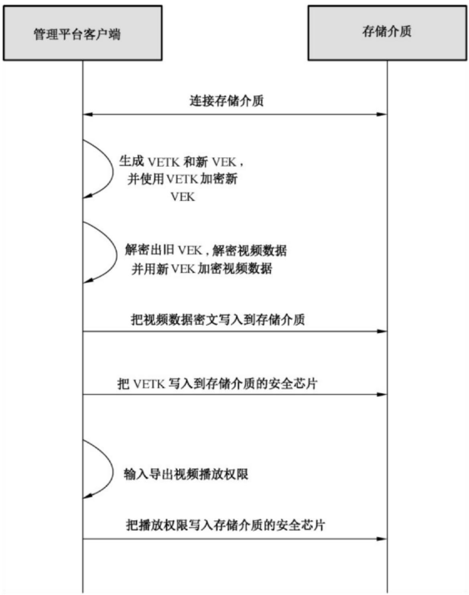  
图 E.1 加密视频导出流程示意图

流程如下：

a）将存储介质连接到管理平台客户端；

b) 管理平台生成视频导出加密密钥 VETK 和新的 VEK，并使用 VETK 加密新 VEK；

c) 管理平台解密视频中的 VEK, 解密视频数据, 并用新 VEK 加密视频数据;

d) 管理平台将视频数据密文写入存储介质；

f) 管理员输入导出视频对应的播放权限,如播放次数、时间等,并把播放权限写入到存储介质的安全芯片中。

e) 管理平台客户端把 VETK 写入到存储介质的安全芯片中；

## 参考文献

[1] GA/T 647—2006 视频安防监控系统 前端设备控制协议 V1.0

[2] GA/T 669.1—2008 城市监控报警联网系统 技术标准 第1部分:通用技术要求

[3] GA/T 669.2—2008 城市监控报警联网系统 技术标准 第2部分:安全技术要求

[4] GA/T 669.4—2008 城市监控报警联网系统 技术标准 第4部分:视音频编、解码技术要求

[5] GA/T 669.5—2008 城市监控报警联网系统 技术标准 第5部分:信息传输、交换、控制技术要求

[6] GA/T 669.6—2008 城市监控报警联网系统 技术标准 第6部分:视音频显示、存储、播放技术要求

[7] GA/T 669.7—2008 城市监控报警联网系统 技术标准 第7部分:管理平台技术要求

[8] YD/T 1171—2001 IP 网络技术要求网络性能参数与指标(NEQ ITU-T Y.1540, NEQ ITU-T Y.1541, NEQ IETF RFC 2330)

[9] YD/T 1522.1—2006 会话初始协议(SIP)技术要求 第1部分:基本的会话初始协议

[10] ISO/IEC 14496-5:2001 信息技术 视听对象编码 第5部分:参考软件

[11] RFC 2633 S/MIME Version 3 Message Specification

[12] RFC 2634 Enhanced Security Services for S/MIME

[13] RFC 2778 A Model for Presence and Instant Messaging

[14] RFC 2779 Instant Messaging/Presence Protocol Requirements

[15] RFC 3016 用于 MPEG-4 音频/视频流的 RTP 负载格式

[16] RFC 3265 Session Initiation Protocol (SIP)—Specific Event Notification

[17] RFC 3329 Security Mechanism Agreement for the Session Initiation Protocol (SIP)

[18] RFC 3665 Session Initiation Protocol (SIP) Basic Call Flow Examples

[19] RFC 3903 Session Initiation Protocol (SIP) Extension for Event State Publication

[20] RFC 3984 H.264 视频的 RTP 负载格式

[21] RFC 4826 Extensible Markup Language (XML) Formats for Representing Resource Lists